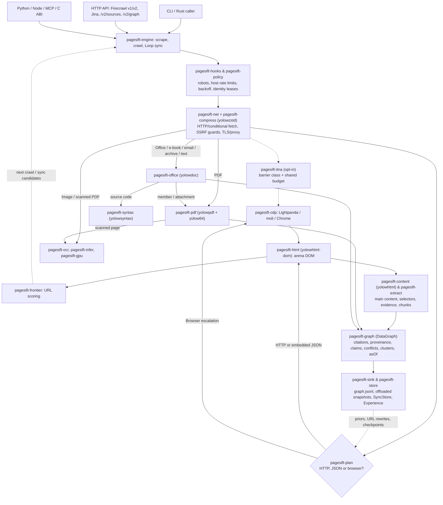
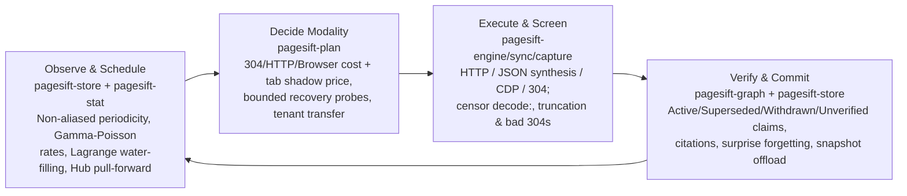
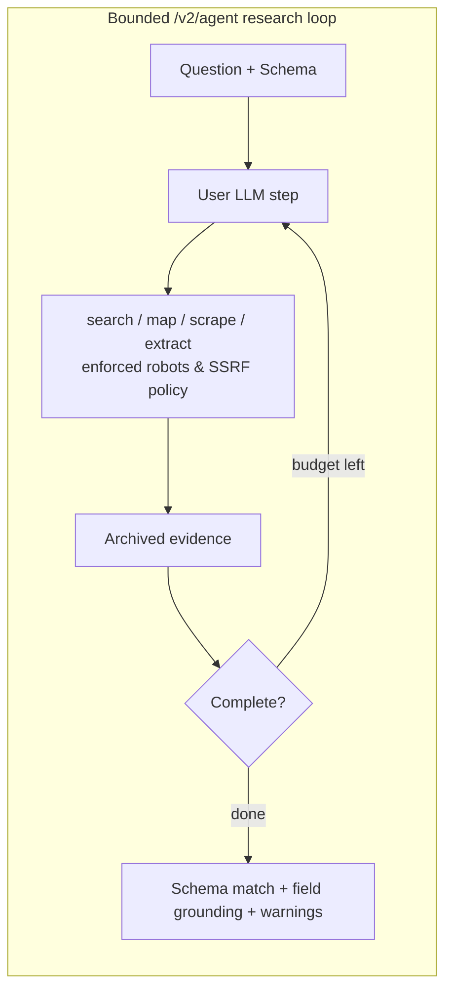
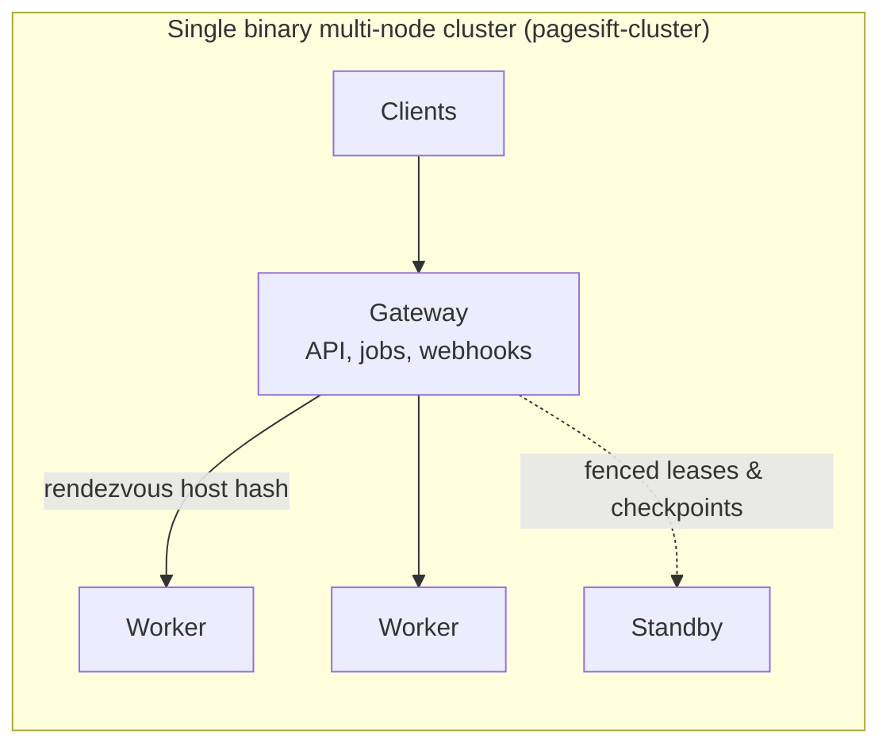

<div align="center">


# pagesift 1.5.6

**Local-first web & document ingestion engine in Rust — HTTP/browser capture, layout-aware PDF/Office/OCR parsing, persistent sync, and verifiable data graphs.**  
One self-hosted Rust binary with a CLI, Firecrawl v1/v2 & Jina Reader HTTP APIs, an MCP server, a C ABI, and native Python / Node.js packages.

[](LICENSE)
[](docs/COMMERCIAL.md)
[](https://github.com/YOLOW92/pagesift/releases)
[](https://crates.io/crates/pagesift)
[](https://pypi.org/project/pagesift/)
[](https://www.npmjs.com/package/@pagesift/node)
[](https://glama.ai/mcp/servers/YOLOW92/pagesift)
[](https://discord.gg/esA3wMZVvA)

**English** · [简体中文](docs/README.zh-CN.md) · [日本語](docs/README.ja.md) · [Español](docs/README.es.md)

</div>

<!-- readme-template: v2 -->
<!-- section: overview -->
## Overview

`pagesift` turns live web pages, uploaded binary documents, archives, and long-lived monitored sources into clean Markdown, schema-validated JSON, and provenance-tracked `DataGraph` relations inside a single memory-bounded Rust binary. HTTP fetching, native document readers, HTML extraction, adaptive sync state, and evidence storage run in-process without requiring Python, JVM, or Node workers; a headless browser pool, NVIDIA GPU OCR, and user-configured LLM endpoints attach only when requested.

Drop-in or companion for: **Firecrawl** (self-hosted v1/v2 API), **Jina Reader** (`/r/` and `/s/`), **Crawl4AI**, **trafilatura**, **Readability**, **pymupdf4llm**, **Docling**, **Kreuzberg**, and **xberg**.

<!-- section: facts -->
## At a glance

- **Layered runtime:** Entry surfaces (`CLI` / `HTTP` / `MCP` / FFI) → policy & SSRF-guarded net → adaptive strategy (`HTTP` / embedded JSON / browser) → native format readers → `DataGraph` & append-only store → cgroup-sized NUMA worker pool (`pagesift-flow`)
- **Inputs:** URLs, HTML, PDF (text + optional PP-OCRv6 / formulas), uploaded images (OCR when enabled), Office & OpenDocument, RTF/WordPerfect/HWP, e-books, emails, archives (`zip`, `tar`, `7z`), SQLite/CSV, 373 code languages, and WARC ([format matrix](docs/parse-api.md))
- **Outputs:** Markdown, HTML, raw HTML, links, images/attachments, RAG chunks, schema JSON, `DataGraph` (`graph.jsonl`, citations, claim lifecycles, conflicts, `fact_clusters`, `?asOf=`), plus structured warnings on partial captures
- **Interfaces:** CLI · Firecrawl v1/v2 HTTP API · Jina Reader (`/r/`, `/s/`) · MCP (stdio / HTTP) · Python · Node.js / TypeScript · Rust crate · C ABI (Go, Java, Kotlin, C#, Ruby, PHP, Lua, Perl, Dart, Swift, Zig) · LangChain & LlamaIndex
- **Platforms & ops:** Single binary (`serve --role gateway`, `worker`, `standby`), Linux x86_64/aarch64 (glibc ≥ 2.28 & musl), macOS arm64, Windows x86_64, Docker `ghcr.io/yolow92/pagesift:1.5.6`
- **Index & release:** Machine-readable index [llms.txt](llms.txt) · Apache-2.0 or [commercial support](docs/COMMERCIAL.md) · **1.5.6** ([release notes](docs/releases/1.5.6.md))

<!-- section: install -->
## Install and quick start

| Surface | Install | Minimal call |
|---|---|---|
| CLI | `cargo install pagesift --locked` | `pagesift scrape https://example.com` |
| Python | `pip install pagesift` | `pagesift.scrape("https://example.com").markdown` |
| Node.js | `npm install @pagesift/node` | `(await new Scraper().scrape("https://example.com")).markdown` |
| Server | `docker run -p 3002:3002 ghcr.io/yolow92/pagesift:1.5.6` | `curl localhost:3002/r/https://example.com` |
| MCP | — | `claude mcp add pagesift -- pagesift mcp` |

<details>
<summary>Quick start snippets: CLI, Python, Node.js, HTTP API, MCP</summary>

**CLI**

```bash
pagesift scrape https://example.com                          # Clean Markdown to stdout
pagesift scrape --graph https://example.com                  # Markdown + DataGraph provenance & claims
pagesift scrape report.pdf                                   # Local PDF, Office, e-book, email, archive, code or WARC
pagesift --ocr scrape scan.pdf                               # OCR scanned PDF pages or uploaded images
pagesift crawl https://docs.rs --limit 500 --out ./data/     # Crawl to disk (add --graph for graph.jsonl)
pagesift graph inspect ./data/graph.jsonl                    # Inspect citations, lineage, claims and conflicts
pagesift sync init --id docs --seed https://example.com      # Initialize and run a persistent Loop sync source
pagesift extract --schema schema.json https://example.com    # Schema JSON with CSS selector relocation
pagesift doctor                                              # Inspect local browsers, GPU and models
```

**Python & Node.js**

```python
import pagesift

page = pagesift.scrape("https://example.com", formats=["markdown", "links"])
print(page.markdown, page.metadata["title"], page.links)

scanner = pagesift.Scraper(ocr=True)
print(scanner.parse(open("scan.pdf", "rb").read(), "scan.pdf").markdown)
```

```typescript
import { Scraper } from '@pagesift/node'

const scraper = new Scraper()
const page = await scraper.scrape('https://example.com', { formats: ['markdown', 'links'] })
console.log(page.markdown, page.metadata.title, page.links)
```

**HTTP server (`Firecrawl v1/v2`, `Jina Reader`, `/v2/sources`, `/v2/graph`) & MCP**

```bash
docker run -d -p 3002:3002 -v pagesift-data:/data -e PAGESIFT_API_KEYS=sk-test ghcr.io/yolow92/pagesift:1.5.6

curl -s localhost:3002/v2/scrape -H 'Authorization: Bearer sk-test' -H 'Content-Type: application/json' \
  -d '{"url":"https://example.com","formats":["markdown"]}'
curl -s localhost:3002/r/https://example.com -H 'Authorization: Bearer sk-test'
curl -s localhost:3002/v2/parse -H 'Authorization: Bearer sk-test' -F file=@report.pdf -F 'options={"formats":["markdown"]}'

pagesift mcp                                                 # stdio for a single agent
pagesift mcp http --port 3003                                # shared local MCP daemon
```

</details>

MCP exposes `pagesift_scrape`, `pagesift_batch_scrape`, `pagesift_crawl`, `pagesift_poll_job`, `pagesift_cancel_job`, `pagesift_map`, `pagesift_interact`, `pagesift_interact_stop`, `pagesift_sync`, `pagesift_graph_query`, and (with a configured model) `pagesift_agent` / `pagesift_agent_status`. See [Shared MCP service](docs/mcp-service.md).

<!-- section: capabilities -->
## Capabilities

Organized by architectural plane—showing implemented surfaces, data paths, and reference docs:

| Plane | Implemented capabilities | Reference |
|---|---|---|
| **Interfaces & compatibility** | Self-hosted CLI, Firecrawl v1/v2 HTTP API (`/v2/scrape`, `/v2/crawl`, `/v2/parse`, `/v2/monitor`, `/v2/sources`, `/v2/graph`, `/v2/agent`, `/interact`), Jina Reader (`/r/`, `/s/`), MCP (stdio/HTTP), Python, Node.js/TS, Rust library, C ABI bindings | [parse-api.md](docs/parse-api.md) · [jina-reader.md](docs/jina-reader.md) · [mcp-service.md](docs/mcp-service.md) |
| **Acquisition & safety** | Conditional HTTP (`ETag`/`Last-Modified`), SSRF & DNS-rebinding guards, `robots.txt` & per-host rate limits, identity leases, embedded JSON synthesis (`__NEXT_DATA__`/`__NUXT_DATA__`/JSON-LD), optional CDP browser pool (`Lightpanda`/`moli`/Chrome) + interactive `/interact` sessions, opt-in `[itna]` access-barrier classification | [interact.md](docs/interact.md) · [http-sessions.md](docs/http-sessions.md) · [bot.md](docs/bot.md) |
| **Native parsing & OCR** | Pure-Rust readers down to container/file level (`yolowhtml`, `yolowpdf`, `yolowdoc`, `yolowsyntax`, `yolowzstd`, `yolow64`) covering web, Office/ODF, e-books, email, nested archives, SQLite/CSV, 373 code languages (AST function/class splits for 32+ languages), WARC I/O, and PP-OCRv6 + PP-FormulaNet on CPU/GPU | [parse-api.md](docs/parse-api.md) |
| **Extraction & agents** | Main-content Markdown with math/code/tables, RAG `queryFilter` & chunking, selector-memory schema extraction with automatic DOM relocation, and model-planned `/v2/agent` research verified against archived page evidence | [structured-extract.md](docs/structured-extract.md) · [agent-api.md](docs/agent-api.md) |
| **Continuous Loop & monitors** | Persistent `pagesift sync` / `/v2/sources` sources with anti-aliased periodic detection, hierarchical Gamma-Poisson shrinkage & Lagrange water-filling under tick budgets, hub co-change propagation, modality cost & tab shadow pricing, bounded `DirectBrowser` recovery probes, surprise forgetting, tenant-isolated cold-start transfer, capture reliability censoring, and `/v2/monitor` webhooks & substantive block diffs | [monitor.md](docs/monitor.md) · [incremental-collection.md](docs/incremental-collection.md) |
| **DataGraph & provenance** | Cross-page and cross-source evidence graph (`graph.jsonl`, `graph_summary.json`, `/v2/graph/claims`, `/history`, `/conflicts`, `?asOf=`): persisted document citations, redirect/canonical/attachment provenance, contextual unit/currency disambiguation, `OriginRelation` independent roots, `fact_clusters`, and claim lifecycles (`Active`, `Superseded`, `Withdrawn`, `Unverified`, `EvidenceDegraded`) | [architecture.md](docs/architecture.md) |

<!-- section: performance -->
## Performance at a glance

Benchmarks are tracked separately so this page stays focused on system structure; all recorded baselines, hardware details, caveats, and competitor comparisons live in [docs/benchmarks.md](docs/benchmarks.md):

- **Latency (recorded benchmarks, single-worker, lower is better):** PDF → Markdown `2.5 ms/page` (1,269 pages); HTML → Markdown `0.23 ms/page` (600 docs); main-content extraction `1.0 ms/page` (597 pages).
- **Throughput, quality & memory (recorded benchmarks):** Office in-process `81.9 files/s` (higher is better); HTML → Markdown `1.000` mean F1; WCXB `0.866` F1; RAG query filter `0.929` recall (higher is better); `17–395 MB` peak memory/worker without a browser across those runs.
- **Full scorecards & Loop evaluation:** [benchmarks.md](docs/benchmarks.md) · [Full benchmark report](benchmarks/history/1.4/results/final/new/report.md) · [Latest Loop release evaluation](docs/releases/1.5.6.md)

<!-- section: architecture -->
## Architecture and core flows

The core runs as one compiled Rust binary with zero managed interpreter runtimes behind parsing, storage, or scheduling. Memory, CPU workers, and browser tabs pass through shared cgroup-aware admission, and internal runtime limits adapt only when online statistics clear significance thresholds (`δ = 0.05`).

### Request and ingestion pipeline



### Continuous Sync closed loop (`Observe → Learn → Decide → Execute → Verify`)

Long-lived sources registered via `pagesift sync` or `/v2/sources` run an adaptive closed loop per tick without discarding prior verified evidence on transient uncertainty:



### Evidence-checked `/v2/agent` and multi-server fleet topology





### Workspace crate map

| Layer | Crates |
|---|---|
| **Entry surfaces & FFI** | `pagesift` (CLI & library), `pagesift-api` (HTTP server & schemas), `pagesift-mcp` (MCP stdio/HTTP), `pagesift-py`, `pagesift-node`, `pagesift-ffi` (C ABI) |
| **Orchestration, strategy & graph** | `pagesift-engine`, `pagesift-plan`, `pagesift-hooks`, `pagesift-llm`, `pagesift-search`, `pagesift-graph` |
| **Network, policy & browser** | `pagesift-net`, `pagesift-policy`, `pagesift-rustls`, `pagesift-cdp`, `pagesift-media`, `pagesift-itna` |
| **Web extraction & discovery** | `pagesift-html` (`yolowhtml-dom`), `pagesift-content` (`yolowhtml`), `pagesift-extract`, `pagesift-diff`, `pagesift-frontier` |
| **Native document & OCR readers** | `pagesift-pdf` (`yolowpdf`), `pagesift-office` (`yolowdoc`), `pagesift-syntax` (`yolowsyntax`), `pagesift-ocr`, `pagesift-infer`, `pagesift-gpu` |
| **Runtime, math & persistence** | `pagesift-flow` (NUMA workers & cgroup admission), `pagesift-stat`, `pagesift-base64` (`yolow64`), `pagesift-compress` (`yolowzstd`), `pagesift-sys`, `pagesift-store`, `pagesift-sink`, `pagesift-cluster` |

See [Architecture reference](docs/architecture.md) for cgroup sizing, statistical defaults (`δ = 0.05` USL/survival/Thompson tuning), incremental checkpoint semantics, and byte-range verified media archives.

<!-- section: choose -->
## When to use it, and when not

**Good fit**

- Feeding live web pages, PDFs, Office suites, archives, or source code into AI agents, RAG pipelines, or downstream analytics with zero external runtime workers
- Self-hosting Firecrawl- or Jina Reader-compatible APIs and shared MCP tooling without per-page SaaS fees
- Continuous monitoring/sync of changing sources where cost-aware browser escalation, lineage tracking, and claim-level conflict detection matter
- Memory-constrained containers where resident workers must respect cgroup caps

**Pick something else when**

- **You want a managed SaaS cloud.** `pagesift` runs self-hosted on your infrastructure.
- **You need automatic CAPTCHA solving.** Interactive challenges are classified and paused for human resolution (`[itna]` recovery is opt-in and does not bypass CAPTCHAs).
- **You only process standalone image URLs without local uploads or OCR.** Uploaded/local images require `--ocr` (`[ocr] enabled = true`); image URLs and OCR-off uploads return `UNSUPPORTED_OPTION`.

<!-- section: license -->
## License

[Apache-2.0](LICENSE). For dedicated support, SLAs, or enterprise agreements, see [commercial license and support](docs/COMMERCIAL.md) or write to `licensing@pagesift.dev`.

<!-- section: changelog -->
## What's new in 1.5.6

PageSift 1.5.6 completes the `1.5.x` Loop correctness remediation and transactional storage hardening: executes crawl job `mirror::write` (`pages` and `done_set`) inside atomic `TasksTx` transactions; separates attempt, valid-observation, and change timestamps, decouples HTTP/Browser capture reliability, and propagates unresolved `uncertain_observations` to `complete_within_scope`; wires HTTP `Last-Modified` validation into periodicity, fixes cross-resource phase isolation, invalidation on missed/late cycles, live `apply_waterfill_schedules_to_inventory` interval writes, and multi-wave `candidates_due` deduplication; enforces live mid-tick browser shadow pricing, prevents stale-ETag entrapment, and cleanly isolates negative-transfer rejection and tenant failure updates; surfaces `Active` vs `Unverified` claim counts and `fact_clusters_truncated` in `SourceStateView`/CLI/MCP while distinguishing `UNKNOWN`/unspecified units from confirmed conflicts.

[Release notes](docs/releases/1.5.6.md) · [1.5.5](docs/releases/1.5.5.md) · [1.5.4](docs/releases/1.5.4.md) · [1.5.3](docs/releases/1.5.3.md) · [1.5.2](docs/releases/1.5.2.md) · [1.5.1](docs/releases/1.5.1.md) · [1.5.0](docs/releases/1.5.0.md) · [all releases](docs/releases/) · [CHANGELOG](docs/CHANGELOG.md)

---

## Community

Questions or feedback: [Discord](https://discord.gg/esA3wMZVvA) · [Issues](https://github.com/YOLOW92/pagesift/issues) · [Discussions](https://github.com/YOLOW92/pagesift/discussions)

## Citation

```bibtex
@software{pagesift2026,
  title  = {PageSift: Rust Web and Document Extraction Engine for AI Pipelines},
  author = {YOLOW92},
  year   = {2026},
  url    = {https://github.com/YOLOW92/pagesift},
  note   = {Version 1.5.6}
}
```

## Star History

[](https://star-history.com/#YOLOW92/pagesift&Date)
