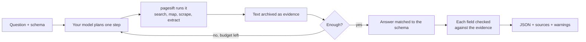
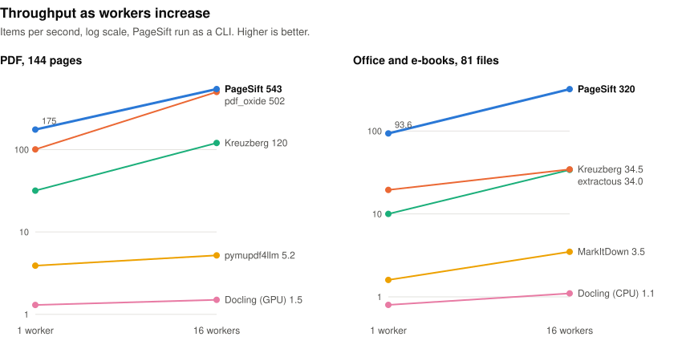
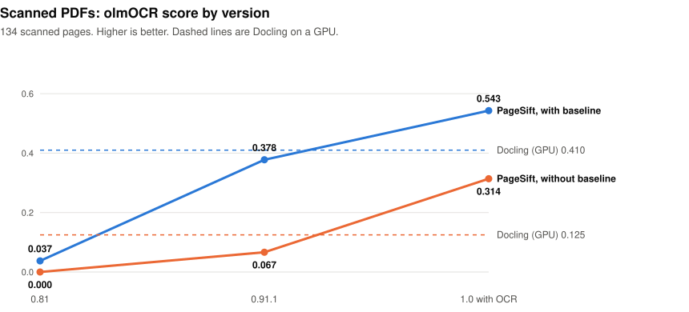
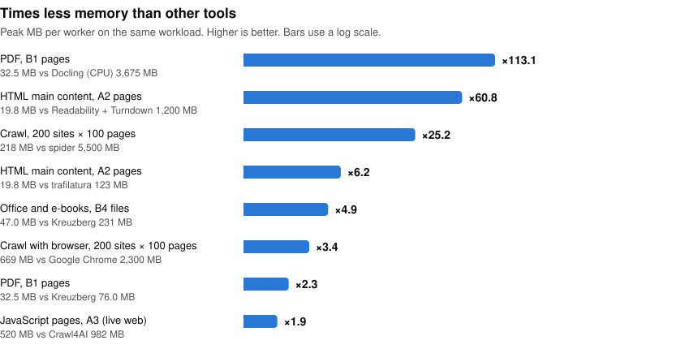
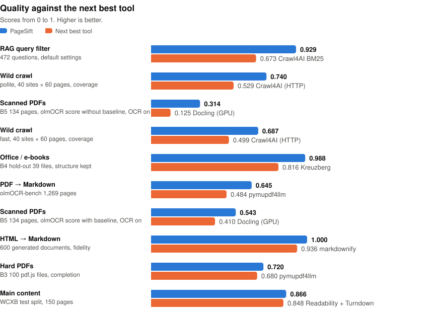
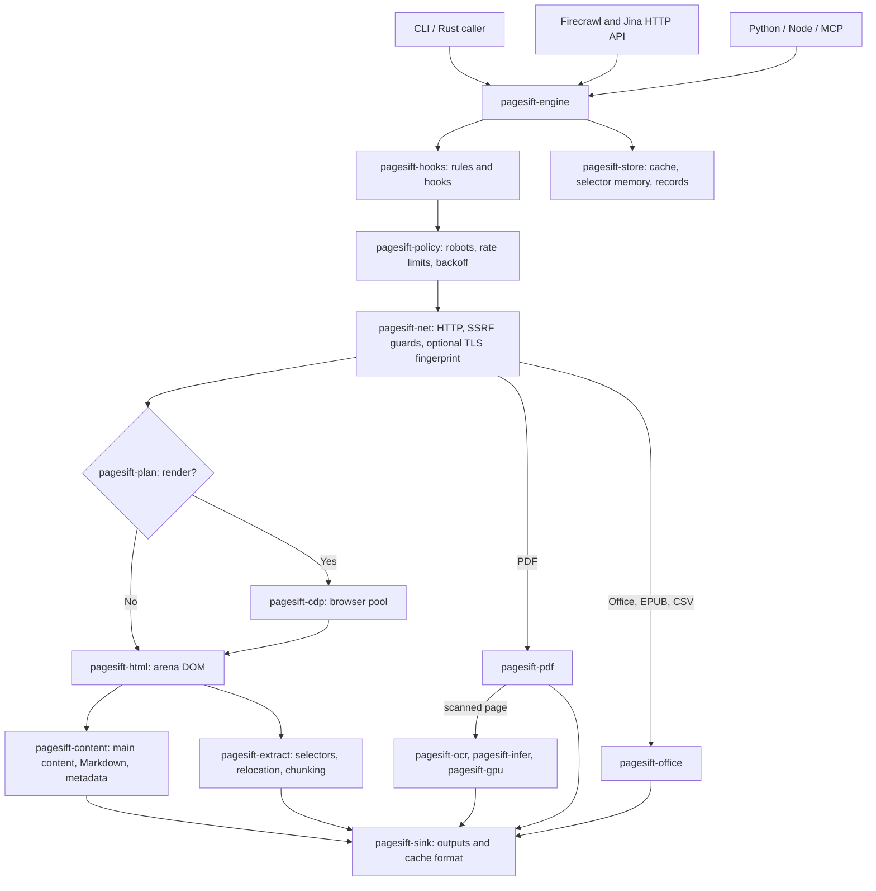
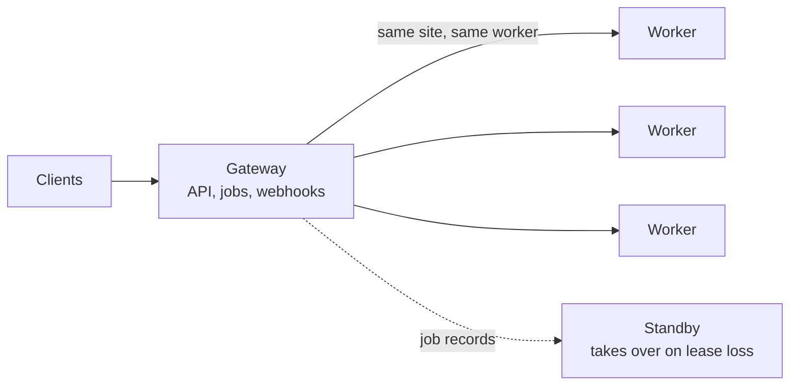

<div align="center">


# pagesift 1.0.0

**The web and document layer for AI agents: any URL, PDF or Office file in, clean Markdown or JSON out.**  
One self-hosted Rust binary with a CLI, Firecrawl and Jina Reader APIs, an MCP server, and Python and Node.js packages.

[](LICENSE)
[](docs/COMMERCIAL.md)
[](https://github.com/YOLOW92/pagesift/releases)
[](https://crates.io/crates/pagesift)
[](https://pypi.org/project/pagesift/)
[](https://www.npmjs.com/package/@pagesift/node)
[](https://glama.ai/mcp/servers/YOLOW92/pagesift)
[](https://discord.gg/esA3wMZVvA)

**English** · [简体中文](docs/README.zh-CN.md) · [日本語](docs/README.ja.md) · [Español](docs/README.es.md)

</div>

<!-- readme-template: v2 -->
<!-- section: overview -->
## What it is

pagesift reads the web and documents for software that thinks: it fetches a URL, rendering JavaScript only when that
adds content, or opens a local file, and returns the content as Markdown or structured JSON. It covers single pages,
whole sites, scanned PDFs, browser actions, change monitoring and research runs driven by your own model.

Can replace or sit alongside: **Firecrawl** (same v1/v2 API, self-hosted), **Jina Reader** (`/r/` and `/s/`),
**Crawl4AI**, **trafilatura**, **Readability**, **pymupdf4llm**, **Docling**, **Kreuzberg**.

<!-- section: facts -->
## At a glance

- **Input:** URLs, HTML, PDF including scanned pages (OCR), Word, Excel, PowerPoint, EPUB, CSV, WARC archives
- **Output:** Markdown, HTML, raw HTML, links, images, metadata, schema-based JSON; warnings when a result is incomplete
- **Interfaces:** CLI · Firecrawl v1/v2 HTTP API · Jina Reader · MCP (stdio or HTTP) · Python · Node.js / TypeScript · Rust crate
- **Platforms:** Linux x86_64 / aarch64 (glibc ≥ 2.28 and musl), macOS arm64, Windows x86_64; Docker image `ghcr.io/yolow92/pagesift`
- **Runtime:** nothing to install for HTTP, PDF and Office. Optional: a browser for JavaScript pages, an NVIDIA GPU for OCR, your own model for `/v2/agent`
- **Memory:** 17–395 MB peak per worker across the 1.0 benchmarks without a browser; OCR with formula models needs about 1.7 GB; capacity is sized from the cgroup limit
- **License:** AGPL-3.0, or a [commercial license](docs/COMMERCIAL.md)
- **Latest:** 1.0.0 · [release notes](docs/releases/1.0.0.md)

<!-- section: install -->
## Install and use

| | Install | First call |
|---|---|---|
| CLI | `cargo install pagesift --locked` | `pagesift scrape https://example.com` |
| Python | `pip install pagesift` | `pagesift.scrape("https://example.com").markdown` |
| Node.js | `npm install @pagesift/node` | `(await new Scraper().scrape("https://example.com")).markdown` |
| Server | `docker run -p 3002:3002 ghcr.io/yolow92/pagesift:1.0.0` | `curl localhost:3002/r/https://example.com` |
| MCP | — | `claude mcp add pagesift -- pagesift mcp` |

**CLI**

```bash
pagesift scrape https://example.com                          # Markdown to stdout
pagesift scrape report.pdf                                   # local PDF, Office, EPUB, CSV, HTML or WARC
pagesift --ocr scrape scan.pdf                               # OCR scanned pages; models download on first use
pagesift crawl https://docs.rs --limit 500 --out ./data/     # one file per page
pagesift crawl https://www.example.edu --query "graduate admission" --adaptive
pagesift extract --schema schema.json https://example.com    # JSON by CSS selectors, repaired when the page changes
pagesift doctor                                              # check browsers, GPU and models
```

**Python**

```python
import pagesift

page = pagesift.scrape("https://example.com", formats=["markdown", "links"])
print(page.markdown, page.metadata["title"], page.links)

pages = pagesift.scrape_many(["https://example.com", "https://example.org"], concurrency=8)

scanner = pagesift.Scraper(ocr=True)     # models download when the first scanned page arrives
print(scanner.parse(open("scan.pdf", "rb").read(), "scan.pdf").markdown)
```

**Node.js / TypeScript**

```typescript
import { Scraper } from '@pagesift/node'

const scraper = new Scraper()
const page = await scraper.scrape('https://example.com', { formats: ['markdown', 'links'] })
console.log(page.markdown, page.metadata.title, page.links)

const items = await scraper.scrapeMany(['https://example.com', 'https://example.org'], { concurrency: 4 })
```

**HTTP server**

```bash
docker run -d -p 3002:3002 -v pagesift-data:/data -e PAGESIFT_API_KEYS=sk-test ghcr.io/yolow92/pagesift:1.0.0

curl -s localhost:3002/v2/scrape -H 'Authorization: Bearer sk-test' -H 'Content-Type: application/json' \
  -d '{"url":"https://example.com","formats":["markdown"]}'                        # Firecrawl API
curl -s localhost:3002/r/https://example.com -H 'Authorization: Bearer sk-test'    # Jina Reader
curl -s localhost:3002/v2/parse -H 'Authorization: Bearer sk-test' \
  -F file=@report.pdf -F 'options={"formats":["markdown"]}'                        # file upload
```

Firecrawl SDKs work by changing the API URL. [Upload API](docs/parse-api.md) · [Jina headers](docs/jina-reader.md)

**MCP**

```bash
pagesift mcp                                                  # stdio, for one agent
pagesift mcp http --port 3003                                 # one shared local service
claude mcp add --scope user --transport http pagesift http://127.0.0.1:3003/mcp
```

Tools: `pagesift_scrape`, `pagesift_batch_scrape`, `pagesift_crawl`, `pagesift_crawl_status`, `pagesift_map`,
`pagesift_interact`, `pagesift_interact_stop`, and with a configured model `pagesift_agent`, `pagesift_agent_status`.
[Shared MCP service](docs/mcp-service.md)

<!-- section: capabilities -->
## What it can do

| Capability | What you get | Docs |
|---|---|---|
| **Clean content** | Main-content detection and Markdown that keeps headings, lists, tables, code and math | [Benchmarks](docs/benchmarks.md) |
| **Documents** | Own Rust readers for PDF, Word, Excel, PowerPoint, EPUB and CSV, including damaged files and CJK fonts | [Upload API](docs/parse-api.md) |
| **OCR** | Scanned PDF pages through PP-OCRv6 and display formulas through PP-FormulaNet, in pure Rust on CPU or NVIDIA GPU | [Upload API](docs/parse-api.md) |
| **Structured extraction** | JSON by CSS selectors that are relocated when a site changes, or by a schema your model writes once and pagesift caches | [Extraction](docs/structured-extract.md) |
| **Browser actions** | Clicks, typing and scrolling on the page, plus sessions you can keep working in | [Interact](docs/interact.md) |
| **Agent** | `POST /v2/agent` answers a question from the web with your own model, and checks each field against the page it came from | [Agent API](docs/agent-api.md) |
| **Monitoring** | Scheduled checks that separate real changes from dates, counters and ads, with webhooks | [Monitor](docs/monitor.md) |
| **Crawling** | Sitemaps, query-focused crawls that stop when pages stop helping, trap handling, robots.txt and per-host limits | [Benchmarks](docs/benchmarks.md) |
| **Archives** | WARC output on every crawl, and WARC files as input with no network | [Release notes](docs/releases/1.0.0.md) |
| **Operations** | Multi-server gateway, workers and standby; job persistence, durable webhooks, metrics, audit log | [Architecture](docs/architecture.md) |
| **Safety** | Private-network and DNS-rebinding guards, and every incomplete result reports a warning | [Bot policy](docs/bot.md) |

**How `/v2/agent` answers a question**



robots.txt, rate limits and network guards apply to every page. The model chooses URLs and queries, not fetch options.

<!-- section: performance -->
## Performance

<!-- perf-glance -->
<picture><source media="(prefers-color-scheme: dark)" srcset="docs/assets/perf-scaling-dark.svg"></picture>

<picture><source media="(prefers-color-scheme: dark)" srcset="docs/assets/perf-versions-dark.svg"></picture>

<picture><source media="(prefers-color-scheme: dark)" srcset="docs/assets/perf-memory-dark.svg"></picture>

<picture><source media="(prefers-color-scheme: dark)" srcset="docs/assets/perf-quality-dark.svg"></picture>

↑ higher is better · ↓ lower is better. Strongest result per domain; methods and sources in the full report.

| Task | Metric | PageSift | Best other tool | Gap |
|---|---|---:|---|---:|
| PDF → Markdown — olmOCR-bench 1,269 pages, per page (single thread) | ms/page ↓ | **2.4** | pypdf 50.0 | **×20.83** |
| PDF → Markdown — B1 144 pages, 1 worker, resident server | files/s ↑ | **234.5** | pdf_oxide 100.6 | **×2.33** |
| PDF → Markdown — olmOCR-bench 1,269 pages | official score ↑ | **0.645** | pymupdf4llm 0.484 | **+0.161** |
| HTML → Markdown — 600 generated documents, per page | ms/page ↓ | **0.24** | Turndown 1.9 | **×8.12** |
| HTML → Markdown — 600 generated documents, fidelity | mean F1 ↑ | **1.000** | markdownify 0.936 | **+0.064** |
| Main content — Firecrawl 597 pages, single thread | p50 ms/page ↓ | **1.0** | crw 7.4 | **×7.26** |
| Main content — A2 269 random pages, 16 workers | pages/s ↑ | **656.1** | Resiliparse 559.3 | **×1.17** |
| Main content — WCXB test split, 150 pages | F1 ↑ | **0.866** | Readability + Turndown 0.848 | **+0.018** |
| Publication dates — htmldate 1,000 pages, date search | ms/page ↓ | **0.31** | htmldate (fast) 2.0 | **×6.45** |
| RAG chunking — 5 corpora, 1.4 MB | total ms ↓ | **7** | chonkie recursive 35 | **×5.01** |
| Office / e-books — B4 81 files, in-process | files/s ↑ | **93.6** | Kreuzberg 19.5 | **×4.80** |
| Office / e-books — B4 hold-out 39 files, structure kept | structure kept ↑ | **0.988** | Kreuzberg 0.816 | **+0.172** |
| RAG query filter — 472 questions, default settings | answer recall ↑ | **0.929** | Crawl4AI BM25 0.673 | **+0.256** |
| Wild crawl — polite, 40 sites × 60 pages, coverage | coverage ↑ | **0.740** | Crawl4AI (HTTP) 0.529 | **+0.211** |
| Wild crawl — fast, 40 sites × 60 pages, coverage | coverage ↑ | **0.687** | Crawl4AI (HTTP) 0.499 | **+0.188** |
| Scanned PDFs — B5 134 pages, olmOCR score without baseline, OCR on | olmOCR score ↑ | **0.314** | Docling (GPU) 0.125 | **+0.189** |
| Scanned PDFs — B5 134 pages, olmOCR score with baseline, OCR on | olmOCR score ↑ | **0.543** | Docling (GPU) 0.410 | **+0.133** |
| Hard PDFs — B3 100 pdf.js files, completion | completion ↑ | **0.720** | pymupdf4llm 0.680 | **+0.040** |

| Peak memory per worker | PageSift MB ↓ | Other tool MB | Less memory |
|---|---:|---|---:|
| PDF, B1 pages | **34** | Docling (CPU) 3,675 (2026-10-28) | **×106.5** |
| HTML main content, A2 pages | **28** | Readability + Turndown 1,200 (2026-10-28) | **×43.0** |
| Crawl, 200 sites × 100 pages | **218** | spider 5,500 (2026-10-21) | **×25.2** |
| Office and e-books, B4 files | **46** | Kreuzberg 231 (2026-10-28) | **×5.0** |
| HTML main content, A2 pages | **28** | trafilatura 123 (2026-10-28) | **×4.4** |
| Crawl with browser, 200 sites × 100 pages | **669** | Google Chrome 2,300 (2026-10-21) | **×3.4** |
| PDF, B1 pages | **34** | Kreuzberg 76 (2026-10-28) | **×2.2** |
| JavaScript pages, A3 (live web) | **520** | Crawl4AI 982 (2026-10-28) | **×1.9** |

<details>
<summary>Still behind</summary>

fast, 40 sites × 60 pages, time (spider covered about half as many pages) 16.1 seconds vs spider 1.4 seconds; A2 replay, 269 pages, HTTP only, no rate limit, 1 worker 47.5 pages/s vs spider 156.6 pages/s; A2 269 random pages, resident worker, per page 5.2 ms/page vs Resiliparse 2.1 ms/page.

</details>

[Full report](benchmarks/history/1.0/results/final/new/report.md)

<!-- /perf-glance -->

<!-- section: architecture -->
## Architecture

The core is written from the file format up in Rust, and limits are measured at run time instead of being set by hand.



**Own code down to the format.** Parsing runs in process with no Python, JVM or Node runtime behind it. pagesift has
its own zero-copy HTML5 parser, PDF file layer with JPEG, CCITT and JBIG2 decoders, Office and EPUB readers, neural
network inference with GPU kernels compiled from Rust, Chrome DevTools client, MCP server and append-only store. A
worker costs tens of megabytes, not a loaded interpreter, and starts in milliseconds.

**One worker per core.** CPU work runs on resident workers grouped by NUMA node, which steal work inside their own node
first. A single admission path covers CPU, memory and browser tabs, and capacity comes from the cgroup limit, so a
container stays within its memory instead of being killed.

**Measured instead of fixed.** Concurrency follows a Universal Scalability Law fit, per-host limits follow a latency
gradient, stage timeouts use survival analysis and retries use per-class success rates. Each one starts from a safe
default and moves only on statistically significant evidence (δ = 0.05). User settings and safety limits stay hard limits.

**A browser only when it pays.** For each family of URL paths, pagesift learns whether rendering added content, and the
rendered result is kept only if it scores higher. Page data such as `__NEXT_DATA__` and JSON-LD is read without a browser.
Lightpanda, moli and Chrome form a fallback chain, and `--explain` records every decision.

**Honest results.** A partial page, a truncated file or a skipped scan returns a warning code instead of looking complete.
Agent answers report which values were found in the evidence, and selector repairs report the old and new selector.

**From one binary to a fleet.** `serve --role gateway`, `worker` and `standby` share the same binary, with site affinity by
rendezvous hashing and leases with fencing. Jobs and webhooks resume after a restart.



[Full architecture](docs/architecture.md)

<!-- section: choose -->
## When to use it, and when not

**Good fit**

- Feeding web pages and documents to an LLM, a RAG index or an agent
- Self-hosting a Firecrawl- or Jina Reader-style service with no per-page fees
- Mixed input: the same call handles HTML, PDF, scans, Office files and e-books
- Small machines and containers, where memory is bounded by the cgroup limit

**Pick something else when**

- **Your input is image files.** OCR covers scanned pages inside PDFs, not standalone images.
- **AGPL does not work for you** and a commercial license is not an option.
- **You need a managed cloud service.** pagesift is self-hosted.

<!-- section: license -->
## License

[AGPL-3.0](LICENSE). For proprietary linking or private deployment without AGPL obligations, see the
[commercial license](docs/COMMERCIAL.md) or write to `licensing@pagesift.dev`.

<!-- section: changelog -->
## What's new in 1.0.0

OCR for scanned PDFs on CPU or NVIDIA GPU, structured extraction with selector repair, browser actions and sessions,
`/v2/agent`, change monitoring, the full Jina Reader API, WARC input, hooks and rules, and an optional browser TLS
fingerprint. Since 0.81, limits are measured at run time, render decisions are learned per path family, and one binary
runs as a multi-server gateway, workers and standby. Some names changed, listed in the release notes.

[Release notes](docs/releases/1.0.0.md) · [0.90.0](docs/releases/0.90.0.md) · [all releases](docs/releases/) · [CHANGELOG](CHANGELOG.md)

---

## Community

Questions or feedback: [Discord](https://discord.gg/esA3wMZVvA) · [Issues](https://github.com/YOLOW92/pagesift/issues) · [Discussions](https://github.com/YOLOW92/pagesift/discussions)

## Citation

```bibtex
@software{pagesift2026,
  title  = {PageSift: Rust Web and Document Extraction Engine for AI Pipelines},
  author = {YOLOW92},
  year   = {2026},
  url    = {https://github.com/YOLOW92/pagesift},
  note   = {Version 1.0.0}
}
```

## Star History

[](https://star-history.com/#YOLOW92/pagesift&Date)
