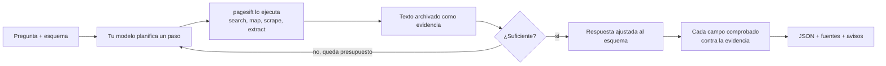
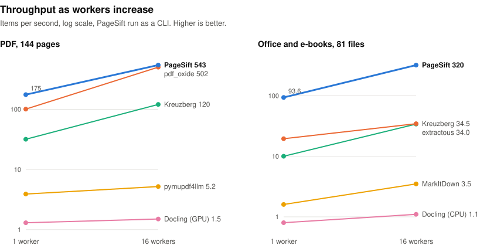
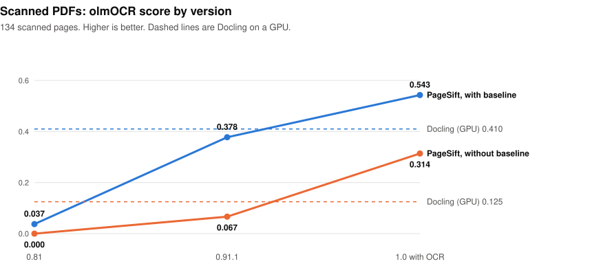
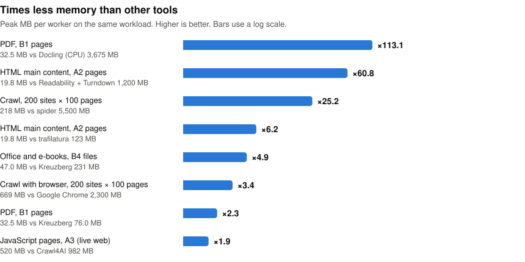
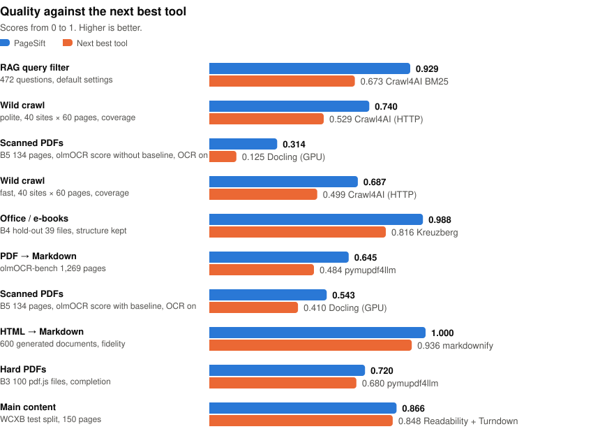
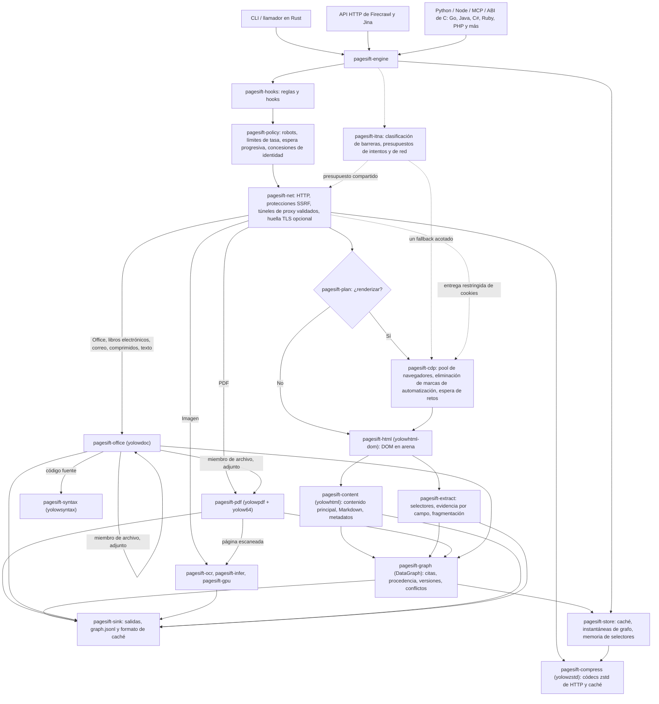
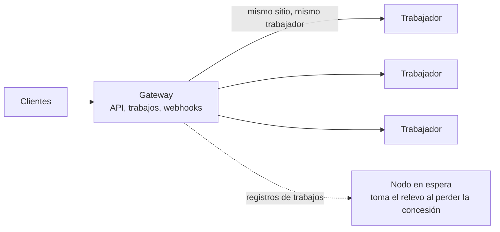

<div align="center">


# pagesift 1.4.1

**La capa de web y documentos para agentes de IA: entra cualquier URL, documento, correo, archivo comprimido o código fuente y salen Markdown limpio, JSON estructurado o relaciones DataGraph.**  
Un único binario en Rust, autoalojado, con CLI, API de Firecrawl y de Jina Reader, servidor MCP y paquetes para Python, Node.js, Go, Java, C#, Ruby, PHP y más.

**Medido:** PDF a Markdown 2,5 ms por página, 20,08 veces más rápido que el siguiente; HTML a Markdown 0,23 ms, 8,36 veces; contenido principal 1,0 ms, 7,26 veces (más bajo es mejor); Office 81,9 archivos/s, 3,03 veces el siguiente (más alto es mejor).

[](../LICENSE)
[](COMMERCIAL.md)
[](https://github.com/YOLOW92/pagesift/releases)
[](https://crates.io/crates/pagesift)
[](https://pypi.org/project/pagesift/)
[](https://www.npmjs.com/package/@pagesift/node)
[](https://glama.ai/mcp/servers/YOLOW92/pagesift)
[](https://discord.gg/esA3wMZVvA)

[English](../README.md) · [简体中文](README.zh-CN.md) · [日本語](README.ja.md) · **Español**

</div>

<!-- readme-template: v2 -->
<!-- section: overview -->
## Qué es

pagesift lee la web y los documentos para el software que piensa: descarga una URL, renderizando JavaScript solo cuando eso
aporta contenido, o abre un archivo local, y devuelve el contenido como Markdown o JSON estructurado. Abarca páginas sueltas,
sitios completos, PDF escaneados, acciones de navegador, monitorización de cambios y ejecuciones de investigación guiadas por tu propio modelo.

Puede sustituir o acompañar a: **Firecrawl** (la misma API v1/v2, autoalojada), **Jina Reader** (`/r/` y `/s/`),
**Crawl4AI**, **trafilatura**, **Readability**, **pymupdf4llm**, **Docling**, **Kreuzberg**, **xberg**.

<!-- section: facts -->
## De un vistazo

- **Entrada:** URL, HTML, PDF incluidas páginas escaneadas (OCR), imágenes (OCR), Word (.docx, .doc), Excel (.xlsx, .xlsb, .xls), PowerPoint (.pptx, .ppt), OpenDocument, RTF, WordPerfect, HWP, EPUB, MOBI, FB2, correo (.eml, .mbox, .msg), archivos comprimidos (zip, tar, gz, bz2, xz, 7z), SQLite, dBASE, CSV, Markdown y otros formatos de texto, 373 lenguajes de código y configuración, archivos WARC
- **Salida:** Markdown, HTML, HTML sin procesar, enlaces, imágenes, metadatos, JSON basado en esquemas, relaciones y evidencias DataGraph; avisos cuando un resultado está incompleto
- **Interfaces:** CLI · API HTTP Firecrawl v1/v2 · Jina Reader · MCP (stdio o HTTP) · Python · Node.js / TypeScript · crate de Rust · ABI de C con enlaces para Go, Java, Kotlin, C#, Ruby, PHP, Lua, Perl, Dart, Swift y Zig · LangChain y LlamaIndex
- **Plataformas:** Linux x86_64 / aarch64 (glibc ≥ 2.28 y musl), macOS arm64, Windows x86_64; imagen Docker `ghcr.io/yolow92/pagesift`
- **Entorno de ejecución:** nada que instalar para HTTP, PDF y Office. Opcional: un navegador para páginas con JavaScript, una GPU NVIDIA para OCR, tu propio modelo para `/v2/agent`
- **Memoria:** pico de 17–395 MB por trabajador en las pruebas de 1.4 sin navegador; el OCR con modelos de fórmulas necesita unos 1.7 GB; la capacidad se dimensiona a partir del límite del cgroup
- **Licencia:** Apache-2.0, o [soporte comercial](COMMERCIAL.md)
- **Última versión:** 1.4.1 · [notas de la versión](releases/1.4.1.md)

<!-- section: install -->
## Instalación y uso

| | Instalación | Primera llamada |
|---|---|---|
| CLI | `cargo install pagesift --locked` | `pagesift scrape https://example.com` |
| Python | `pip install pagesift` | `pagesift.scrape("https://example.com").markdown` |
| Node.js | `npm install @pagesift/node` | `(await new Scraper().scrape("https://example.com")).markdown` |
| Servidor | `docker run -p 3002:3002 ghcr.io/yolow92/pagesift:1.4.1` | `curl localhost:3002/r/https://example.com` |
| MCP | — | `claude mcp add pagesift -- pagesift mcp` |

**CLI**

```bash
pagesift scrape https://example.com                          # Markdown a stdout
pagesift scrape --graph https://example.com                  # Markdown + relaciones y evidencias DataGraph
pagesift scrape report.pdf                                   # archivo local PDF, Office, libro electrónico, correo, comprimido, imagen, código o WARC
pagesift --ocr scrape scan.pdf                               # OCR de páginas escaneadas; los modelos se descargan en el primer uso
pagesift crawl https://docs.rs --limit 500 --out ./data/     # un archivo por página (añade --graph para graph.jsonl)
pagesift graph inspect ./data/graph.jsonl                    # inspecciona citas, procedencia, versiones y conflictos
pagesift extract --schema schema.json https://example.com    # JSON por selectores CSS, reparados cuando cambia la página
pagesift doctor                                              # comprueba navegadores, GPU y modelos
```

**Python**

```python
import pagesift

page = pagesift.scrape("https://example.com", formats=["markdown", "links"])
print(page.markdown, page.metadata["title"], page.links)

pages = pagesift.scrape_many(["https://example.com", "https://example.org"], concurrency=8)

scanner = pagesift.Scraper(ocr=True)     # los modelos se descargan cuando llega la primera página escaneada
print(scanner.parse(open("scan.pdf", "rb").read(), "scan.pdf").markdown)
```

**Node.js / TypeScript**

```typescript
import { Scraper } from '@pagesift/node'

const scraper = new Scraper()
const page = await scraper.scrape('https://example.com', { formats: ['markdown', 'links'] })
console.log(page.markdown, page.metadata.title, page.links)

const items = await scraper.scrapeMany(['https://example.com', 'https://example.org'], { concurrency: 4 })
```

**Servidor HTTP**

```bash
docker run -d -p 3002:3002 -v pagesift-data:/data -e PAGESIFT_API_KEYS=sk-test ghcr.io/yolow92/pagesift:1.4.1

curl -s localhost:3002/v2/scrape -H 'Authorization: Bearer sk-test' -H 'Content-Type: application/json' \
  -d '{"url":"https://example.com","formats":["markdown"]}'                        # API de Firecrawl
curl -s localhost:3002/r/https://example.com -H 'Authorization: Bearer sk-test'    # Jina Reader
curl -s localhost:3002/v2/parse -H 'Authorization: Bearer sk-test' \
  -F file=@report.pdf -F 'options={"formats":["markdown"]}'                        # subida de archivos
```

Los SDK de Firecrawl funcionan cambiando la URL de la API. [API de subida](parse-api.md) · [Cabeceras de Jina](jina-reader.md)

**MCP**

```bash
pagesift mcp                                                  # stdio, para un agente
pagesift mcp http --port 3003                                 # un servicio local compartido
claude mcp add --scope user --transport http pagesift http://127.0.0.1:3003/mcp
```

Herramientas: `pagesift_scrape`, `pagesift_batch_scrape`, `pagesift_crawl`, `pagesift_poll_job`, `pagesift_cancel_job`,
`pagesift_map`, `pagesift_interact`, `pagesift_interact_stop`, `pagesift_graph_query` y, con un modelo configurado, `pagesift_agent`, `pagesift_agent_status`.
[Servicio MCP compartido](mcp-service.md)

<!-- section: capabilities -->
## Qué puede hacer

| Capacidad | Qué obtienes | Documentación |
|---|---|---|
| **Contenido limpio** | Detección del contenido principal y Markdown que conserva encabezados, listas, tablas, código y fórmulas | [Benchmarks](benchmarks.md) |
| **Documentos** | Lectores propios en Rust (`yolowpdf`, `yolowdoc`, `yolowsyntax`, `yolowzstd`, `yolowhtml`, `yolow64`) para PDF, Office, libros electrónicos, correo, comprimidos, imágenes, SQLite y formatos de texto | [API de subida](parse-api.md) |
| **OCR** | Páginas de PDF escaneadas con PP-OCRv6 y fórmulas en bloque con PP-FormulaNet, en Rust puro sobre CPU o GPU NVIDIA | [API de subida](parse-api.md) |
| **Extracción estructurada** | JSON mediante selectores CSS que se reubican cuando cambia un sitio, o mediante un esquema que tu modelo escribe una vez y pagesift guarda en caché | [Extracción](structured-extract.md) |
| **DataGraph** | Citas entre documentos, procedencia de redirecciones/canonical/adjuntos, linaje entre versiones, evidencias por campo, agrupación de hechos y conflictos (`graph`) | [Arquitectura](architecture.md) |
| **Acciones de navegador** | Clics, escritura y desplazamiento en la página, además de sesiones en las que puedes seguir trabajando | [Interacción](interact.md) |
| **Agente** | `POST /v2/agent` responde a una pregunta con datos de la web usando tu propio modelo, y comprueba cada campo contra la página de la que procede | [API de agente](agent-api.md) |
| **Monitorización** | Comprobaciones programadas que distinguen los cambios reales de fechas, contadores y anuncios, con webhooks | [Monitorización](monitor.md) |
| **Rastreo** | Sitemaps, rastreos enfocados por consulta que se detienen cuando las páginas dejan de aportar, manejo de trampas, robots.txt y límites por host | [Benchmarks](benchmarks.md) |
| **Archivos web** | Salida WARC en cada rastreo y archivos WARC como entrada sin red | [Notas de la versión](releases/1.0.0.md) |
| **Operación** | Gateway multiservidor, trabajadores y nodo en espera; persistencia de trabajos, webhooks duraderos, métricas, registro de auditoría | [Arquitectura](architecture.md) |
| **Seguridad** | Protecciones contra redes privadas y DNS rebinding, y todo resultado incompleto informa con un aviso | [Política de bots](bot.md) |

**Cómo responde `/v2/agent` a una pregunta**



robots.txt, los límites de tasa y las protecciones de red se aplican a cada página. El modelo elige URL y consultas, no opciones de descarga.

<!-- section: performance -->
## Rendimiento

<!-- perf-glance -->
<picture><source media="(prefers-color-scheme: dark)" srcset="assets/perf-scaling-dark.svg"></picture>

<picture><source media="(prefers-color-scheme: dark)" srcset="assets/perf-versions-dark.svg"></picture>

<picture><source media="(prefers-color-scheme: dark)" srcset="assets/perf-memory-dark.svg"></picture>

<picture><source media="(prefers-color-scheme: dark)" srcset="assets/perf-quality-dark.svg"></picture>

↑ más alto es mejor · ↓ más bajo es mejor. El resultado más fuerte por dominio; métodos y fuentes en el informe completo.

| Tarea | Métrica | PageSift | Mejor otra herramienta | Diferencia |
|---|---|---:|---|---:|
| PDF → Markdown — olmOCR-bench 1,269 pages, per page (single thread) | ms/page ↓ | **2.5** | pypdf 50.0 | **×20.08** |
| PDF → Markdown — B1 144 pages, 1 worker, resident server | files/s ↑ | **224.0** | pdf_oxide 100.6 | **×2.23** |
| PDF → Markdown — olmOCR-bench 1,269 pages | official score ↑ | **0.645** | pymupdf4llm 0.484 | **+0.161** |
| HTML → Markdown — 600 generated documents, per page | ms/page ↓ | **0.23** | Turndown 1.9 | **×8.36** |
| HTML → Markdown — 600 generated documents, fidelity | mean F1 ↑ | **1.000** | markdownify 0.936 | **+0.064** |
| Main content — Firecrawl 597 pages, single thread | p50 ms/page ↓ | **1.0** | crw 7.4 | **×7.26** |
| Main content — A2 269 random pages, 16 workers | pages/s ↑ | **656.1** | Resiliparse 559.3 | **×1.17** |
| Main content — WCXB test split, 150 pages | F1 ↑ | **0.866** | Readability + Turndown 0.848 | **+0.018** |
| Publication dates — htmldate 1,000 pages, date search | ms/page ↓ | **0.31** | htmldate (fast) 2.0 | **×6.45** |
| RAG chunking — 5 corpora, 1.4 MB | total ms ↓ | **7** | chonkie recursive 35 | **×5.01** |
| Office / e-books — B4 81 files, in-process | files/s ↑ | **81.9** | xberg 27.0 | **×3.03** |
| Office / e-books — B4 hold-out 39 files, structure kept | structure kept ↑ | **0.988** | xberg 0.878 | **+0.110** |
| RAG query filter — 472 questions, default settings | answer recall ↑ | **0.929** | Crawl4AI BM25 0.673 | **+0.256** |
| Wild crawl — polite, 40 sites × 60 pages, coverage | coverage ↑ | **0.740** | Crawl4AI (HTTP) 0.529 | **+0.211** |
| Wild crawl — fast, 40 sites × 60 pages, coverage | coverage ↑ | **0.687** | Crawl4AI (HTTP) 0.499 | **+0.188** |
| Scanned PDFs — B5 134 pages, olmOCR score without baseline, OCR on | olmOCR score ↑ | **0.314** | Docling (GPU) 0.125 | **+0.189** |
| Scanned PDFs — B5 134 pages, olmOCR score with baseline, OCR on | olmOCR score ↑ | **0.543** | Docling (GPU) 0.410 | **+0.133** |
| Hard PDFs — B3 100 pdf.js files, completion | completion ↑ | **0.720** | pymupdf4llm 0.680 | **+0.040** |

| Memoria pico por worker | PageSift MB ↓ | Otra herramienta MB | Menos memoria |
|---|---:|---|---:|
| PDF, B1 pages | **30** | Docling (CPU) 3,675 (2026-10-28) | **×121.3** |
| HTML main content, A2 pages | **28** | Readability + Turndown 1,200 (2026-10-28) | **×43.0** |
| Crawl, 200 sites × 100 pages | **218** | spider 5,500 (2026-10-21) | **×25.2** |
| Office and e-books, B4 files | **42** | Kreuzberg 231 (2026-10-28) | **×5.5** |
| HTML main content, A2 pages | **28** | trafilatura 123 (2026-10-28) | **×4.4** |
| Crawl with browser, 200 sites × 100 pages | **669** | Google Chrome 2,300 (2026-10-21) | **×3.4** |
| PDF, B1 pages | **30** | Kreuzberg 76 (2026-10-28) | **×2.5** |
| JavaScript pages, A3 (live web) | **520** | Crawl4AI 982 (2026-10-28) | **×1.9** |

**PageSift 1.4 y xberg 1.3.9.** xberg medido el 2026-11-04; un rango son dos ejecuciones. En negrita, el mejor valor de la fila.

| Métrica | PageSift CLI | PageSift servidor | xberg | xberg modo de maquetación |
|---|---:|---:|---:|---:|
| PDF B1, puntuación olmOCR 1.269 páginas ↑ | **0.645** | — | 0.436 | 0.472 |
| Office B4, estructura conservada, reserva 39 archivos ↑ | **0.988** | — | 0.878 | — |
| PDF B1, 1 worker, archivos/s ↑ | 145.0 | **224.0** | 29.5–29.9 | 1.35 |
| PDF B1, 16 workers, archivos/s ↑ | **475.2** | 282.9 | 65.8–68.4 | 1.41 |
| Office B4, 1 worker, archivos/s ↑ | 81.9 | **89.4** | 27.0 | — |
| Office B4, 16 workers, archivos/s ↑ | **283.2** | 142.4 | 73.4–74.2 | — |
| PDF B1, 1 worker, MB pico ↓ | **30** | 211 | 147–172 | 1118 |
| Office B4, 1 worker, MB pico ↓ | **42** | 254 | 112 | — |
| Office B4, 1 worker, mediana ms por archivo ↓ | 5.5 | **1.8** | 3.2–3.3 | — |


<details>
<summary>Aún por detrás</summary>

fast, 40 sites × 60 pages, time (spider covered about half as many pages) 16.1 seconds vs spider 1.4 seconds; A2 replay, 269 pages, HTTP only, no rate limit, 1 worker 47.5 pages/s vs spider 156.6 pages/s; A2 269 random pages, resident worker, per page 5.2 ms/page vs Resiliparse 2.1 ms/page.

</details>

[Informe completo](../benchmarks/history/1.4/results/final/new/report.md)

<!-- /perf-glance -->

<!-- section: architecture -->
## Arquitectura

El núcleo está escrito en Rust desde el formato de archivo hacia arriba, y los límites se miden en tiempo de ejecución en lugar de fijarse a mano.



La recuperación de barreras de acceso es opcional (`[itna] enabled`, desactivada por defecto).
`pagesift-itna` clasifica las barreras, permite como máximo un fallback acotado al navegador y comparte
un único presupuesto de red entre redirecciones y subpeticiones del navegador. Las sesiones se alquilan
por owner, origin, salida y huella; las cookies HTTP solo llegan al navegador mediante una entrega
restringida al origin exacto. Los CAPTCHA interactivos se informan como tareas que necesitan una persona
y no se resuelven.

**Código propio hasta el formato.** El análisis se ejecuta dentro del proceso, sin ningún runtime de Python, JVM o Node detrás. pagesift se apoya
en crates independientes (`yolowhtml`, `yolowpdf`, `yolowdoc`, `yolowsyntax`, `yolowzstd` y `yolow64`), inferencia de redes
neuronales con kernels de GPU compilados desde Rust, cliente de Chrome DevTools, servidor MCP, `pagesift-graph` (DataGraph) y almacén de solo anexado. Un
trabajador cuesta decenas de megabytes, no un intérprete cargado, y arranca en milisegundos.

**Un trabajador por núcleo.** El trabajo de CPU se ejecuta en trabajadores residentes agrupados por nodo NUMA, que roban trabajo primero dentro de su propio nodo.
Una única vía de admisión cubre CPU, memoria y pestañas del navegador, y la capacidad sale del límite del cgroup, de modo que un
contenedor se mantiene dentro de su memoria en lugar de ser eliminado.

**Medido en lugar de fijo.** La concurrencia sigue un ajuste de la Ley de Escalabilidad Universal, los límites por host siguen un gradiente
de latencia, los tiempos de espera por etapa usan análisis de supervivencia y los reintentos usan tasas de éxito por clase. Cada uno parte de un valor
predeterminado seguro y solo cambia ante evidencia estadísticamente significativa (δ = 0.05). Los ajustes del usuario y los límites de seguridad siguen siendo límites estrictos.

**Un navegador solo cuando compensa.** Para cada familia de rutas de URL, pagesift aprende si el renderizado aportó contenido, y el
resultado renderizado solo se conserva si puntúa más alto. Los datos de página como `__NEXT_DATA__` y JSON-LD se leen sin navegador.
Lightpanda, moli y Chrome forman una cadena de respaldo, y `--explain` registra cada decisión.

**Resultados honestos.** Una página parcial, un archivo truncado o un escaneo omitido devuelve un código de aviso en lugar de parecer completo.
Las respuestas del agente indican qué valores se encontraron en la evidencia, y las reparaciones de selectores indican el selector antiguo y el nuevo.

**De un binario a una flota.** `serve --role gateway`, `worker` y `standby` comparten el mismo binario, con afinidad por sitio mediante
rendezvous hashing y concesiones con fencing. Los trabajos y los webhooks se reanudan tras un reinicio.



[Arquitectura completa](architecture.md)

<!-- section: choose -->
## Cuándo usarlo y cuándo no

**Encaja bien**

- Pasar páginas web y documentos a un LLM, un índice RAG o un agente
- Alojar en tus propias máquinas un servicio al estilo de Firecrawl o Jina Reader, sin tarifas por página
- Entrada mixta: la misma llamada maneja HTML, PDF, escaneos, archivos de Office y libros electrónicos
- Máquinas pequeñas y contenedores, donde la memoria está acotada por el límite del cgroup

**Elige otra cosa cuando**

- **Tu entrada son archivos de imagen.** El OCR cubre páginas escaneadas dentro de PDF, no imágenes sueltas.
- **Necesitas un servicio gestionado en la nube.** pagesift es autoalojado.

<!-- section: license -->
## Licencia

[Apache-2.0](../LICENSE). Para soporte empresarial, SLAs personalizados o asistencia dedicada de despliegue, consulta la
[licencia y soporte comercial](COMMERCIAL.md) o escribe a `licensing@pagesift.dev`.

<!-- section: changelog -->
## Novedades de 1.4.1

PageSift 1.4.1 refuerza la seguridad, corrección y estabilidad de la serie `1.4.x`: aislamiento por inquilino y sesión en ChangeTracking y DataGraph (`/v2/graph/history`, `/v2/graph/conflicts`, tareas en segundo plano y RPC de clúster), verificación de confianza para declaraciones canonical y redirecciones, independencia de `evidence` frente a `facts`/`conflicts`, alineación de `changed_block_ids` con `queryFilter` y fragmentos, historial lineal por versión vinculado a su instantánea exacta con CAS por recurso, presupuestos de memoria por rastreo y consultas paginadas simétricas, mejoras en `AdaptiveConcurrencyGate` y cancelación del pool de CPU, propagación de `default-features = false` en `pagesift-office` y comprobaciones SSRF en proxies con DNS remoto.

[Notas de la versión](releases/1.4.1.md) · [1.4.0](releases/1.4.0.md) · [1.3.0](releases/1.3.0.md) · [todas las versiones](releases/) · [CHANGELOG](CHANGELOG.md)

---

## Comunidad

Preguntas o comentarios: [Discord](https://discord.gg/esA3wMZVvA) · [Issues](https://github.com/YOLOW92/pagesift/issues) · [Discussions](https://github.com/YOLOW92/pagesift/discussions)

## Cita

```bibtex
@software{pagesift2026,
  title  = {PageSift: Rust Web and Document Extraction Engine for AI Pipelines},
  author = {YOLOW92},
  year   = {2026},
  url    = {https://github.com/YOLOW92/pagesift},
  note   = {Version 1.4.1}
}
```

## Historial de estrellas

[](https://star-history.com/#YOLOW92/pagesift&Date)
