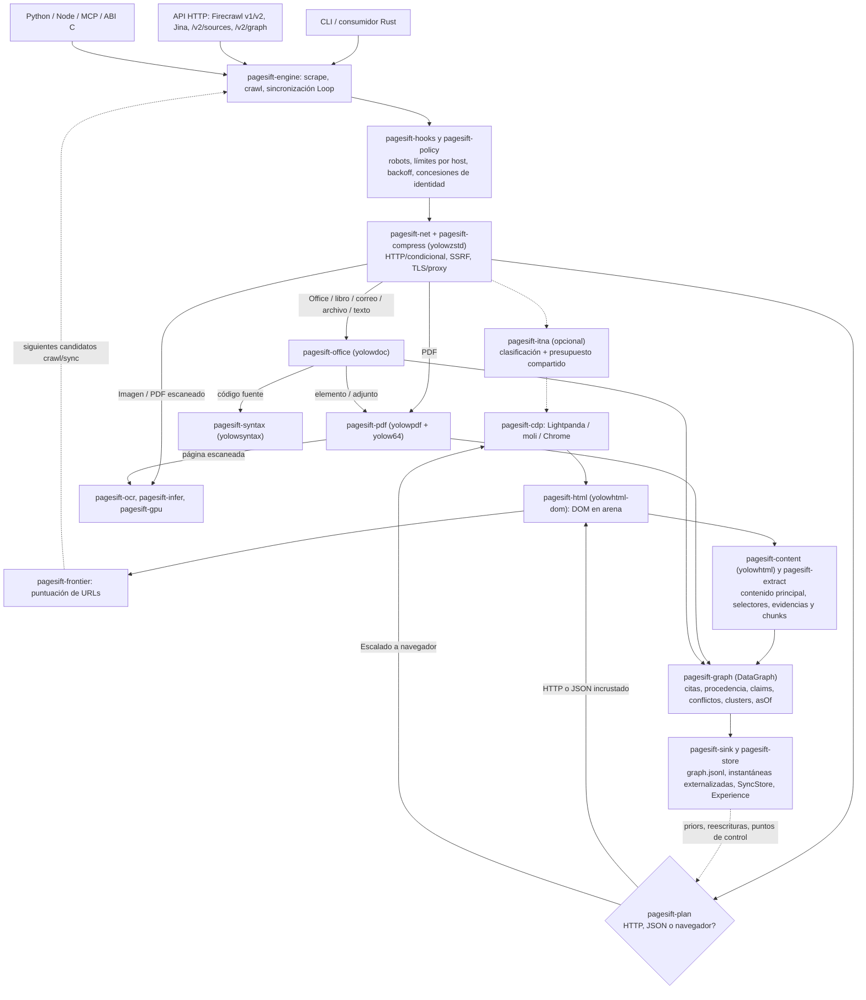
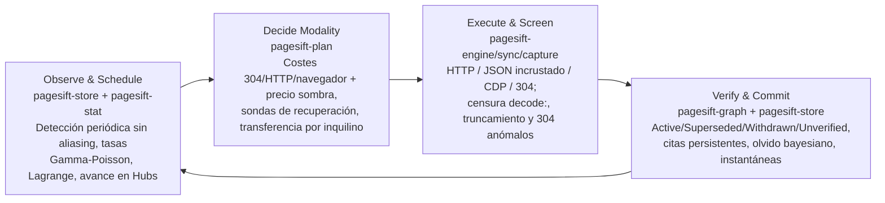
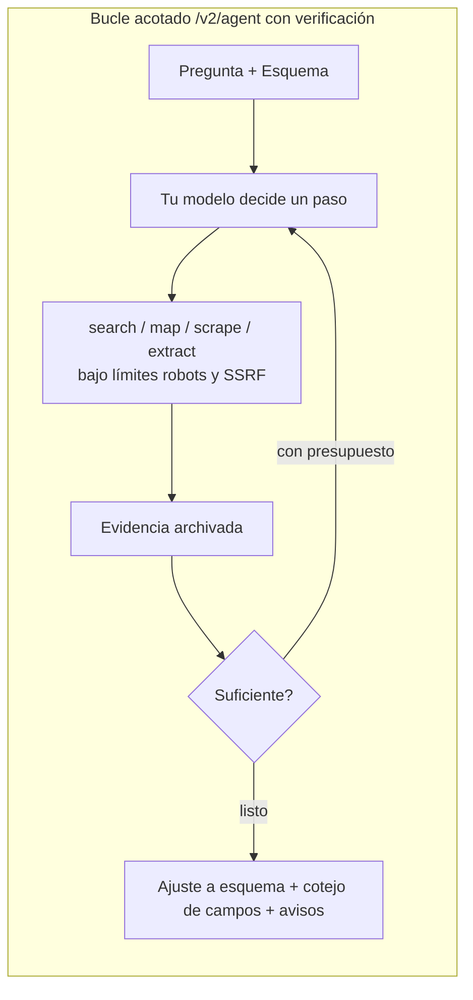
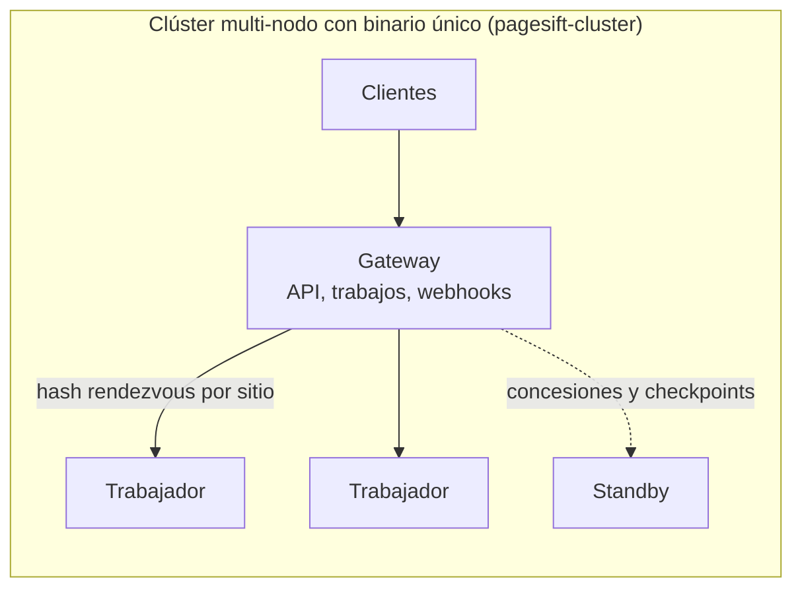

<div align="center">


# pagesift 1.5.6

**Motor local-first en Rust para ingesta de web y documentos — captura HTTP/navegador, análisis con diseño para PDF/Office/OCR, sincronización persistente y grafos de datos verificables.**  
Un único binario autoalojado en Rust con CLI, APIs HTTP compatibles con Firecrawl v1/v2 y Jina Reader, servidor MCP, ABI de C y paquetes nativos para Python y Node.js.

[](../LICENSE)
[](COMMERCIAL.md)
[](https://github.com/YOLOW92/pagesift/releases)
[](https://crates.io/crates/pagesift)
[](https://pypi.org/project/pagesift/)
[](https://www.npmjs.com/package/@pagesift/node)
[](https://glama.ai/mcp/servers/YOLOW92/pagesift)
[](https://discord.gg/esA3wMZVvA)

[English](../README.md) · [简体中文](README.zh-CN.md) · [日本語](README.ja.md) · **Español**

</div>

<!-- readme-template: v2 -->
<!-- section: overview -->
## Qué es

`pagesift` transforma páginas web en vivo, archivos locales binarios, archivos comprimidos y fuentes monitorizadas de larga duración en Markdown determinista, JSON validado por esquema y relaciones `DataGraph` con trazabilidad de origen dentro de un único proceso Rust acotado en memoria. La descarga HTTP, los lectores nativos de documentos, la extracción HTML, el estado de sincronización adaptativa y el almacenamiento de evidencias operan en proceso sin trabajadores Python, JVM ni Node; un pool de navegador sin cabeza, OCR en GPU NVIDIA y tu propio endpoint LLM se conectan solo bajo demanda.

Alternativa o complemento para: **Firecrawl** (API v1/v2 autoalojada), **Jina Reader** (`/r/` y `/s/`), **Crawl4AI**, **trafilatura**, **Readability**, **pymupdf4llm**, **Docling**, **Kreuzberg** y **xberg**.

<!-- section: facts -->
## De un vistazo

- **Capas en ejecución:** Superficies de entrada (`CLI`/`HTTP`/`MCP`/FFI) → políticas y red protegida contra SSRF → captura adaptativa (`HTTP`/JSON incrustado/navegador) → lectores nativos y extractores → `DataGraph` y almacén append-only → pool NUMA acotado por cgroup (`pagesift-flow`)
- **Entradas:** URLs, HTML, PDF (capa de texto + PP-OCRv6 / fórmulas opcionales), imágenes subidas (OCR activo), Office y OpenDocument, RTF/WordPerfect/HWP, libros electrónicos, correo, archivos (`zip`, `tar`, `7z`), SQLite/CSV, 373 lenguajes de código y archivos WARC ([matriz de formatos](parse-api.md))
- **Salidas:** Markdown, HTML, HTML sin procesar, enlaces, imágenes/adjuntos, fragmentos RAG, JSON con esquema, `DataGraph` (`graph.jsonl`, citas, ciclos de vida de claims, conflictos, `fact_clusters`, `?asOf=`) y avisos estructurados en capturas parciales
- **Interfaces:** CLI · API HTTP Firecrawl v1/v2 · Jina Reader (`/r/`, `/s/`) · MCP (stdio / HTTP) · Python · Node.js / TypeScript · crate Rust · ABI de C (Go, Java, Kotlin, C#, Ruby, PHP, Lua, Perl, Dart, Swift, Zig) · LangChain y LlamaIndex
- **Plataformas y despliegue:** Binario único (`serve --role gateway`, `worker`, `standby`), Linux x86_64/aarch64 (glibc ≥ 2.28 y musl), macOS arm64, Windows x86_64, Docker `ghcr.io/yolow92/pagesift:1.5.6`
- **Índice y versión:** Índice legible por máquina [llms.txt](../llms.txt) · Apache-2.0 o [soporte comercial](COMMERCIAL.md) · **1.5.6** ([notas de versión](releases/1.5.6.md))

<!-- section: install -->
## Instalación y comienzo rápido

| Interfaz | Instalación | Primera llamada |
|---|---|---|
| CLI | `cargo install pagesift --locked` | `pagesift scrape https://example.com` |
| Python | `pip install pagesift` | `pagesift.scrape("https://example.com").markdown` |
| Node.js | `npm install @pagesift/node` | `(await new Scraper().scrape("https://example.com")).markdown` |
| Servidor | `docker run -p 3002:3002 ghcr.io/yolow92/pagesift:1.5.6` | `curl localhost:3002/r/https://example.com` |
| MCP | — | `claude mcp add pagesift -- pagesift mcp` |

<details>
<summary>Ejemplos rápidos: CLI, Python, Node.js, HTTP API y MCP</summary>

**CLI**

```bash
pagesift scrape https://example.com                          # Markdown limpio a stdout
pagesift scrape --graph https://example.com                  # Markdown + procedencia y claims DataGraph
pagesift scrape report.pdf                                   # Archivo local PDF, Office, libro, correo, archivo, código o WARC
pagesift --ocr scrape scan.pdf                               # OCR sobre páginas escaneadas o imágenes subidas
pagesift crawl https://docs.rs --limit 500 --out ./data/     # Rastrear sitio a disco (--graph genera graph.jsonl)
pagesift graph inspect ./data/graph.jsonl                    # Inspeccionar citas, linaje, claims y conflictos
pagesift sync init --id docs --seed https://example.com      # Inicializar y sincronizar fuente persistente Loop
pagesift extract --schema schema.json https://example.com    # JSON con esquema y reparación de selectores CSS
pagesift doctor                                              # Comprobar navegadores locales, GPU y modelos
```

**Python y Node.js**

```python
import pagesift

page = pagesift.scrape("https://example.com", formats=["markdown", "links"])
print(page.markdown, page.metadata["title"], page.links)

scanner = pagesift.Scraper(ocr=True)
print(scanner.parse(open("scan.pdf", "rb").read(), "scan.pdf").markdown)
```

```typescript
import { Scraper } from '@pagesift/node'

const scraper = new Scraper()
const page = await scraper.scrape('https://example.com', { formats: ['markdown', 'links'] })
console.log(page.markdown, page.metadata.title, page.links)
```

**Servidor HTTP (`Firecrawl v1/v2`, `Jina Reader`, `/v2/sources`, `/v2/graph`) y MCP**

```bash
docker run -d -p 3002:3002 -v pagesift-data:/data -e PAGESIFT_API_KEYS=sk-test ghcr.io/yolow92/pagesift:1.5.6

curl -s localhost:3002/v2/scrape -H 'Authorization: Bearer sk-test' -H 'Content-Type: application/json' \
  -d '{"url":"https://example.com","formats":["markdown"]}'
curl -s localhost:3002/r/https://example.com -H 'Authorization: Bearer sk-test'
curl -s localhost:3002/v2/parse -H 'Authorization: Bearer sk-test' -F file=@report.pdf -F 'options={"formats":["markdown"]}'

pagesift mcp                                                 # stdio para un agente
pagesift mcp http --port 3003                                # servicio MCP HTTP local compartido
```

</details>

Herramientas MCP disponibles: `pagesift_scrape`, `pagesift_batch_scrape`, `pagesift_crawl`, `pagesift_poll_job`, `pagesift_cancel_job`, `pagesift_map`, `pagesift_interact`, `pagesift_interact_stop`, `pagesift_sync`, `pagesift_graph_query` y, con modelo configurado, `pagesift_agent` y `pagesift_agent_status`. Consulta [servicio MCP compartido](mcp-service.md).

<!-- section: capabilities -->
## Capacidades

Organizadas por plano arquitectónico mostrando las capacidades implementadas y su documentación:

| Plano | Capacidades implementadas | Referencia |
|---|---|---|
| **Interfaces y compatibilidad** | CLI autoalojada, API HTTP Firecrawl v1/v2 (`/v2/scrape`, `/v2/crawl`, `/v2/parse`, `/v2/monitor`, `/v2/sources`, `/v2/graph`, `/v2/agent`, `/interact`), Jina Reader (`/r/`, `/s/`), MCP (stdio/HTTP), Python, Node.js/TS, biblioteca Rust y ABI de C | [parse-api.md](parse-api.md) · [jina-reader.md](jina-reader.md) · [mcp-service.md](mcp-service.md) |
| **Captura y seguridad** | HTTP condicional (`ETag`/`Last-Modified`), protección SSRF y DNS rebinding, `robots.txt` y límites por host, concesiones de identidad, síntesis de JSON incrustado (`__NEXT_DATA__`/`__NUXT_DATA__`/JSON-LD), pool opcional CDP (`Lightpanda`/`moli`/Chrome) + sesiones `/interact` y recuperación opcional `[itna]` ante barreras | [interact.md](interact.md) · [http-sessions.md](http-sessions.md) · [bot.md](bot.md) |
| **Lectores nativos y OCR** | Lectores en Rust puro hasta nivel de contenedor (`yolowhtml`, `yolowpdf`, `yolowdoc`, `yolowsyntax`, `yolowzstd`, `yolow64`) para web, Office/ODF, libros electrónicos, correo, archivos anidados, SQLite/CSV, 373 lenguajes de código (segmentación AST en 32+ lenguajes), WARC y PP-OCRv6 + PP-FormulaNet en CPU/GPU | [parse-api.md](parse-api.md) |
| **Extracción y agentes** | Markdown de contenido principal con tablas/código/fórmulas, filtro RAG `queryFilter` y segmentación, extracción por esquema con reparación automática de selectores CSS e investigación `/v2/agent` verificada contra la evidencia archivada | [structured-extract.md](structured-extract.md) · [agent-api.md](agent-api.md) |
| **Loop continuo y monitores** | Fuentes persistentes `pagesift sync` / `/v2/sources` con detección periódica sin aliasing, contracción jerárquica Gamma-Poisson y reparto presupuestario de Lagrange, propagación cooperativa en Hubs, costes por modalidad y precio sombra de pestañas, sondas de recuperación `DirectBrowser`, olvido por sorpresa bayesiana, transferencia aislada por inquilino, censura ante capturas inciertas y webhooks `/v2/monitor` | [monitor.md](monitor.md) · [incremental-collection.md](incremental-collection.md) |
| **DataGraph y procedencia** | Grafo de evidencias entre páginas y fuentes (`graph.jsonl`, `graph_summary.json`, `/v2/graph/claims`, `/history`, `/conflicts`, `?asOf=`): citas persistidas, redirecciones/canónicas/adjuntos, desambiguación contextual de divisas y unidades, raíces independientes `OriginRelation` y `fact_clusters`, y estados de claims (`Active`, `Superseded`, `Withdrawn`, `Unverified`, `EvidenceDegraded`) | [architecture.md](architecture.md) |

<!-- section: performance -->
## Resumen de rendimiento

Las métricas detalladas, condiciones de hardware, advertencias de metodología y tablas frente a otras herramientas se mantienen aparte en [benchmarks.md](benchmarks.md):

- **Latencia (pruebas registradas, 1 trabajador, más bajo es mejor):** PDF → Markdown `2,5 ms/página` (1.269 páginas); HTML → Markdown `0,23 ms/página` (600 documentos); contenido principal `1,0 ms/página` (597 páginas).
- **Rendimiento, fidelidad y memoria (pruebas registradas):** Office en proceso `81,9 archivos/s` (más alto es mejor); HTML → Markdown F1 medio `1,000`; WCXB F1 `0,866`; recuperación RAG `0,929` (más alto es mejor); pico de memoria `17–395 MB` por trabajador sin navegador.
- **Informes completos y evaluación Loop:** [benchmarks.md](benchmarks.md) · [Informe completo de benchmarks](../benchmarks/history/1.4/results/final/new/report.md) · [Evaluación local más reciente de Loop](releases/1.5.6.md)

<!-- section: architecture -->
## Arquitectura y flujos principales

El núcleo se ejecuta como un binario Rust compilado sin intérpretes externos detrás del análisis, el almacenamiento ni la planificación. CPU, memoria y pestañas comparten una ruta única de admisión ajustada al límite cgroup, y los umbrales internos solo se adaptan tras superar significación estadística (`δ = 0,05`).

### Pipeline de petición e ingesta



### Bucle cerrado de sincronización continua (`Observe → Learn → Decide → Execute → Verify`)

Las fuentes persistentes registradas mediante `pagesift sync` o `/v2/sources` ejecutan en cada tick un bucle cerrado que protege los claims verificados ante capturas inciertas:



### Agente verificado `/v2/agent` y topología multi-servidor





### Mapa de crates del espacio de trabajo

| Capa | Crates |
|---|---|
| **Superficies de entrada y FFI** | `pagesift` (CLI y biblioteca), `pagesift-api` (servidor HTTP y esquemas), `pagesift-mcp` (MCP stdio/HTTP), `pagesift-py`, `pagesift-node`, `pagesift-ffi` (ABI C) |
| **Orquestación, estrategia y grafo** | `pagesift-engine`, `pagesift-plan`, `pagesift-hooks`, `pagesift-llm`, `pagesift-search`, `pagesift-graph` |
| **Red, políticas y navegador** | `pagesift-net`, `pagesift-policy`, `pagesift-rustls`, `pagesift-cdp`, `pagesift-media`, `pagesift-itna` |
| **Extracción web y frontera** | `pagesift-html` (`yolowhtml-dom`), `pagesift-content` (`yolowhtml`), `pagesift-extract`, `pagesift-diff`, `pagesift-frontier` |
| **Lectores nativos y OCR** | `pagesift-pdf` (`yolowpdf`), `pagesift-office` (`yolowdoc`), `pagesift-syntax` (`yolowsyntax`), `pagesift-ocr`, `pagesift-infer`, `pagesift-gpu` |
| **Ejecución, estadística y persistencia** | `pagesift-flow` (trabajadores NUMA y admisión cgroup), `pagesift-stat`, `pagesift-base64` (`yolow64`), `pagesift-compress` (`yolowzstd`), `pagesift-sys`, `pagesift-store`, `pagesift-sink`, `pagesift-cluster` |

Consulta la [referencia completa de arquitectura](architecture.md) para dimensionamiento por cgroup, ajuste estadístico (`δ = 0,05` USL/supervivencia/Thompson), puntos de control incrementales y publicación verificada de archivos multimedia.

<!-- section: choose -->
## Cuándo usarlo y cuándo no

**Encaja bien**

- Alimentar agentes, índices RAG o flujos analíticos desde web, PDF, Office, archivos o código fuente sin procesos externos
- Autoalojar servicios compatibles con Firecrawl o Jina Reader y MCP compartido sin coste por página
- Sincronización continua de fuentes cambiantes donde importan los costes de navegador, la procedencia y la detección de conflictos
- Entornos pequeños o contenedores donde los trabajadores deben respetar los límites del cgroup

**Elige otra cosa cuando**

- **Necesitas una nube gestionada.** `pagesift` es software autoalojado.
- **Necesitas resolución automática de CAPTCHA.** Los desafíos interactivos se clasifican y quedan pendientes de resolución humana (`[itna]` es opcional y no evita CAPTCHAs).
- **Trabajas con URLs de imágenes o sin OCR.** Las imágenes locales/subidas requieren `--ocr` (`[ocr] enabled = true`); las URLs de imagen o subidas sin OCR devuelven `UNSUPPORTED_OPTION`.

<!-- section: license -->
## Licencia

[Apache-2.0](../LICENSE). Para soporte empresarial, SLAs personalizados o asistencia dedicada de despliegue, consulta la [licencia y soporte comercial](COMMERCIAL.md) o escribe a `licensing@pagesift.dev`.

<!-- section: changelog -->
## Novedades de 1.5.6

PageSift 1.5.6 completa la corrección integral de Loop `1.5.x` y el endurecimiento transaccional del almacén: ejecuta `mirror::write` de trabajos de rastreo (`pages` y `done_set`) en una sola transacción atómica `TasksTx`; separa marcas de intento, última observación válida y cambio sustantivo, desacoplando la fiabilidad HTTP/navegador y propagando `uncertain_observations` sin resolver para bloquear `complete_within_scope`; integra y valida `Last-Modified` HTTP en la detección periódica mientras corrige la invalidación de ciclos perdidos/tardíos, el aislamiento de fases por recurso, la escritura real de intervalos mediante `apply_waterfill_schedules_to_inventory` y la deduplicación multi-oleada de `candidates_due`; aplica en ejecución el precio sombra del navegador dentro del tick (`browser_escalation_permitted`), elimina bloqueos por ETags obsoletos o sondas únicas, corrige el doble consumo al rechazar transferencia negativa y el aislamiento por inquilino en fallos; y separa recuentos `Active` frente a `Unverified`, `fact_clusters_truncated` y unidades/divisas `"UNKNOWN"` frente a conflictos confirmados.

[Notas de la versión](releases/1.5.6.md) · [1.5.5](releases/1.5.5.md) · [1.5.4](releases/1.5.4.md) · [1.5.3](releases/1.5.3.md) · [1.5.2](releases/1.5.2.md) · [1.5.1](releases/1.5.1.md) · [1.5.0](releases/1.5.0.md) · [todas las versiones](releases/) · [CHANGELOG](CHANGELOG.md)

---

## Comunidad

Preguntas o comentarios: [Discord](https://discord.gg/esA3wMZVvA) · [Issues](https://github.com/YOLOW92/pagesift/issues) · [Discussions](https://github.com/YOLOW92/pagesift/discussions)

## Cita

```bibtex
@software{pagesift2026,
  title  = {PageSift: Rust Web and Document Extraction Engine for AI Pipelines},
  author = {YOLOW92},
  year   = {2026},
  url    = {https://github.com/YOLOW92/pagesift},
  note   = {Version 1.5.6}
}
```

## Historial de estrellas

[](https://star-history.com/#YOLOW92/pagesift&Date)
