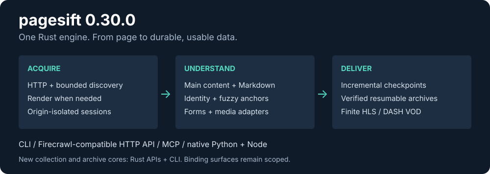

<div align="center">

# pagesift

**Web scraping rápido y respetuoso para LLM y agentes de IA.**
Convierte cualquier sitio web en Markdown limpio y datos estructurados: un solo binario de Rust, una API compatible con Firecrawl y una fracción de la memoria.

[](../LICENSE)
[](../COMMERCIAL.md)
[](https://github.com/YOLOW92/pagesift/releases)
[](https://crates.io/crates/pagesift)
[](https://pypi.org/project/pagesift/)
[](https://www.npmjs.com/package/pagesift)

[English](../README.md) · [简体中文](README.zh-CN.md) · [日本語](README.ja.md) · **Español**

</div>

---

## 0.20.0

0.20.0 añade recopilación incremental, sesiones HTTP explícitas, archivos verificables y siete núcleos Rust con límites documentados. Las nuevas operaciones se ofrecen principalmente por Rust/CLI. Hay 17 categorías parciales; no se afirma superioridad funcional completa.

[Release / migration](releases/0.20.0.md) · [Documentation](README.md) · [Architecture](architecture.md) · [Evidence](../bench/six/evidence/README.md)



pagesift es un motor de scraping y crawling autoalojado para pipelines de IA, RAG y agentes. Descarga páginas, renderiza JavaScript solo cuando hace falta, extrae el contenido principal y devuelve Markdown, HTML, enlaces y metadatos a través de una API HTTP compatible con [Firecrawl v2](https://docs.firecrawl.dev), un servidor MCP, una CLI y paquetes nativos para Python y Node.

Está pensado para funcionar como servicio: memoria acotada, backpressure, persistencia de trabajos, webhooks, límites por clave y métricas. Además, juega limpio: respeta robots.txt, limita la frecuencia por host, usa un User-Agent honesto y no evade ninguna protección antibots.

## Por qué pagesift

| | |
|---|---|
| ⚡ **Rápido** | Extracción del contenido principal en **0.85 ms** por página (p50, un solo hilo): 10× más rápido que crw y 59× más rápido que Crawl4AI. Crawling HTTP sin límite de frecuencia a **3,800+ páginas/s** en una sola máquina. |
| 🪶 **Ligero** | Rastrea 200 sitios × 100 páginas con **~220 MB**, donde Spider necesita 4.1 GB. Al sustituir Crawl4AI en un servicio en producción, el pico de memoria bajó de 1.4 GB a **225 MB**. |
| 🎯 **Preciso** | La mejor puntuación de contenido principal en el conjunto de datos etiquetado de Firecrawl: **0.716** frente a 0.711 (crw) y 0.670 (Crawl4AI), con la mitad de contenido repetitivo filtrado. Fechas de publicación tan precisas como htmldate, la biblioteca especializada (F1 **0.948** en su propio conjunto anotado), en **0,06 ms** en lugar de 4 ms. |
| 🧠 **Renderizado inteligente** | Solo renderiza las páginas que lo necesitan, con el motor más ligero que funcione: Lightpanda → moli → Chrome. Aprende, sitio por sitio, cuándo un navegador no aporta nada. |
| 🔌 **Reemplazo directo** | API de Firecrawl v2 (`/v2/scrape`, `/crawl`, `/map`, `/search`, `/extract`, `/batch/scrape`), así que los SDK de Firecrawl existentes funcionan sin cambios. Servidor MCP para agentes. |
| 🛡️ **Seguro por defecto** | Protección contra SSRF en cada petición, redirección, subpetición del navegador y webhook; comprobaciones contra DNS rebinding; nunca desactiva el sandbox del navegador. |

Cifras detalladas y reproducibles: **[docs/benchmarks.md](benchmarks.md)**.

## Inicio rápido

### Docker

```bash
docker run -d -p 3002:3002 -v pagesift-data:/data \
  -e PAGESIFT_API_KEYS=change-me ghcr.io/yolow92/pagesift:0.20.0

curl -s http://localhost:3002/v2/scrape \
  -H 'Authorization: Bearer change-me' -H 'Content-Type: application/json' \
  -d '{"url": "https://example.com", "formats": ["markdown", "links"]}'
```

La imagen incluye Lightpanda para renderizar JavaScript.

### Línea de comandos

```bash
# from a release binary (Linux, macOS) or with Cargo
cargo install pagesift

pagesift scrape https://example.com                 # Markdown to stdout
pagesift crawl https://example.com --out ./site     # one Markdown file per page
pagesift map https://example.com                    # list a site's URLs
pagesift serve --port 3002                          # the HTTP API
pagesift doctor                                     # check browsers, network, config
```

### Python

```bash
pip install pagesift
```

```python
import pagesift

doc = pagesift.scrape("https://example.com")
print(doc.markdown)

# many pages at once, on every core
for doc in pagesift.scrape_iter(["https://example.com/a", "https://example.com/b"]):
    print(doc.metadata["title"])
```

### Node.js

```bash
npm install pagesift
```

```js
const { Scraper } = require('pagesift')

const scraper = new Scraper()
const page = await scraper.scrape('https://example.com')
console.log(page.markdown)
```

### MCP

```bash
pagesift mcp            # stdio; tools: pagesift_scrape, pagesift_batch_scrape, pagesift_crawl, pagesift_crawl_status, pagesift_map
```

## Funcionalidades

**Scraping y crawling**
- Formatos: `markdown`, `html` (limpio), `rawHtml`, `links`, `images`; `summary` y `json` (extracción según un esquema) con cualquier LLM compatible con OpenAI; `changeTracking` (diferencias respecto a la visita anterior; requiere la caché).
- Crawling con rutas incluidas/excluidas, profundidad y límites, sitemaps y robots.txt; el **crawling guiado por consulta** (`query`, `adaptive`) visita primero las páginas más relevantes y se detiene cuando las nuevas páginas dejan de aportar.
- Markdown fiel: tablas, listas anidadas, bloques de código con su lenguaje, saltos de línea y fórmulas (KaTeX, MathJax, MathML y las fórmulas de Wikipedia pasan a TeX `$…$`); los caracteres de Markdown del texto se escapan solo cuando se interpretarían como formato. Obtiene 1.000 en una prueba aleatoria de ida y vuelta en la que el siguiente mejor conversor obtiene 0.937.
- **Crawling de sitios reales sin desperdiciar el límite:** elimina parámetros de seguimiento e IDs de sesión, omite binarios y rutas infinitas, aprende qué URLs son alias de la misma página, deja para el final las trampas de calendarios y paginación, reintenta más tarde los fallos temporales y se frena cuando un sitio responde 429. En una web desordenada simulada encuentra el 71% de las páginas de contenido dentro del límite, frente al 49% de la siguiente mejor herramienta (ver benchmarks).
- `queryFilter` conserva solo lo relevante para una consulta: la página se divide en unidades de ~100 tokens dentro de cada sección, se puntúan con BM25 junto con su ruta de encabezados y se conservan las que alcanzan al menos la mitad de la mejor puntuación, en el orden de la página y con sus encabezados. En un benchmark de RAG etiquetado conserva el 93% del texto de la respuesta en unas 600 palabras, mientras que el filtro BM25 de Crawl4AI conserva el 67% en 13.500 palabras y es 73× más lento. Admite `maxTokens`, `topK` y un `threshold` absoluto.
- `chunking` devuelve el Markdown en fragmentos listos para RAG, cada uno con su ruta de encabezados y su posición: `recursive` (con tamaño máximo, corta en el límite más significativo y mantiene los bloques de código y los encabezados con su contenido; un port a Rust de semchunk, con la misma calidad de recuperación y más de 3× más rápido), por encabezados, párrafos, frases y ventanas de tokens.
- Extracción de texto de PDF; metadatos (título, descripción, idioma, autor, fecha de publicación, Open Graph). La fecha de publicación se busca como lo hace htmldate (etiquetas meta, JSON-LD, elementos de fecha, patrones de texto), con nombres de meses en unos veinte idiomas, y conserva la zona horaria de la propia página.
- Peticiones condicionales (`ifNoneMatch`, `ifModifiedSince`), caché de contenido (`maxAge`) y hashes de contenido para detectar cambios.

**Renderizado**
- Elección automática del motor con fallback (Lightpanda, moli, Chrome/Chromium/chrome-headless-shell), o un navegador remoto por CDP.
- Pool de navegadores adaptativo, dimensionado según el rendimiento medido, la CPU y la memoria libre; los iframes del mismo origen se integran en la página.
- Anuncios, rastreadores, fuentes y archivos multimedia bloqueados por defecto.

**Funcionamiento como servicio**
- Persistencia de trabajos y reanudación tras reinicios, webhooks con reintentos y firmas, y límites de frecuencia, concurrencia y cuotas diarias por clave de API.
- Métricas de Prometheus (`/metrics`), logs en JSON, apagado ordenado y health checks.
- Proxies de salida con nombre por petición, listas de hosts permitidos para servicios internos, plazo total por petición y códigos de error claros (`DNS_FAILURE`, `NETWORK_ERROR`, `BUSY`, `ACCESS_BARRIER`, …).

## Comparativa

| | pagesift | Crawl4AI | Firecrawl | crw | Spider |
|---|---|---|---|---|---|
| Lenguaje | Rust | Python | TypeScript | Rust | Rust |
| Binario único autoalojado | ✅ | ❌ | ❌ | ✅ | ✅ |
| API compatible con Firecrawl | ✅ | ❌ | ✅ | ✅ | ❌ |
| Puntuación de extracción de contenido principal ↑ | **0.716** | 0.670 | — | 0.711 | — |
| Fidelidad del Markdown (ida y vuelta aleatoria) ↑ | **1.000** | 0.784 | — | — | — |
| Filtro de consulta RAG: respuesta conservada / palabras devueltas | **93% / 600** | 67% / 13.500 | — | — | — |
| Extracción p50 por página ↓ | **0.85 ms** | 50.2 ms | — | 8.93 ms | — |
| Crawling HTTP, 200 × 100 páginas ↑ | **3,890 p/s** | 17 p/s | — | 48 p/s | 2,090 p/s |
| Memoria para ese crawling ↓ | **218 MB** | 946 MB | — | 447 MB | 4.1 GB |
| Crawling de sitios desordenados: páginas de contenido encontradas ↑ | **71.0%** | 49.1% | — | 35.4% | 34.7% |
| Crawling de sitios desordenados: peticiones desperdiciadas ↓ | **13%** | 44% | — | 45% | 45% |
| Motores JS ligeros (Lightpanda/moli) | ✅ ambos, fallback automático | ❌ | ❌ | Lightpanda | — |
| Servidor MCP | ✅ | ✅ | ✅ | ✅ | — |
| Paquetes nativos Python / Node | ✅ / ✅ | ✅ / ❌ | SDK HTTP | — | ✅ / ✅ |
| Licencia | AGPL-3.0 + comercial | Apache-2.0 | AGPL-3.0 | AGPL-3.0 | MIT |

"—" significa que no se comprobó. No se hizo benchmark del servicio autoalojado de Firecrawl. Consulta [docs/benchmarks.md](benchmarks.md) para ver la metodología y las tablas completas.

## Configuración

Todo funciona con los valores por defecto. Para un servidor, copia [`pagesift.example.toml`](../pagesift.example.toml) y pasa `--config` o define `PAGESIFT_CONFIG`. Cubre las claves de API y sus límites, los webhooks, el User-Agent, los límites de frecuencia, los motores de navegador, la caché, los backends de LLM y de búsqueda, los proxies de salida y los hosts internos permitidos.

## Crawling responsable

pagesift respeta robots.txt (incluido `Crawl-delay`), limita la frecuencia de cada host, reduce el ritmo ante respuestas 429 y 5xx, y se identifica con un User-Agent honesto. Cuando un sitio muestra un desafío o una página de acceso denegado, pagesift lo informa (`ACCESS_BARRIER`) en lugar de intentar sortearlo. No se aceptan pull requests que añadan sigilo, suplantación de huellas digitales, resolución de CAPTCHA o rotación de proxies.

## Licencia

pagesift tiene licencia dual:

- **[AGPL-3.0](../LICENSE)** para uso de código abierto. Puedes autoalojarlo, modificarlo y usarlo comercialmente; si ofreces una versión modificada a otras personas a través de una red, comparte tus cambios.
- **[Licencia comercial](../COMMERCIAL.md)** para usar pagesift sin las obligaciones de la AGPL —productos de código cerrado, servicios alojados propietarios—, con soporte opcional.

## Contribuir

Los issues y pull requests son bienvenidos; lee [CONTRIBUTING.md](../CONTRIBUTING.md). Quienes contribuyen firman un [CLA](../CLA.md) una sola vez. Reportes de seguridad: [SECURITY.md](../SECURITY.md).
