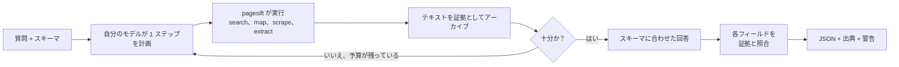
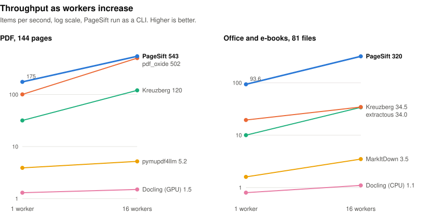
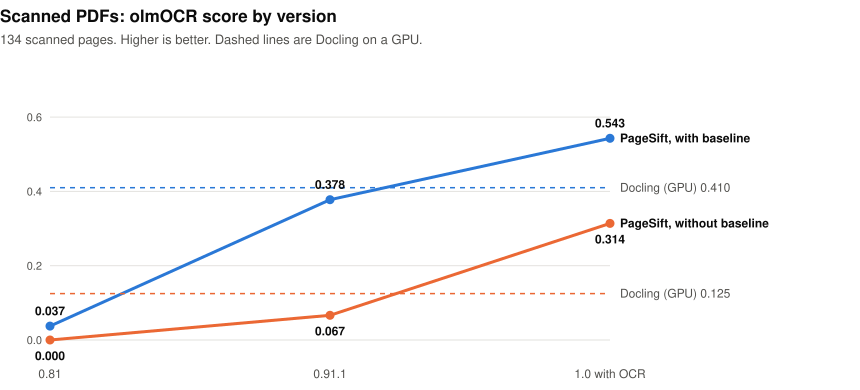
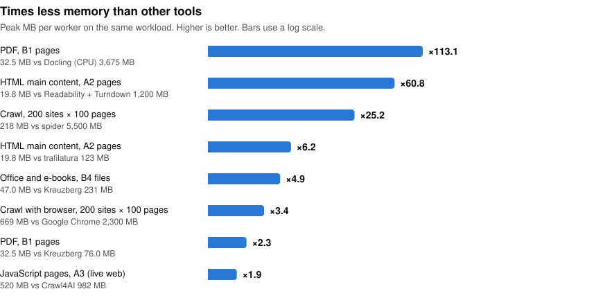
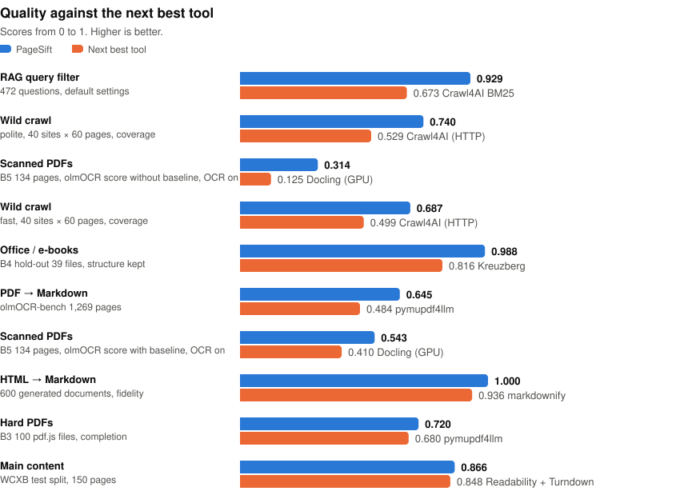
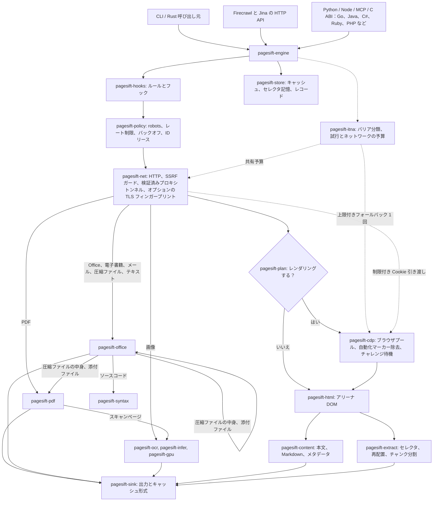
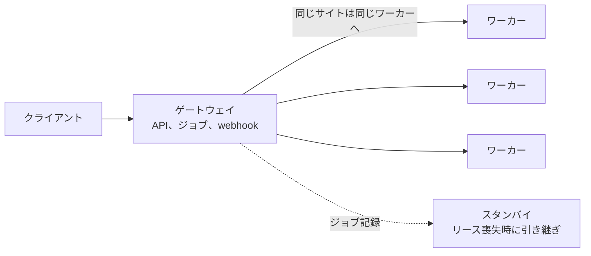

<div align="center">


# pagesift 1.2.2

**AI エージェントのための Web・文書レイヤー：URL、文書、メール、圧縮ファイル、ソースコードを入力すると、クリーンな Markdown または JSON を出力します。**  
セルフホストできる単一の Rust バイナリ：CLI、Firecrawl・Jina Reader API、MCP サーバー、Python・Node.js・Go・Java・C#・Ruby・PHP などのパッケージ。

**実測：** PDF から Markdown は 1 ページ 2.4 ms で次点の 20.49 倍高速、HTML から Markdown は 0.24 ms で 8.12 倍、本文抽出は 1.0 ms で 7.26 倍（低いほど良い）。Office は毎秒 91.7 ファイルで次点の 3.40 倍（高いほど良い）。

[](../LICENSE)
[](COMMERCIAL.md)
[](https://github.com/YOLOW92/pagesift/releases)
[](https://crates.io/crates/pagesift)
[](https://pypi.org/project/pagesift/)
[](https://www.npmjs.com/package/@pagesift/node)
[](https://glama.ai/mcp/servers/YOLOW92/pagesift)
[](https://discord.gg/esA3wMZVvA)

[English](../README.md) · [简体中文](README.zh-CN.md) · **日本語** · [Español](README.es.md)

</div>

<!-- readme-template: v2 -->
<!-- section: overview -->
## 概要

pagesift は、考えるソフトウェアのために Web と文書を読みます。URL を取得する（JavaScript のレンダリングは本文が増える場合だけ行います）か、
ローカルファイルを開き、内容を Markdown または構造化 JSON で返します。単一ページ、サイト全体、スキャン PDF、ブラウザ操作、
変更監視、自分のモデルで動かすリサーチ実行に対応します。

置き換え、または併用できるツール：**Firecrawl**（同じ v1/v2 API、セルフホスト）、**Jina Reader**（`/r/` と `/s/`）、
**Crawl4AI**、**trafilatura**、**Readability**、**pymupdf4llm**、**Docling**、**Kreuzberg**、**xberg**。

<!-- section: facts -->
## 早見表

- **入力：** URL、HTML、PDF（スキャンページの OCR を含む）、画像ファイル（OCR）、Word（.docx、.doc）、Excel（.xlsx、.xlsb、.xls）、PowerPoint（.pptx、.ppt）、OpenDocument、RTF、WordPerfect、HWP、EPUB、MOBI、FB2、メール（.eml、.mbox、.msg）、圧縮ファイル（zip、tar、gz、bz2、xz、7z）、SQLite、dBASE、CSV、Markdown などのテキスト形式、373 種類のソースコードと設定言語、WARC アーカイブ
- **出力：** Markdown、HTML、生 HTML、リンク、画像、メタデータ、スキーマに基づく JSON。結果が不完全な場合は警告
- **インターフェース：** CLI · Firecrawl v1/v2 HTTP API · Jina Reader · MCP（stdio または HTTP）· Python · Node.js / TypeScript · Rust crate · C ABI と Go、Java、Kotlin、C#、Ruby、PHP、Lua、Perl、Dart、Swift、Zig バインディング · LangChain、LlamaIndex
- **プラットフォーム：** Linux x86_64 / aarch64（glibc 2.28 以上と musl）、macOS arm64、Windows x86_64。Docker イメージ `ghcr.io/yolow92/pagesift`
- **ランタイム：** HTTP、PDF、Office にはインストール不要。オプション：JavaScript ページ用のブラウザ、OCR 用の NVIDIA GPU、`/v2/agent` 用の自分のモデル
- **メモリ：** ブラウザなしの 1.1 の各ベンチマークでワーカーあたりピーク 18–377 MB。数式モデルを使う OCR には約 1.7 GB が必要です。容量は cgroup の上限から決まります
- **ライセンス：** AGPL-3.0、または[商用ライセンス](COMMERCIAL.md)
- **最新版：** 1.2.1 · [リリースノート](releases/1.2.1.md)

<!-- section: install -->
## インストールと使い方

| | インストール | 最初の呼び出し |
|---|---|---|
| CLI | `cargo install pagesift --locked` | `pagesift scrape https://example.com` |
| Python | `pip install pagesift` | `pagesift.scrape("https://example.com").markdown` |
| Node.js | `npm install @pagesift/node` | `(await new Scraper().scrape("https://example.com")).markdown` |
| サーバー | `docker run -p 3002:3002 ghcr.io/yolow92/pagesift:1.2.1` | `curl localhost:3002/r/https://example.com` |
| MCP | — | `claude mcp add pagesift -- pagesift mcp` |

**CLI**

```bash
pagesift scrape https://example.com                          # Markdown を標準出力へ
pagesift scrape report.pdf                                   # ローカルの PDF、Office、電子書籍、メール、圧縮ファイル、画像、コード、WARC ファイル
pagesift --ocr scrape scan.pdf                               # スキャンページを OCR。モデルは初回使用時にダウンロード
pagesift crawl https://docs.rs --limit 500 --out ./data/     # 1 ページにつき 1 ファイル
pagesift crawl https://www.example.edu --query "graduate admission" --adaptive
pagesift extract --schema schema.json https://example.com    # CSS セレクタで JSON を抽出。ページが変わると修復
pagesift doctor                                              # ブラウザ、GPU、モデルをチェック
```

**Python**

```python
import pagesift

page = pagesift.scrape("https://example.com", formats=["markdown", "links"])
print(page.markdown, page.metadata["title"], page.links)

pages = pagesift.scrape_many(["https://example.com", "https://example.org"], concurrency=8)

scanner = pagesift.Scraper(ocr=True)     # 最初のスキャンページが届いた時点でモデルをダウンロード
print(scanner.parse(open("scan.pdf", "rb").read(), "scan.pdf").markdown)
```

**Node.js / TypeScript**

```typescript
import { Scraper } from '@pagesift/node'

const scraper = new Scraper()
const page = await scraper.scrape('https://example.com', { formats: ['markdown', 'links'] })
console.log(page.markdown, page.metadata.title, page.links)

const items = await scraper.scrapeMany(['https://example.com', 'https://example.org'], { concurrency: 4 })
```

**HTTP サーバー**

```bash
docker run -d -p 3002:3002 -v pagesift-data:/data -e PAGESIFT_API_KEYS=sk-test ghcr.io/yolow92/pagesift:1.2.1

curl -s localhost:3002/v2/scrape -H 'Authorization: Bearer sk-test' -H 'Content-Type: application/json' \
  -d '{"url":"https://example.com","formats":["markdown"]}'                        # Firecrawl API
curl -s localhost:3002/r/https://example.com -H 'Authorization: Bearer sk-test'    # Jina Reader
curl -s localhost:3002/v2/parse -H 'Authorization: Bearer sk-test' \
  -F file=@report.pdf -F 'options={"formats":["markdown"]}'                        # ファイルをアップロード
```

Firecrawl SDK は API URL を変更するだけで動作します。[アップロード API](parse-api.md) · [Jina ヘッダー](jina-reader.md)

**MCP**

```bash
pagesift mcp                                                  # stdio、1 つのエージェント用
pagesift mcp http --port 3003                                 # 共有のローカルサービス 1 つ
claude mcp add --scope user --transport http pagesift http://127.0.0.1:3003/mcp
```

ツール：`pagesift_scrape`、`pagesift_batch_scrape`、`pagesift_crawl`、`pagesift_poll_job`、`pagesift_cancel_job`、
`pagesift_map`、`pagesift_interact`、`pagesift_interact_stop`。モデルを設定すると `pagesift_agent`、`pagesift_agent_status` も使えます。
[共有 MCP サービス](mcp-service.md)

<!-- section: capabilities -->
## できること

| 機能 | 得られるもの | ドキュメント |
|---|---|---|
| **クリーンな本文** | 本文検出と、見出し・リスト・表・コード・数式を保った Markdown | [ベンチマーク](benchmarks.md) |
| **文書** | PDF、新旧 Office、OpenDocument、電子書籍、メール、圧縮ファイル、画像、データベース、テキスト形式の自前 Rust リーダー。破損ファイルや CJK フォントにも対応 | [アップロード API](parse-api.md) |
| **OCR** | スキャン PDF ページは PP-OCRv6、ディスプレイ数式は PP-FormulaNet で処理。純粋な Rust で CPU または NVIDIA GPU 上で動作 | [アップロード API](parse-api.md) |
| **構造化抽出** | サイトが変わると再配置される CSS セレクタ、または自分のモデルが一度だけ書いて pagesift がキャッシュするスキーマによる JSON | [抽出](structured-extract.md) |
| **ブラウザ操作** | ページ上のクリック、入力、スクロール。作業を続けられるセッションも利用可能 | [ブラウザ操作](interact.md) |
| **エージェント** | `POST /v2/agent` は自分のモデルを使って Web から質問に答え、各フィールドを取得元のページと照合します | [エージェント API](agent-api.md) |
| **監視** | 実際の変更を日付・カウンター・広告と区別する定期チェック。webhook に対応 | [監視](monitor.md) |
| **クロール** | サイトマップ、ページが役に立たなくなった時点で止まるクエリによるフォーカスクロール、トラップ処理、robots.txt、ホストごとの制限 | [ベンチマーク](benchmarks.md) |
| **アーカイブ** | すべてのクロールで WARC を出力し、WARC ファイルをネットワークなしで入力として読み込み | [リリースノート](releases/1.0.0.md) |
| **運用** | 複数サーバーのゲートウェイ、ワーカー、スタンバイ。ジョブ永続化、永続的な webhook、メトリクス、監査ログ | [アーキテクチャ](architecture.md) |
| **安全性** | プライベートネットワークと DNS リバインディングの防御。不完全な結果はすべて警告を報告 | [ボットポリシー](bot.md) |

**`/v2/agent` が質問に答える流れ**



robots.txt、レート制限、ネットワークガードはすべてのページに適用されます。モデルが選ぶのは URL とクエリで、取得オプションは選びません。

<!-- section: performance -->
## パフォーマンス

<!-- perf-glance -->
<picture><source media="(prefers-color-scheme: dark)" srcset="assets/perf-scaling-dark.svg"></picture>

<picture><source media="(prefers-color-scheme: dark)" srcset="assets/perf-versions-dark.svg"></picture>

<picture><source media="(prefers-color-scheme: dark)" srcset="assets/perf-memory-dark.svg"></picture>

<picture><source media="(prefers-color-scheme: dark)" srcset="assets/perf-quality-dark.svg"></picture>

↑ 高いほど良い · ↓ 低いほど良い。分野ごとに最も強い 1 項目。方法と出典は完全なレポートに。

| タスク | 指標 | PageSift | 最良の他ツール | 差 |
|---|---|---:|---|---:|
| PDF → Markdown — olmOCR-bench 1,269 pages, per page (single thread) | ms/page ↓ | **2.4** | pypdf 50.0 | **×20.49** |
| PDF → Markdown — B1 144 pages, 1 worker, resident server | files/s ↑ | **176.5** | pdf_oxide 100.6 | **×1.75** |
| PDF → Markdown — olmOCR-bench 1,269 pages | official score ↑ | **0.645** | pymupdf4llm 0.484 | **+0.161** |
| HTML → Markdown — 600 generated documents, per page | ms/page ↓ | **0.24** | Turndown 1.9 | **×8.12** |
| HTML → Markdown — 600 generated documents, fidelity | mean F1 ↑ | **1.000** | markdownify 0.936 | **+0.064** |
| Main content — Firecrawl 597 pages, single thread | p50 ms/page ↓ | **1.0** | crw 7.4 | **×7.26** |
| Main content — WCXB test split, 150 pages | F1 ↑ | **0.866** | Readability + Turndown 0.848 | **+0.018** |
| Publication dates — htmldate 1,000 pages, date search | ms/page ↓ | **0.31** | htmldate (fast) 2.0 | **×6.45** |
| RAG chunking — 5 corpora, 1.4 MB | total ms ↓ | **7** | chonkie recursive 35 | **×5.01** |
| Office / e-books — B4 81 files, in-process | files/s ↑ | **91.7** | xberg 27.0 | **×3.40** |
| Office / e-books — B4 hold-out 39 files, structure kept | structure kept ↑ | **0.988** | xberg 0.878 | **+0.110** |
| RAG query filter — 472 questions, default settings | answer recall ↑ | **0.929** | Crawl4AI BM25 0.673 | **+0.256** |
| Wild crawl — polite, 40 sites × 60 pages, coverage | coverage ↑ | **0.740** | Crawl4AI (HTTP) 0.529 | **+0.211** |
| Wild crawl — fast, 40 sites × 60 pages, coverage | coverage ↑ | **0.687** | Crawl4AI (HTTP) 0.499 | **+0.188** |
| Scanned PDFs — B5 134 pages, olmOCR score without baseline, OCR on | olmOCR score ↑ | **0.314** | Docling (GPU) 0.125 | **+0.189** |
| Scanned PDFs — B5 134 pages, olmOCR score with baseline, OCR on | olmOCR score ↑ | **0.543** | Docling (GPU) 0.410 | **+0.133** |
| Hard PDFs — B3 100 pdf.js files, completion | completion ↑ | **0.720** | pymupdf4llm 0.680 | **+0.040** |

| ワーカーあたりのピークメモリ | PageSift MB ↓ | 他ツール MB | メモリ削減 |
|---|---:|---|---:|
| PDF, B1 pages | **32** | Docling (CPU) 3,675 (2026-10-28) | **×113.1** |
| HTML main content, A2 pages | **20** | Readability + Turndown 1,200 (2026-10-28) | **×60.8** |
| Crawl, 200 sites × 100 pages | **218** | spider 5,500 (2026-10-21) | **×25.2** |
| HTML main content, A2 pages | **20** | trafilatura 123 (2026-10-28) | **×6.2** |
| Office and e-books, B4 files | **47** | Kreuzberg 231 (2026-10-28) | **×4.9** |
| Crawl with browser, 200 sites × 100 pages | **669** | Google Chrome 2,300 (2026-10-21) | **×3.4** |
| PDF, B1 pages | **32** | Kreuzberg 76 (2026-10-28) | **×2.3** |
| JavaScript pages, A3 (live web) | **520** | Crawl4AI 982 (2026-10-28) | **×1.9** |

**PageSift 1.1 と xberg 1.3.9。** xberg は 2026-11-04 に測定。範囲は 2 回の結果。太字は行内で最良の値。

| 指標 | PageSift CLI | PageSift サーバー | xberg | xberg レイアウトモード |
|---|---:|---:|---:|---:|
| PDF B1、olmOCR スコア 1,269 ページ ↑ | **0.645** | — | 0.436 | 0.472 |
| Office B4、構造保持率、ホールドアウト 39 件 ↑ | **0.988** | — | 0.878 | — |
| PDF B1、1 ワーカー、件/秒 ↑ | 161.4 | **176.5** | 29.5–29.9 | 1.35 |
| PDF B1、16 ワーカー、件/秒 ↑ | **539.3** | 305.1 | 65.8–68.4 | 1.41 |
| Office B4、1 ワーカー、件/秒 ↑ | **91.7** | 69.1 | 27.0 | — |
| Office B4、16 ワーカー、件/秒 ↑ | **314.0** | 147.0 | 73.4–74.2 | — |
| PDF B1、1 ワーカー、ピーク MB ↓ | **32** | 211 | 147–172 | 1118 |
| Office B4、1 ワーカー、ピーク MB ↓ | **47** | 252 | 112 | — |
| Office B4、1 ワーカー、1 件の中央値 ms ↓ | 4.5 | **2.2** | 3.2–3.3 | — |


<details>
<summary>まだ後れている項目</summary>

fast, 40 sites × 60 pages, time (spider covered about half as many pages) 16.1 seconds vs spider 1.4 seconds; A2 replay, 269 pages, HTTP only, no rate limit, 1 worker 47.5 pages/s vs spider 156.6 pages/s; A2 269 random pages, resident worker, per page 4.5 ms/page vs Resiliparse 2.1 ms/page.

</details>

[完全なレポート](../benchmarks/history/1.1/results/final/new/report.md)

<!-- /perf-glance -->

<!-- section: architecture -->
## アーキテクチャ

コアはファイル形式のレベルから Rust で書かれており、制限は手動で設定せず実行時に測定します。



アクセスバリア回復は任意です（`[itna] enabled`、既定は無効）。`pagesift-itna` がバリアを分類し、
上限付きのブラウザフォールバックを最大 1 回許可し、リダイレクトとブラウザのサブリクエストで
1 つのネットワーク予算を共有します。セッションは owner、origin、出口、フィンガープリントごとにリースされ、
HTTP Cookie は完全一致の origin に対する制限付き引き渡しでのみブラウザに渡ります。
対話型 CAPTCHA は人間による対応が必要として報告され、解決は行いません。

**形式まで自前のコード。** パースはプロセス内で実行され、背後に Python、JVM、Node のランタイムはありません。
pagesift は独自のゼロコピー HTML5 パーサー、JPEG・CCITT・JBIG2 デコーダーを備えた PDF ファイル層、Office・電子書籍・メール・圧縮ファイルのリーダー、
Rust からコンパイルした GPU カーネルによるニューラルネットワーク推論、Chrome DevTools クライアント、MCP サーバー、追記専用ストアを備えています。
ワーカーのコストは読み込み済みのインタープリタではなく数十メガバイトで、起動はミリ秒単位です。

**コアごとに 1 ワーカー。** CPU 処理は NUMA ノードごとにまとめた常駐ワーカーで実行し、ワーカーはまず自分のノード内でワークスティールを行います。
単一のアドミッション経路が CPU、メモリ、ブラウザタブをカバーし、容量は cgroup の上限から決まるため、
コンテナは強制終了されることなくメモリ内に収まります。

**固定値ではなく測定。** 並行数は Universal Scalability Law のフィットに従い、ホストごとの制限はレイテンシ勾配に従い、
ステージのタイムアウトは生存時間分析を、再試行はクラスごとの成功率を使います。いずれも安全な既定値から始まり、
統計的に有意な証拠（δ = 0.05）があるときだけ変わります。ユーザー設定と安全上の制限はハードリミットのままです。

**ブラウザは割に合うときだけ。** pagesift は URL パスのファミリーごとに、レンダリングで本文が増えたかどうかを学習し、
レンダリング結果はスコアが高い場合だけ採用します。`__NEXT_DATA__` や JSON-LD などのページデータはブラウザなしで読み取ります。
Lightpanda、moli、Chrome がフォールバックチェーンを構成し、`--explain` はすべての判断を記録します。

**正直な結果。** 部分的なページ、切り詰められたファイル、スキップしたスキャンは、完全に見せかけず警告コードを返します。
エージェントの回答は証拠の中で見つかった値を報告し、セレクタの修復は新旧のセレクタを報告します。

**1 つのバイナリからフリートへ。** `serve --role gateway`、`worker`、`standby` は同じバイナリを共有し、
ランデブーハッシュによるサイトアフィニティとフェンシング付きリースを使います。ジョブと webhook は再起動後に再開します。



[アーキテクチャ全体](architecture.md)

<!-- section: choose -->
## 向いている場面、向いていない場面

**向いている場面**

- Web ページや文書を LLM、RAG インデックス、エージェントに渡す
- Firecrawl や Jina Reader 形式のサービスをセルフホストする。ページ単位の料金はかかりません
- 混在した入力：同じ呼び出しで HTML、PDF、スキャン、Office ファイル、電子書籍を扱えます
- 小さなマシンやコンテナ：メモリは cgroup の上限で制限されます

**別のツールを選ぶべき場合**

- **入力が画像ファイル。** OCR の対象は PDF 内のスキャンページで、単独の画像は対象外です。
- **AGPL が使えず**、商用ライセンスも選択肢にない場合。
- **マネージドのクラウドサービスが必要。** pagesift はセルフホストです。

<!-- section: license -->
## ライセンス

[AGPL-3.0](../LICENSE)。AGPL の義務なしでのプロプライエタリなリンクや非公開デプロイについては、
[商用ライセンス](COMMERCIAL.md)を確認するか、`licensing@pagesift.dev` までご連絡ください。

<!-- section: changelog -->
## 1.2.2 の新機能

crawl、batch、extract のジョブは作成したアカウントのみが利用できます。search と extract のページ取得は日次クォータに計上され、キャッシュも robots.txt を確認します。未対応のスナップショットと base64 画像のオプションはエラーになります。

[リリースノート](releases/1.2.2.md) · [1.2.1](releases/1.2.1.md) · [すべてのリリース](releases/) · [CHANGELOG](../CHANGELOG.md)

---

## コミュニティ

ご質問やフィードバック：[Discord](https://discord.gg/esA3wMZVvA) · [Issues](https://github.com/YOLOW92/pagesift/issues) · [Discussions](https://github.com/YOLOW92/pagesift/discussions)

## 引用

```bibtex
@software{pagesift2026,
  title  = {PageSift: Rust Web and Document Extraction Engine for AI Pipelines},
  author = {YOLOW92},
  year   = {2026},
  url    = {https://github.com/YOLOW92/pagesift},
  note   = {Version 1.2.1}
}
```

## Star History

[](https://star-history.com/#YOLOW92/pagesift&Date)
