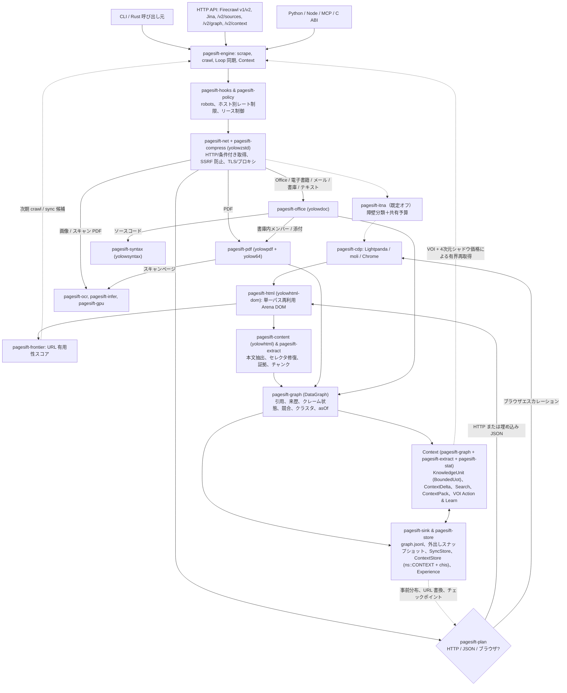
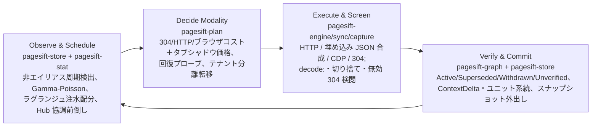
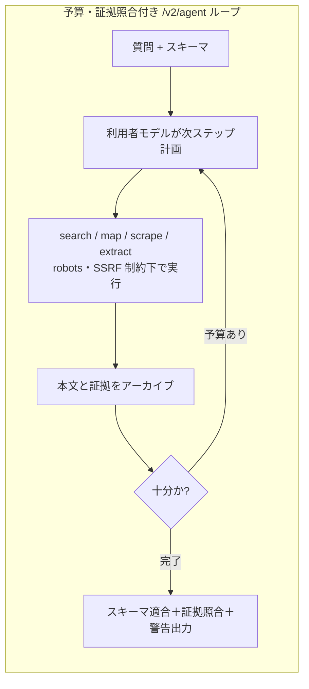
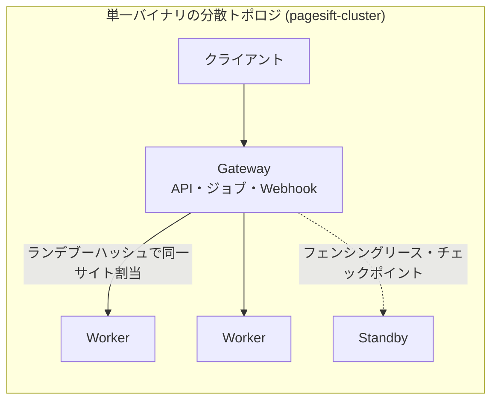

<div align="center">


# pagesift 1.6.2

**ローカルファーストな Rust 製 Web・文書取り込みエンジン — HTTP/ブラウザ収集、レイアウト認識 PDF/Office/OCR 解析、継続的同期、検証可能な DataGraph、証拠に基づく AI コンテキスト編成を単一バイナリに統合。**  
セルフホストできる単一の Rust バイナリとして CLI、Firecrawl v1/v2・Jina Reader HTTP API、MCP サーバー、C ABI、Python / Node.js パッケージを提供します。

[](../LICENSE)
[](COMMERCIAL.md)
[](https://github.com/YOLOW92/pagesift/releases)
[](https://crates.io/crates/pagesift)
[](https://pypi.org/project/pagesift/)
[](https://www.npmjs.com/package/@pagesift/node)
[](https://glama.ai/mcp/servers/YOLOW92/pagesift)
[](https://discord.gg/esA3wMZVvA)

[English](../README.md) · [简体中文](README.zh-CN.md) · **日本語** · [Español](README.es.md)

</div>

<!-- readme-template: v2 -->
<!-- section: overview -->
## 概要

`pagesift` は、ライブ Web ページ、ローカル文書ファイル、アーカイブ、長期監視対象ソースを、メモリ上限付きの単一 Rust プロセス内でクリーンな Markdown、スキーマ検証済み JSON、来歴追跡付きの `DataGraph` 関係データ、およびトークン予算・証拠制約付きの `ContextPack` へ変換します。HTTP 収集、ネイティブ文書パーサ、HTML 抽出、適応的同期状態管理、増分コンテキスト索引、証拠ストレージは Python・JVM・Node ワーカーに依存せず同一プロセスで動作し、ヘッドレスブラウザプールや NVIDIA GPU OCR、利用者所有の LLM エンドポイントは必要時のみ組み込まれます。

置き換えまたは併用できるツール：**Firecrawl**（セルフホスト v1/v2 API）、**Jina Reader**（`/r/` と `/s/`）、**Crawl4AI**、**trafilatura**、**Readability**、**pymupdf4llm**、**Docling**、**Kreuzberg**、**xberg**。

<!-- section: facts -->
## 早見表

- **階層構成：** エントリ層（`CLI`/`HTTP`/`MCP`/FFI）→ ポリシー・SSRF 保護付きネット層 → 適応取得（`HTTP`/埋め込み JSON/ブラウザ）→ ネイティブ形式パーサ＆抽出 → `DataGraph`・`Context`・追記型ストア → cgroup ベースの NUMA ワーカープール（`pagesift-flow`）
- **入力：** URL、HTML、PDF（テキスト層＋オプション PP-OCRv6 / 数式認識）、アップロード画像（OCR 有効時）、Office・OpenDocument、RTF/WordPerfect/HWP、電子書籍、メール、書庫（`zip`、`tar`、`7z`）、SQLite/CSV、373 種類のソースコード言語、WARC アーカイブ（[形式一覧](parse-api.md)）
- **出力：** Markdown、HTML、生 HTML、リンク、画像・添付データ、RAG チャンク、スキーマ JSON、`DataGraph`（`graph.jsonl`、引用、クレーム状態、競合、`fact_clusters`、`?asOf=`）、`ContextPack`（`KnowledgeUnit`、`ContextDelta`、`provenanceManifest`）、不完全取得時の構造化警告
- **インターフェース：** CLI · Firecrawl v1/v2 HTTP API · Jina Reader（`/r/`、`/s/`）· MCP（stdio / HTTP）· Python · Node.js / TypeScript · Rust crate · C ABI（Go、Java、Kotlin、C#、Ruby、PHP、Lua、Perl、Dart、Swift、Zig）· LangChain / LlamaIndex
- **プラットフォーム：** 単一バイナリ（`serve --role gateway`、`worker`、`standby`）、Linux x86_64/aarch64（glibc ≥ 2.28 / musl）、macOS arm64、Windows x86_64、Docker `ghcr.io/yolow92/pagesift:1.6.2`
- **インデックスと版：** 機械可読インデックス [llms.txt](../llms.txt) · Apache-2.0 または[商用サポート](COMMERCIAL.md) · **1.6.2**（[リリースノート](releases/1.6.2.md)）

<!-- section: install -->
## インストールと使い方

| 入口 | インストール | 最初の呼び出し |
|---|---|---|
| CLI | `cargo install pagesift --locked` | `pagesift scrape https://example.com` |
| Python | `pip install pagesift` | `pagesift.scrape("https://example.com").markdown` |
| Node.js | `npm install @pagesift/node` | `(await new Scraper().scrape("https://example.com")).markdown` |
| サーバー | `docker run -p 3002:3002 ghcr.io/yolow92/pagesift:1.6.2` | `curl localhost:3002/r/https://example.com` |
| MCP | — | `claude mcp add pagesift -- pagesift mcp` |

<details>
<summary>クイックスタート例：CLI、Python、Node.js、HTTP API、MCP</summary>

**CLI**

```bash
pagesift scrape https://example.com                          # クリーンな Markdown を標準出力へ
pagesift scrape --graph https://example.com                  # Markdown + DataGraph 来歴・クレーム出力
pagesift scrape report.pdf                                   # ローカル PDF、Office、電子書籍、メール、書庫、コード、WARC
pagesift --ocr scrape scan.pdf                               # スキャン PDF やアップロード画像に OCR を実行
pagesift crawl https://docs.rs --limit 500 --out ./data/     # サイト全体を取得保存（--graph で graph.jsonl 生成）
pagesift graph inspect ./data/graph.jsonl                    # 引用、系統、クレーム、競合を確認
pagesift sync init --id docs --seed https://example.com      # 永続 Loop ソースを初期化・同期
pagesift context pack --file report.pdf "rate limits"        # 来歴マニフェスト付き ContextPack を予算内で編成
pagesift extract --schema schema.json https://example.com    # セレクタ自動修復付きスキーマ JSON 抽出
pagesift doctor                                              # ローカルのブラウザ・GPU・モデル状態を確認
```

**Python・Node.js**

```python
import pagesift

page = pagesift.scrape("https://example.com", formats=["markdown", "links"])
print(page.markdown, page.metadata["title"], page.links)

with pagesift.Scraper(store_path="./data/store") as s:
    pack = s.context(action="pack", source_ids=["docs"], query="rate limits", budget_tokens=1024)
    print(pack["pack"]["compiledContext"])
```

```typescript
import { Scraper } from '@pagesift/node'

const scraper = new Scraper({ storePath: './data/store' })
const page = await scraper.scrape('https://example.com', { formats: ['markdown', 'links'] })
const pack = await scraper.context({ action: 'pack', sourceIds: ['docs'], query: 'rate limits', budgetTokens: 1024 })
console.log(page.markdown, pack.pack)
```

**HTTP サーバー（`Firecrawl v1/v2`、`Jina Reader`、`/v2/sources`、`/v2/graph`、`/v2/context`）・MCP**

```bash
docker run -d -p 3002:3002 -v pagesift-data:/data -e PAGESIFT_API_KEYS=sk-test ghcr.io/yolow92/pagesift:1.6.2

curl -s localhost:3002/v2/scrape -H 'Authorization: Bearer sk-test' -H 'Content-Type: application/json' \
  -d '{"url":"https://example.com","formats":["markdown"]}'
curl -s localhost:3002/r/https://example.com -H 'Authorization: Bearer sk-test'
curl -s localhost:3002/v2/parse -H 'Authorization: Bearer sk-test' -F file=@report.pdf -F 'options={"formats":["markdown"]}'
curl -s localhost:3002/v2/context/pack -H 'Authorization: Bearer sk-test' -H 'Content-Type: application/json' \
  -d '{"sourceIds":["docs"],"query":"rate limits","budgetTokens":1024}'

pagesift mcp                                                 # 単一エージェント向け stdio モード
pagesift mcp http --port 3003                                # ローカル共有 HTTP MCP デーモン
```

</details>

MCP ツール：`pagesift_scrape`、`pagesift_batch_scrape`、`pagesift_crawl`、`pagesift_poll_job`、`pagesift_cancel_job`、`pagesift_map`、`pagesift_interact`、`pagesift_interact_stop`、`pagesift_sync`、`pagesift_graph_query`、`pagesift_context`、およびモデル設定時の `pagesift_agent` と `pagesift_agent_status`。詳細は[共有 MCP サービス](mcp-service.md)および [Context リファレンス](context.md)を参照してください。

<!-- section: capabilities -->
## できること

アーキテクチャの責務ごとに現在実装済みの機能とリファレンスを整理しています：

| レイヤー | 実装済み機能 | ドキュメント |
|---|---|---|
| **インターフェース互換** | セルフホスト CLI、Firecrawl v1/v2 HTTP API（`/v2/scrape`、`/v2/crawl`、`/v2/parse`、`/v2/monitor`、`/v2/sources`、`/v2/graph`、`/v2/context`、`/v2/agent`、`/interact`）、Jina Reader（`/r/`、`/s/`）、MCP（stdio/HTTP）、Python、Node.js/TS、Rust ライブラリ、C ABI バインディング | [parse-api.md](parse-api.md) · [context.md](context.md) · [mcp-service.md](mcp-service.md) |
| **収集と安全性** | 条件付き HTTP（`ETag`/`Last-Modified`）、SSRF / DNS リバインディング保護、`robots.txt` とホスト単位レート制限、アイデンティティリース、埋め込み JSON 合成（`__NEXT_DATA__`/`__NUXT_DATA__`/JSON-LD）、任意 CDP ブラウザプール（`Lightpanda`/`moli`/Chrome）と `/interact` セッション、オプトイン `[itna]` アクセス障壁回復 | [interact.md](interact.md) · [http-sessions.md](http-sessions.md) · [bot.md](bot.md) |
| **ネイティブ解析と OCR** | コンテナ／フォーマット層からの純 Rust パーサ（`yolowhtml`、`yolowpdf`、`yolowdoc`、`yolowsyntax`、`yolowzstd`、`yolow64`）により Web、Office/ODF、電子書籍、メール、多段圧縮書庫、SQLite/CSV、373 言語コード（32 以上の言語で関数・クラス単位分割）、WARC、PP-OCRv6 / PP-FormulaNet（CPU/GPU）に対応 | [parse-api.md](parse-api.md) |
| **抽出とエージェント** | 見出し・表（`<caption>`・`hidden="until-found"`）・数式・コードを保持する本文 Markdown、RAG `queryFilter` とチャンク分割、DOM 変化に追従するセレクタ記憶抽出、アーカイブ済み証拠と各フィールドを突き合わせる `/v2/agent` | [structured-extract.md](structured-extract.md) · [agent-api.md](agent-api.md) |
| **継続同期 Loop と監視** | 永続 `pagesift sync` / `/v2/sources` ソース（非エイリアス周期検出、階層 Gamma-Poisson 縮小とラグランジュ注水予算配分、Hub 協調前倒し、モダリティ別コスト・タブシャドウプライシング、`DirectBrowser` 回復プローブ、ベイズ予測サプライズ忘却、テナント分離転移と信頼性検閲）、および `/v2/monitor` 実質ブロック差分と Webhook | [monitor.md](monitor.md) · [incremental-collection.md](incremental-collection.md) |
| **DataGraph と来歴** | ページ横断・ソース横断の証拠グラフ（`graph.jsonl`、`graph_summary.json`、`/v2/graph/claims`、`/history`、`/conflicts`、`?asOf=`）：永続化された引用エッジ、リダイレクト／正規URL／添付来歴、文脈通貨判別、`OriginRelation` 独立ソース根と `fact_clusters`、クレーム状態管理（`Active`、`Superseded`、`Withdrawn`、`Unverified`、`EvidenceDegraded`） | [architecture.md](architecture.md) |
| **Context とプロンプト編成** | 版横断で安定した `KnowledgeUnit` ID・曖昧性追跡（`boundedUot`/`greedyDice`/`exactAnchorOnly`）、依存スタンプ駆動のアトミック `ContextDelta` と冪等チェックポイント、語彙・記号・二時間軸（`asOf`+`effectiveAt`）・系統 `Search`、予算と `MustKeep` を守る `ContextPack`（`submodularClosure`/`boundedDpp`/`edgeSalience`）＋`provenanceManifest`、VOI・シャドウ価格に基づく `Action` とドリフト防護 `Learn` | [context.md](context.md) |

<!-- section: performance -->
## パフォーマンス概要

トップページでは設計とデータフローを中心に示すため、計測条件・マシン構成・競合ツールとの比較表は [benchmarks.md](benchmarks.md) にまとめています：

- **レイテンシ（記録ベンチマーク・単一ワーカー・低いほど良い）：** PDF → Markdown `2.5–2.58 ms/ページ`（1,269 ページ）、HTML → Markdown `0.23–0.24 ms/ページ`（600 文書）、本文抽出 `1.0 ms/ページ`（597 ページ）、Context `BoundedUot` 照合 `63.9 µs`・`ContextPack` 編成 `67–225 µs`（`192`/`384` トークン予算）。
- **スループット・品質・メモリ（記録ベンチマーク）：** Office インプロセス処理 `81.9–210.0 ファイル/s`（高いほど良い）、HTML → Markdown 平均 F1 `1.000`、WCXB F1 `0.866`、RAG クエリ再現率 `0.929`（高いほど良い）、Context `Search + Pack` `1–16` スレッドで `2,708.8–24,434.4 QPS`（RSS `25.9–28.8 MiB`、QPS は高いほど・RSS は低いほど良い）、ブラウザ未使用時の各計測ピークメモリ `17–395 MB/ワーカー`。
- **詳細スコアと評価記録：** [benchmarks.md](benchmarks.md) · [完全ベンチマークレポート](../benchmarks/history/1.4/results/final/new/report.md) · [最新 Context・Loop リリース評価](releases/1.6.0.md)

<!-- section: architecture -->
## アーキテクチャと主要フロー

コア全体がコンパイル済み単一 Rust バイナリとして動作し、パース・ストレージ・スケジューリングの背後に外部ランタイムを必要としません。CPU ワーカー、メモリ、ブラウザタブは cgroup 上限を考慮した共通アドミッション制御を通り、内部パラメータはオンライン統計検定（`δ = 0.05`）を満たした場合のみ適応します。

### リクエスト・取り込みパイプライン



### 継続同期 Loop の閉ループ（`Observe → Learn → Decide → Execute → Verify`）

`pagesift sync` や `/v2/sources` で登録された持続的データソースは各ティックで閉ループを実行し、不確実な観測時にも検証済みの既存クレームを保護しつつ、有効化時は `ContextStore` を増分更新します：



### 証拠検証 `/v2/agent` とマルチサーバー構成





### ワークスペース Crate マップ

| レイヤー | クレート一覧 |
|---|---|
| **エントリ層と FFI** | `pagesift`（CLI・ライブラリ）、`pagesift-api`（HTTP サーバー・スキーマ）、`pagesift-mcp`（MCP stdio/HTTP）、`pagesift-py`、`pagesift-node`、`pagesift-ffi`（C ABI） |
| **オーケストレーション・戦略・グラフ** | `pagesift-engine`、`pagesift-plan`、`pagesift-hooks`、`pagesift-llm`、`pagesift-search`、`pagesift-graph` |
| **ネットワーク・ポリシー・ブラウザ** | `pagesift-net`、`pagesift-policy`、`pagesift-rustls`、`pagesift-cdp`、`pagesift-media`、`pagesift-itna` |
| **Web 構造抽出とフロンティア** | `pagesift-html`（`yolowhtml-dom`）、`pagesift-content`（`yolowhtml`）、`pagesift-extract`、`pagesift-diff`、`pagesift-frontier` |
| **ネイティブ文書・OCR パーサ** | `pagesift-pdf`（`yolowpdf`）、`pagesift-office`（`yolowdoc`）、`pagesift-syntax`（`yolowsyntax`）、`pagesift-ocr`、`pagesift-infer`、`pagesift-gpu` |
| **ランタイム・オンライン統計・永続化** | `pagesift-flow`（NUMA ワーカー・cgroup 制御）、`pagesift-stat`、`pagesift-base64`（`yolow64`）、`pagesift-compress`（`yolowzstd`）、`pagesift-sys`、`pagesift-store`、`pagesift-sink`、`pagesift-cluster` |

cgroup による容量計算、統計的調整基準（`δ = 0.05` の USL・生存時間・トンプソン抽出）、増分デリバリーのチェックポイント、バイト範囲メディアアーカイブ検証の詳細は[アーキテクチャ仕様](architecture.md)を参照してください。

<!-- section: choose -->
## 向いている場面、向いていない場面

**向いている場面**

- Web ページ、PDF、Office 文書、アーカイブ、ソースコードを外部ワーカープロセスなしで LLM・RAG・エージェント基盤へ供給したい
- 表見出し、否定・限定条件、単位、有効期間、ソース間競合と引用マニフェストを保持した `ContextPack` をトークン予算内で編成したい
- Firecrawl / Jina Reader 互換 API や共有 MCP サーバーをページ課金なしでセルフホストしたい
- 変更監視や継続同期において、コスト認識型のブラウザ切替、来歴管理、クレーム単位の競合検出が必要

**別のツールを選ぶべき場合**

- **マネージドクラウドサービスが欲しい場合：** `pagesift` はセルフホスト専用です。
- **対話型 CAPTCHA の自動突破が必要な場合：** アクセス障壁は分類され、人間による解決待ちとして報告されます（`[itna]` は任意設定であり CAPTCHA 回避を行いません）。
- **OCR なしで画像ファイルを扱いたい場合：** ローカル／アップロード画像は `--ocr`（`[ocr] enabled = true`）が必要で、画像 URL や OCR オフ時の画像アップロードは `UNSUPPORTED_OPTION` を返します。

<!-- section: license -->
## ライセンス

[Apache-2.0](../LICENSE)。エンタープライズサポート、カスタム SLA、専用導入支援については[商用ライセンス・サポート](COMMERCIAL.md)または `licensing@pagesift.dev` をご確認ください。

<!-- section: changelog -->
## 1.6.2 の新機能

PageSift 1.6.2 は `1.6.x` 系列の旧テナント永続データ互換・非同期クォータ精算キャンセル安全性・Rust `KeyLimits` ビルダー・監視 `/run` 並列制御の強化リリースです：ルータ起動時に既存 `Store`（`Store::existing_tenants`）とクラスタ台帳（`Ledger::has_account_usage`）を検査し、`1.6.0` の無名キー（FNV-1a `key-<16hex>`）と一意な `name` キーが既存の `Context`・`DataGraph`・`Loop` ソース・監視・ジョブ・日次クォータへそのままアクセスできるよう自動継続しつつ、重複 `name` キーは SHA-256 指紋で厳格に分離し運用警告を出力します。`PageHold::commit()` で `.await` 前にメモリ上の `held -> settled` 遷移を同期完了し独立タスクで直列永続化することでキャンセルによるクォータ滞留窓を解消し、Rust 向けに `KeyLimits::new().with_*()` ビルダーと `KeyLimits.account` 互換境界の明示を追加、さらに監視 ID 単位の排他実行によりバックグラウンド定期検査と `POST /v2/monitor/{id}/run` の競合による空チェック発生を解消しました。

[リリースノート](releases/1.6.2.md) · [1.6.1](releases/1.6.1.md) · [1.6.0](releases/1.6.0.md) · [1.5.6](releases/1.5.6.md) · [1.5.5](releases/1.5.5.md) · [1.5.4](releases/1.5.4.md) · [1.5.3](releases/1.5.3.md) · [すべてのリリース](releases/) · [CHANGELOG](CHANGELOG.md)

---

## コミュニティ

ご質問やフィードバック：[Discord](https://discord.gg/esA3wMZVvA) · [Issues](https://github.com/YOLOW92/pagesift/issues) · [Discussions](https://github.com/YOLOW92/pagesift/discussions)

## 引用

```bibtex
@software{pagesift2026,
  title  = {PageSift: Rust Web and Document Extraction Engine for AI Pipelines},
  author = {YOLOW92},
  year   = {2026},
  url    = {https://github.com/YOLOW92/pagesift},
  note   = {Version 1.6.2}
}
```

## Star History

[](https://star-history.com/#YOLOW92/pagesift&Date)
