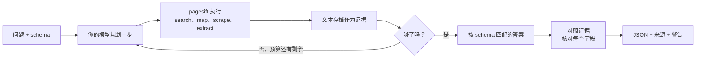
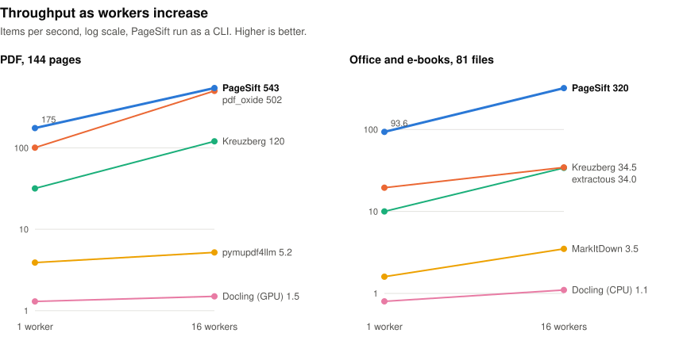
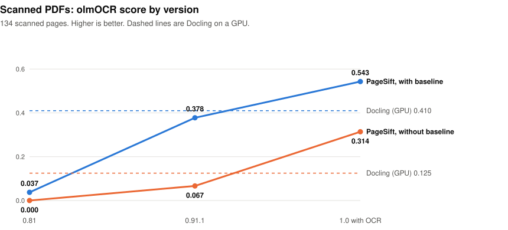
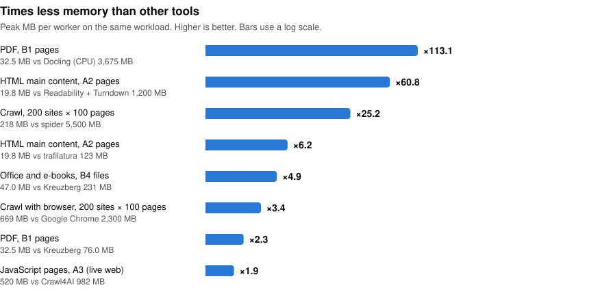
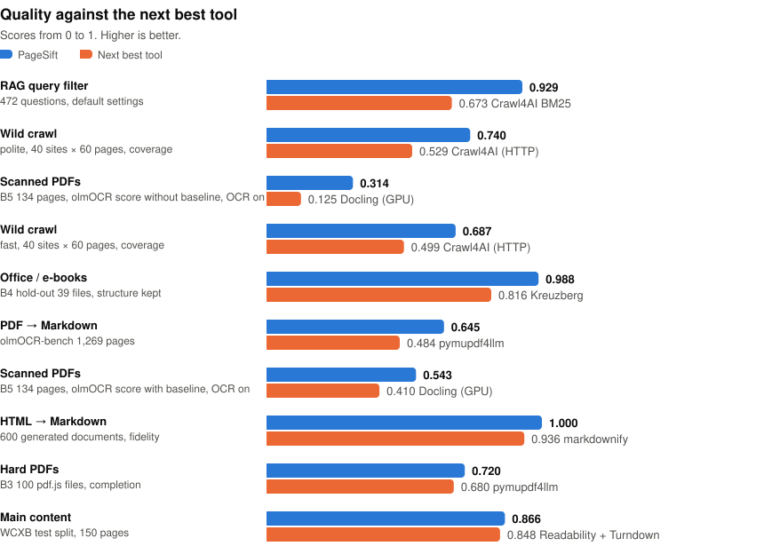
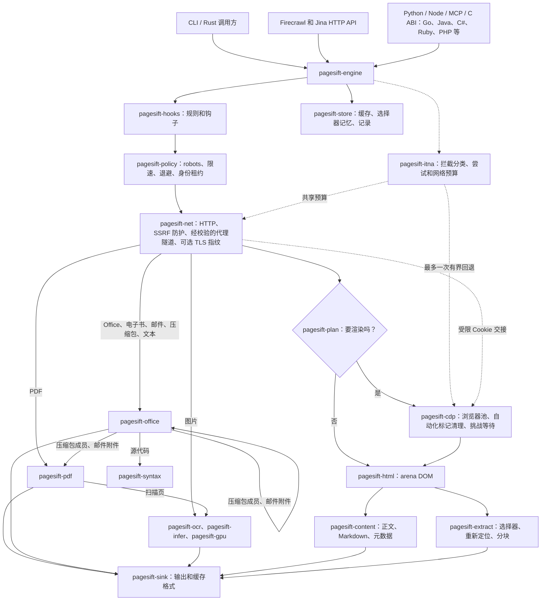
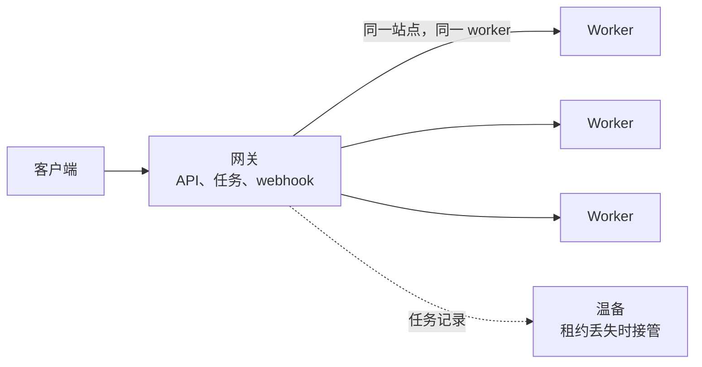

<div align="center">


# pagesift 1.2.3

**AI 智能体的网页和文档层：输入任意 URL、文档、邮件、压缩包或源代码文件，输出干净的 Markdown 或 JSON。**  
一个自托管的 Rust 二进制：CLI、Firecrawl 和 Jina Reader API、MCP 服务器，以及 Python、Node.js、Go、Java、C#、Ruby、PHP 等语言的包。

**实测：** PDF 转 Markdown 每页 2.4 ms，比第二名快 20.49 倍；HTML 转 Markdown 每页 0.24 ms，快 8.12 倍；正文提取每页 1.0 ms，快 7.26 倍（越低越好）；Office 每秒 91.7 个文件，是第二名的 3.40 倍（越高越好）。

[](../LICENSE)
[](COMMERCIAL.md)
[](https://github.com/YOLOW92/pagesift/releases)
[](https://crates.io/crates/pagesift)
[](https://pypi.org/project/pagesift/)
[](https://www.npmjs.com/package/@pagesift/node)
[](https://glama.ai/mcp/servers/YOLOW92/pagesift)
[](https://discord.gg/esA3wMZVvA)

[English](../README.md) · **简体中文** · [日本語](README.ja.md) · [Español](README.es.md)

</div>

<!-- readme-template: v2 -->
<!-- section: overview -->
## 它是什么

pagesift 替会思考的软件读取网页和文档：它抓取一个 URL（只在能多拿到内容时才渲染 JavaScript）或打开本地文件，
以 Markdown 或结构化 JSON 返回内容。它能处理单个页面、整站、扫描版 PDF、浏览器操作、变化监控，
以及由你自己的模型驱动的调研任务。

可以替代或配合使用：**Firecrawl**（同样的 v1/v2 API，自托管）、**Jina Reader**（`/r/` 和 `/s/`）、
**Crawl4AI**、**trafilatura**、**Readability**、**pymupdf4llm**、**Docling**、**Kreuzberg**、**xberg**。

<!-- section: facts -->
## 速览

- **输入：** URL、HTML、PDF（含扫描页，用 OCR）、图片文件（OCR）、Word（.docx、.doc）、Excel（.xlsx、.xlsb、.xls）、PowerPoint（.pptx、.ppt）、OpenDocument、RTF、WordPerfect、HWP、EPUB、MOBI、FB2、邮件（.eml、.mbox、.msg）、压缩包（zip、tar、gz、bz2、xz、7z）、SQLite、dBASE、CSV、Markdown 等文本格式、373 种源代码和配置语言、WARC 归档
- **输出：** Markdown、HTML、原始 HTML、链接、图片、元数据、基于 schema 的 JSON；结果不完整时给出警告
- **接口：** CLI · Firecrawl v1/v2 HTTP API · Jina Reader · MCP（stdio 或 HTTP）· Python · Node.js / TypeScript · Rust crate · C ABI 及 Go、Java、Kotlin、C#、Ruby、PHP、Lua、Perl、Dart、Swift、Zig 绑定 · LangChain 和 LlamaIndex
- **平台：** Linux x86_64 / aarch64（glibc ≥ 2.28 和 musl）、macOS arm64、Windows x86_64；Docker 镜像 `ghcr.io/yolow92/pagesift`
- **运行环境：** HTTP、PDF 和 Office 无需额外安装。可选：处理 JavaScript 页面的浏览器、用于 OCR 的 NVIDIA GPU、供 `/v2/agent` 使用的你自己的模型
- **内存：** 1.1 各项基准中，不带浏览器时每个 worker 峰值 18–377 MB；带公式模型的 OCR 约需 1.7 GB；容量按 cgroup 上限确定
- **许可证：** AGPL-3.0，或[商业许可](COMMERCIAL.md)
- **最新版本：** 1.2.3 · [发行说明](releases/1.2.3.zh-CN.md)

<!-- section: install -->
## 安装与使用

| | 安装 | 第一次调用 |
|---|---|---|
| CLI | `cargo install pagesift --locked` | `pagesift scrape https://example.com` |
| Python | `pip install pagesift` | `pagesift.scrape("https://example.com").markdown` |
| Node.js | `npm install @pagesift/node` | `(await new Scraper().scrape("https://example.com")).markdown` |
| 服务器 | `docker run -p 3002:3002 ghcr.io/yolow92/pagesift:1.2.3` | `curl localhost:3002/r/https://example.com` |
| MCP | — | `claude mcp add pagesift -- pagesift mcp` |

**CLI**

```bash
pagesift scrape https://example.com                          # Markdown 输出到 stdout
pagesift scrape report.pdf                                   # 本地 PDF、Office、电子书、邮件、压缩包、图片、代码或 WARC 文件
pagesift --ocr scrape scan.pdf                               # 对扫描页做 OCR；模型在首次使用时下载
pagesift crawl https://docs.rs --limit 500 --out ./data/     # 每页一个文件
pagesift crawl https://www.example.edu --query "graduate admission" --adaptive
pagesift extract --schema schema.json https://example.com    # 按 CSS 选择器输出 JSON，页面变化时修复
pagesift doctor                                              # 检查浏览器、GPU 和模型
```

**Python**

```python
import pagesift

page = pagesift.scrape("https://example.com", formats=["markdown", "links"])
print(page.markdown, page.metadata["title"], page.links)

pages = pagesift.scrape_many(["https://example.com", "https://example.org"], concurrency=8)

scanner = pagesift.Scraper(ocr=True)     # 第一个扫描页到来时才下载模型
print(scanner.parse(open("scan.pdf", "rb").read(), "scan.pdf").markdown)
```

**Node.js / TypeScript**

```typescript
import { Scraper } from '@pagesift/node'

const scraper = new Scraper()
const page = await scraper.scrape('https://example.com', { formats: ['markdown', 'links'] })
console.log(page.markdown, page.metadata.title, page.links)

const items = await scraper.scrapeMany(['https://example.com', 'https://example.org'], { concurrency: 4 })
```

**HTTP 服务器**

```bash
docker run -d -p 3002:3002 -v pagesift-data:/data -e PAGESIFT_API_KEYS=sk-test ghcr.io/yolow92/pagesift:1.2.3

curl -s localhost:3002/v2/scrape -H 'Authorization: Bearer sk-test' -H 'Content-Type: application/json' \
  -d '{"url":"https://example.com","formats":["markdown"]}'                        # Firecrawl API
curl -s localhost:3002/r/https://example.com -H 'Authorization: Bearer sk-test'    # Jina Reader
curl -s localhost:3002/v2/parse -H 'Authorization: Bearer sk-test' \
  -F file=@report.pdf -F 'options={"formats":["markdown"]}'                        # 上传文件
```

Firecrawl SDK 只需更换 API URL 即可使用。[上传 API](parse-api.md) · [Jina 请求头](jina-reader.md)

**MCP**

```bash
pagesift mcp                                                  # stdio，供单个智能体使用
pagesift mcp http --port 3003                                 # 一个共享的本地服务
claude mcp add --scope user --transport http pagesift http://127.0.0.1:3003/mcp
```

工具：`pagesift_scrape`、`pagesift_batch_scrape`、`pagesift_crawl`、`pagesift_poll_job`、`pagesift_cancel_job`、
`pagesift_map`、`pagesift_interact`、`pagesift_interact_stop`，配置模型后还有 `pagesift_agent`、`pagesift_agent_status`。
[共享 MCP 服务](mcp-service.md)

<!-- section: capabilities -->
## 它能做什么

| 能力 | 你能得到什么 | 文档 |
|---|---|---|
| **干净内容** | 正文识别，Markdown 保留标题、列表、表格、代码和数学公式 | [基准](benchmarks.md) |
| **文档** | 自研的 Rust 读取器，支持 PDF、新旧版 Office、OpenDocument、电子书、邮件、压缩包、图片、数据库和文本格式，包括损坏文件和 CJK 字体 | [上传 API](parse-api.md) |
| **OCR** | 扫描版 PDF 页面用 PP-OCRv6，行间公式用 PP-FormulaNet，纯 Rust 实现，运行在 CPU 或 NVIDIA GPU 上 | [上传 API](parse-api.md) |
| **结构化提取** | 按 CSS 选择器输出 JSON，站点变化时重新定位选择器；或按 schema 提取，schema 由你的模型写一次，pagesift 缓存 | [提取](structured-extract.md) |
| **浏览器操作** | 在页面上点击、输入和滚动，还有可以继续使用的会话 | [交互](interact.md) |
| **智能体** | `POST /v2/agent` 用你自己的模型从网上回答问题，并对照来源页面核对每个字段 | [智能体 API](agent-api.md) |
| **监控** | 定时检查，把真实变化和日期、计数器、广告区分开，支持 webhook | [监控](monitor.md) |
| **爬取** | 站点地图、页面不再有帮助时停止的聚焦爬取、陷阱处理、robots.txt 和按主机限速 | [基准](benchmarks.md) |
| **归档** | 每次爬取都输出 WARC，也能以 WARC 文件为输入，不需要网络 | [发行说明](releases/1.0.0.md) |
| **运维** | 多服务器网关、worker 和温备；任务持久化、持久化 webhook、指标、审计日志 | [架构](architecture.md) |
| **安全** | 防护私有网络和 DNS 重绑定，每个不完整的结果都会报告警告 | [爬虫策略](bot.md) |

**`/v2/agent` 如何回答问题**



robots.txt、限速和网络防护对每个页面都生效。模型选择 URL 和查询，不选择抓取选项。

<!-- section: performance -->
## 性能

<!-- perf-glance -->
<picture><source media="(prefers-color-scheme: dark)" srcset="assets/perf-scaling-dark.svg"></picture>

<picture><source media="(prefers-color-scheme: dark)" srcset="assets/perf-versions-dark.svg"></picture>

<picture><source media="(prefers-color-scheme: dark)" srcset="assets/perf-memory-dark.svg"></picture>

<picture><source media="(prefers-color-scheme: dark)" srcset="assets/perf-quality-dark.svg"></picture>

↑ 越高越好 · ↓ 越低越好。每个领域取最强的一项；方法和出处见完整报告。

| 任务 | 指标 | PageSift | 最好的其他工具 | 差距 |
|---|---|---:|---|---:|
| PDF → Markdown — olmOCR-bench 1,269 页，单页（单线程） | 单页耗时 ↓ | **2.4** | pypdf 50.0 | **×20.49** |
| PDF → Markdown — B1 144 页，1 路，常驻服务 | 吞吐 ↑ | **176.5** | pdf_oxide 100.6 | **×1.75** |
| PDF → Markdown — olmOCR-bench 1,269 页 | 官方总分 ↑ | **0.645** | pymupdf4llm 0.484 | **+0.161** |
| HTML → Markdown — 600 篇生成文档，单页 | 单页耗时 ↓ | **0.24** | Turndown 1.9 | **×8.12** |
| HTML → Markdown — 600 篇生成文档，保真度 | 平均 F1 ↑ | **1.000** | markdownify 0.936 | **+0.064** |
| 网页正文 — Firecrawl 597 页，单线程 | 单页中位耗时 ↓ | **1.0** | crw 7.4 | **×7.26** |
| 网页正文 — WCXB 测试集 150 页 | F1 ↑ | **0.866** | Readability + Turndown 0.848 | **+0.018** |
| 发布日期 — htmldate 1,000 页，日期搜索 | 单页耗时 ↓ | **0.31** | htmldate (fast) 2.0 | **×6.45** |
| RAG 分块 — 5 份语料，1.4 MB | 总耗时 ↓ | **7** | chonkie recursive 35 | **×5.01** |
| Office / 电子书 — B4 81 份，单进程 | 吞吐 ↑ | **91.7** | xberg 27.0 | **×3.40** |
| Office / 电子书 — B4 留出集 39 份，结构保留率 | 结构保留率 ↑ | **0.988** | xberg 0.878 | **+0.110** |
| RAG 查询过滤 — 472 题，默认配置 | 答案召回 ↑ | **0.929** | Crawl4AI BM25 0.673 | **+0.256** |
| 真实站点抓取 — polite，40 站 × 60 页，覆盖 | 覆盖率 ↑ | **0.740** | Crawl4AI (HTTP) 0.529 | **+0.211** |
| 真实站点抓取 — fast，40 站 × 60 页，覆盖 | 覆盖率 ↑ | **0.687** | Crawl4AI (HTTP) 0.499 | **+0.188** |
| 扫描件 PDF — B5 134 页，olmOCR 分（不含 baseline，开 OCR） | olmOCR 分 ↑ | **0.314** | Docling (GPU) 0.125 | **+0.189** |
| 扫描件 PDF — B5 134 页，olmOCR 分（含 baseline，开 OCR） | olmOCR 分 ↑ | **0.543** | Docling (GPU) 0.410 | **+0.133** |
| 难题 PDF — B3 100 份 pdf.js，完成率 | 完成率 ↑ | **0.720** | pymupdf4llm 0.680 | **+0.040** |

| 每 worker 峰值内存 | PageSift MB ↓ | 其他工具 MB | 内存少 |
|---|---:|---|---:|
| PDF，B1 | **32** | Docling (CPU) 3,675 (2026-10-28) | **×113.1** |
| 网页正文，A2 | **20** | Readability + Turndown 1,200 (2026-10-28) | **×60.8** |
| 抓取，200 站 × 100 页 | **218** | spider 5,500 (2026-10-21) | **×25.2** |
| 网页正文，A2 | **20** | trafilatura 123 (2026-10-28) | **×6.2** |
| Office 和电子书，B4 | **47** | Kreuzberg 231 (2026-10-28) | **×4.9** |
| 带浏览器抓取，200 站 × 100 页 | **669** | Google Chrome 2,300 (2026-10-21) | **×3.4** |
| PDF，B1 | **32** | Kreuzberg 76 (2026-10-28) | **×2.3** |
| 需要 JS 的页面，A3（实网） | **520** | Crawl4AI 982 (2026-10-28) | **×1.9** |

**PageSift 1.1 和 xberg 1.3.9。** xberg 测于 2026-11-04；范围是两轮的结果。加粗的是该行最好的值。

| 指标 | PageSift CLI | PageSift 服务 | xberg | xberg 版面模式 |
|---|---:|---:|---:|---:|
| PDF B1，olmOCR 总分 1,269 页 ↑ | **0.645** | — | 0.436 | 0.472 |
| Office B4，结构保留率，留出集 39 份 ↑ | **0.988** | — | 0.878 | — |
| PDF B1，1 路，份/秒 ↑ | 161.4 | **176.5** | 29.5–29.9 | 1.35 |
| PDF B1，16 路，份/秒 ↑ | **539.3** | 305.1 | 65.8–68.4 | 1.41 |
| Office B4，1 路，份/秒 ↑ | **91.7** | 69.1 | 27.0 | — |
| Office B4，16 路，份/秒 ↑ | **314.0** | 147.0 | 73.4–74.2 | — |
| PDF B1，1 路，峰值 MB ↓ | **32** | 211 | 147–172 | 1118 |
| Office B4，1 路，峰值 MB ↓ | **47** | 252 | 112 | — |
| Office B4，1 路，单份中位毫秒 ↓ | 4.5 | **2.2** | 3.2–3.3 | — |


<details>
<summary>仍落后</summary>

fast，40 站 × 60 页，耗时（spider 覆盖的页面约为一半） 16.1 seconds vs spider 1.4 seconds；A2 回放 269 页，只抓 HTTP、不限速，1 路 47.5 pages/s vs spider 156.6 pages/s；A2 随机 269 页，常驻 worker，单页 4.5 ms/page vs Resiliparse 2.1 ms/page。

</details>

[完整报告](../benchmarks/history/1.1/results/final/new/report.md)

<!-- /perf-glance -->

<!-- section: architecture -->
## 架构

核心从文件格式起全部用 Rust 编写，限额在运行时测量，而不是手工设定。



拦截恢复是可选功能（`[itna] enabled`，默认关闭）。`pagesift-itna` 负责拦截分类、最多一次有界浏览器回退，
并让重定向和浏览器子请求共用一份网络预算。会话按 owner、origin、出口和指纹租用；
HTTP Cookie 只能通过精确 origin 的受限交接进入浏览器。交互式验证码会报告需要人工处理，不做求解。

**自研代码，一直到格式层。** 解析在进程内运行，背后没有 Python、JVM 或 Node 运行时。
pagesift 有自己的零拷贝 HTML5 解析器、带 JPEG、CCITT 和 JBIG2 解码器的 PDF 文件层、Office、电子书、邮件和压缩包读取器、
神经网络推理（GPU 内核由 Rust 编译）、Chrome DevTools 客户端、MCP 服务器和只追加存储。
一个 worker 只占几十 MB，而不是一个加载好的解释器，启动只要几毫秒。

**每核一个 worker。** CPU 工作运行在按 NUMA 节点分组的常驻 worker 上，它们先在自己的节点内偷任务。
CPU、内存和浏览器标签页走同一条准入路径，容量来自 cgroup 上限，
因此容器会保持在内存限额内，而不会被杀掉。

**测量而不是写死。** 并发度按通用可扩展性定律（Universal Scalability Law）拟合，按主机限额跟随延迟梯度，
阶段超时用生存分析，重试用按类别统计的成功率。每一项都从安全的默认值开始，
只在统计显著的证据（δ = 0.05）下才调整。用户设置和安全限制始终是硬上限。

**只在值得时才用浏览器。** 对每一族 URL 路径，pagesift 学习渲染是否带来了更多内容，
渲染结果只有得分更高才保留。`__NEXT_DATA__` 和 JSON-LD 这类页面数据不用浏览器就能读取。
Lightpanda、moli 和 Chrome 组成回退链，`--explain` 记录每个决定。

**如实报告结果。** 不完整的页面、被截断的文件或跳过的扫描页会返回警告码，而不是看起来像完整结果。
智能体的回答会报告哪些值在证据中找到，选择器修复会报告新旧选择器。

**从一个二进制到一个集群。** `serve --role gateway`、`worker` 和 `standby` 共用同一个二进制，
站点亲和用 rendezvous 哈希，租约带隔离。任务和 webhook 在重启后恢复。



[完整架构](architecture.md)

<!-- section: choose -->
## 什么时候用，什么时候不用

**适合**

- 把网页和文档喂给 LLM、RAG 索引或智能体
- 自托管 Firecrawl 或 Jina Reader 式的服务，不按页付费
- 混合输入：同一个调用处理 HTML、PDF、扫描件、Office 文件和电子书
- 小机器和容器：内存受 cgroup 上限约束

**这些情况选别的**

- **你的输入是图片文件。** OCR 覆盖 PDF 内的扫描页，不处理独立图片。
- **AGPL 对你不合适**，商业许可也不可行。
- **你需要托管的云服务。** pagesift 是自托管的。

<!-- section: license -->
## 许可证

[AGPL-3.0](../LICENSE)。如需专有链接或不承担 AGPL 义务的私有部署，请见
[商业许可](COMMERCIAL.md) 或写信到 `licensing@pagesift.dev`。

<!-- section: changelog -->
## 1.2.3 新增

可选 `imageAssets` 支持网页、PDF 和 Office 图片：可附带 Base64 字节、写入 data URL，或把 Markdown 改写为 `asset://` 引用；提供逐图结果、按内容识别 MIME，并让 `attach`/`rewrite` 在任务内只发布一次。batch/crawl 流可选正文初稿事件，`removeBase64Images: false` 会保留源页面 data URL。新增自研 Base64 并与 `base64` 0.23.1、`base64-simd` 0.8.0 对比：4 KiB 及以上的测量输入更快，但并非所有短输入都领先。

[发布说明](releases/1.2.3.zh-CN.md) · [Base64 测量](releases/1.2.3-benchmarks.md) · [1.2.2](releases/1.2.2.md) · [全部版本](releases/) · [CHANGELOG](../CHANGELOG.md)

---

## 社区

问题或反馈：[Discord](https://discord.gg/esA3wMZVvA) · [Issues](https://github.com/YOLOW92/pagesift/issues) · [Discussions](https://github.com/YOLOW92/pagesift/discussions)

## 引用

```bibtex
@software{pagesift2026,
  title  = {PageSift: Rust Web and Document Extraction Engine for AI Pipelines},
  author = {YOLOW92},
  year   = {2026},
  url    = {https://github.com/YOLOW92/pagesift},
  note   = {Version 1.2.3}
}
```

## Star History

[](https://star-history.com/#YOLOW92/pagesift&Date)
