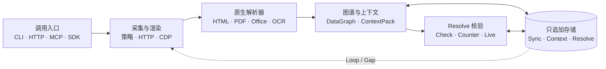
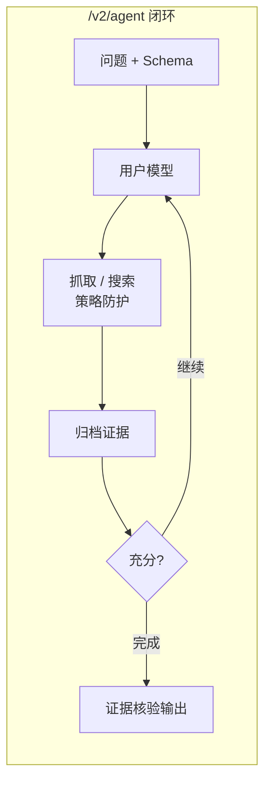
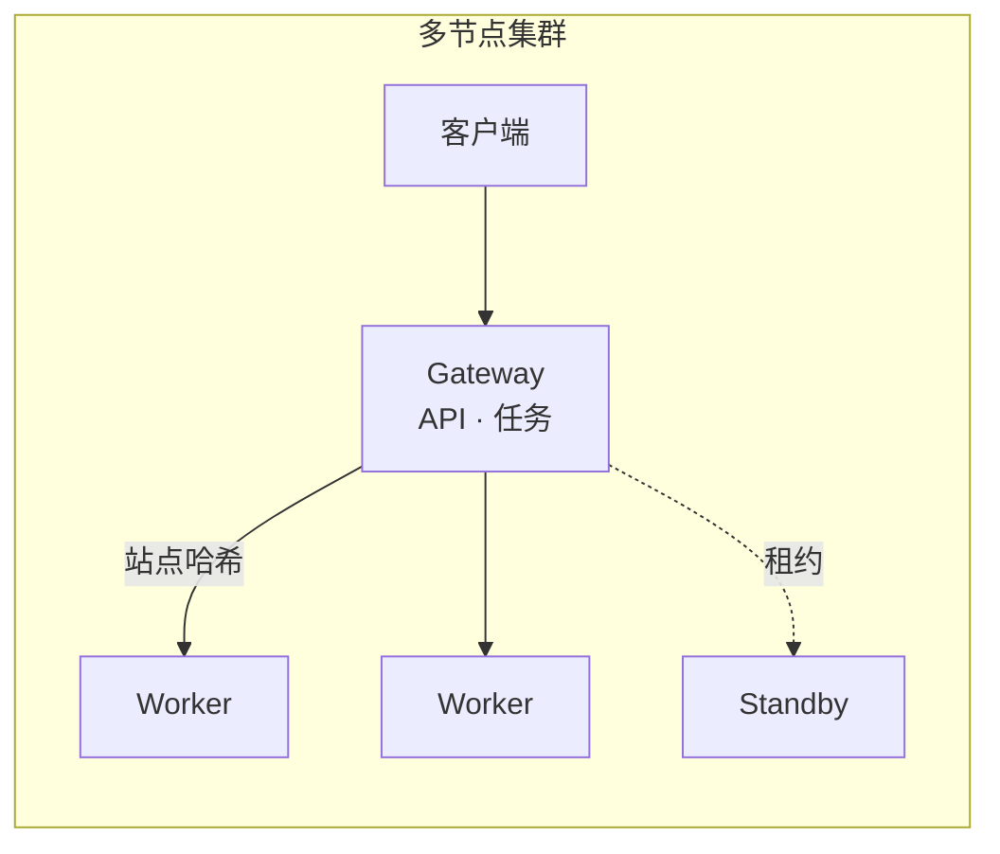

<div align="center">


# pagesift 1.7.0

**本地优先的 Rust 网页与文档采集解析引擎——集 HTTP/浏览器抓捕、版面感知 PDF/Office/OCR 解析、持续同步、可验证数据图谱、证据级 AI 上下文编译与实时结论核验于一体。**  
单个自托管 Rust 二进制，内置 CLI、Firecrawl v1/v2 与 Jina Reader HTTP API、MCP 服务、C ABI，以及 Python / Node.js 原生包。

[](../LICENSE)
[](COMMERCIAL.md)
[](https://github.com/YOLOW92/pagesift/releases)
[](https://crates.io/crates/pagesift)
[](https://pypi.org/project/pagesift/)
[](https://www.npmjs.com/package/@pagesift/node)
[](https://glama.ai/mcp/servers/YOLOW92/pagesift)
[](https://discord.gg/esA3wMZVvA)

[English](../README.md) · **简体中文** · [日本語](README.ja.md) · [Español](README.es.md)

</div>

<!-- readme-template: v2 -->
<!-- section: overview -->
## 它是什么

`pagesift` 在单个受内存上限约束的 Rust 进程中，将实时网页、本地二进制文档、归档与长周期监控信源转换为确定性 Markdown、Schema 校验 JSON、带来源谱系的 `DataGraph` 关系图谱、受 Token 与证据约束编译的 `ContextPack` 上下文，以及可持续增量复核的 `Resolve` 结论图谱。HTTP 抓捕、原生格式解析、正文抽取、自适应同步状态、增量上下文索引、确定性七层声明核验与证据存储全部进程内协同运行，无需外挂 Python、JVM 或 Node worker；无头浏览器池、NVIDIA GPU OCR 与用户自带大模型端点仅在需要时按需接入。

可替代或协同使用：**Firecrawl**（自托管 v1/v2 API）、**Jina Reader**（`/r/` 与 `/s/`）、**Crawl4AI**、**trafilatura**、**Readability**、**pymupdf4llm**、**Docling**、**Kreuzberg** 与 **xberg**。

<!-- section: sponsors -->
## 赞助商

<a href="https://proxy-seller.com/?partner=9CCCBD6151334AC0"></a>

> 推广链接：通过此链接购买，项目可能获得佣金。

[**Proxy-Seller**](https://proxy-seller.com/?partner=9CCCBD6151334AC0) 赞助了 pagesift：住宅、ISP 与数据中心代理 IP（IPv4/IPv6），220+ 地区，7×24 支持。使用优惠码 `PAGESIFT`，ISP / IPv4 / 住宅代理可享 85 折。*推广链接：通过此链接购买，项目可能获得佣金。*

<!-- section: facts -->
## 速览

- **分层运行时：** 入口层（`CLI`/`HTTP`/`MCP`/FFI）→ 策略与 SSRF 防护网络 → 自适应采集（`HTTP`/内嵌 JSON/浏览器）→ 原生格式解析与抽取 → `DataGraph`、`Context`、`Resolve` 与只追加存储 → 按 cgroup 定容的 NUMA 工作池（`pagesift-flow`）
- **支持输入：** URL、HTML、PDF（文本层 + 可选 PP-OCRv6 / 公式识别）、上传图片文件（开启 OCR 时）、Office 与 OpenDocument、RTF/WordPerfect/HWP、电子书、邮件、嵌套压缩包（`zip`、`tar`、`7z`）、SQLite/CSV、373 种代码语言与 WARC 归档（[格式矩阵](parse-api.md)）
- **输出产物：** Markdown、HTML、原始 HTML、链接、导出图片/附件、RAG 分块、Schema JSON、`DataGraph`（`graph.jsonl`、引用链、声明生命周期、冲突、`fact_clusters`、`?asOf=`）、`ContextPack`（`KnowledgeUnit`、`ContextDelta`、`provenanceManifest`）、`Resolve`（`ConclusionRecord`、`CounterSearchAudit`、`ResolveEvent`），并在不完整抓捕时返回结构化告警
- **调用接口：** CLI · Firecrawl v1/v2 HTTP API · Jina Reader（`/r/`、`/s/`）· MCP（stdio / HTTP）· Python · Node.js / TypeScript · Rust crate · C ABI（Go、Java、Kotlin、C#、Ruby、PHP、Lua、Perl、Dart、Swift、Zig）· LangChain / LlamaIndex
- **平台与部署：** 单二进制（`serve --role gateway`、`worker`、`standby`），Linux x86_64/aarch64（glibc ≥ 2.28 与 musl）、macOS arm64、Windows x86_64、Docker `ghcr.io/yolow92/pagesift:1.7.0`
- **索引与版本：** 机器可读文档索引 [llms.txt](../llms.txt) · Apache-2.0 或[商业支持](COMMERCIAL.md) · **1.7.0**（[发行说明](releases/1.7.0.md)）

<!-- section: install -->
## 安装与快速开始

| 入口 | 安装命令 | 最小调用 |
|---|---|---|
| CLI | `cargo install pagesift --locked` | `pagesift scrape https://example.com` |
| Python | `pip install pagesift` | `pagesift.scrape("https://example.com").markdown` |
| Node.js | `npm install @pagesift/node` | `(await new Scraper().scrape("https://example.com")).markdown` |
| 服务端 | `docker run -p 3002:3002 ghcr.io/yolow92/pagesift:1.7.0` | `curl localhost:3002/r/https://example.com` |
| MCP | — | `claude mcp add pagesift -- pagesift mcp` |

<details>
<summary>快速上手示例：CLI、Python、Node.js、HTTP API 与 MCP</summary>

**CLI**

```bash
pagesift scrape https://example.com                          # 干净 Markdown 输出到 stdout
pagesift scrape --graph https://example.com                  # Markdown + DataGraph 来源谱系与声明
pagesift scrape report.pdf                                   # 本地 PDF、Office、电子书、邮件、压缩包、代码或 WARC
pagesift --ocr scrape scan.pdf                               # 对扫描 PDF 页或上传图片做 OCR
pagesift crawl https://docs.rs --limit 500 --out ./data/     # 整站爬取落盘（加 --graph 生成 graph.jsonl）
pagesift graph inspect ./data/graph.jsonl                    # 查看引用、来源谱系、声明与冲突
pagesift sync init --id docs --seed https://example.com      # 注册并运行持久化 Loop 数据源
pagesift context pack --file report.pdf "rate limits"        # 编译带引用溯源清单的预算受限 ContextPack
pagesift resolve check --store ./data/store --source-id docs "Plan Pro costs $99/yr." # 核验并持久化结论
pagesift extract --schema schema.json https://example.com    # 带选择器漂移自修复的 Schema JSON 抽取
pagesift doctor                                              # 检查本机浏览器、GPU 与模型环境
```

**Python 与 Node.js**

```python
import pagesift

page = pagesift.scrape("https://example.com", formats=["markdown", "links"])
print(page.markdown, page.metadata["title"], page.links)

with pagesift.Scraper(store_path="./data/store") as s:
    pack = s.context(action="pack", source_ids=["docs"], query="rate limits", budget_tokens=1024)
    verdict = s.resolve(action="check", source_ids=["docs"], answer="Plan Pro costs $99/yr.")
    print(pack["pack"]["compiledContext"], verdict["conclusion"]["state"])
```

```typescript
import { Scraper } from '@pagesift/node'

const scraper = new Scraper({ storePath: './data/store' })
const page = await scraper.scrape('https://example.com', { formats: ['markdown', 'links'] })
const pack = await scraper.context({ action: 'pack', sourceIds: ['docs'], query: 'rate limits', budgetTokens: 1024 })
const verdict = await scraper.resolve({ action: 'check', sourceIds: ['docs'], answer: 'Plan Pro costs $99/yr.' })
console.log(page.markdown, pack.pack, verdict.conclusion?.state)
```

**HTTP 服务（`Firecrawl v1/v2`、`Jina Reader`、`/v2/sources`、`/v2/graph`、`/v2/context`、`/v2/resolve`）与 MCP**

```bash
docker run -d -p 3002:3002 -v pagesift-data:/data -e PAGESIFT_API_KEYS=sk-test ghcr.io/yolow92/pagesift:1.7.0

curl -s localhost:3002/v2/scrape -H 'Authorization: Bearer sk-test' -H 'Content-Type: application/json' \
  -d '{"url":"https://example.com","formats":["markdown"]}'
curl -s localhost:3002/r/https://example.com -H 'Authorization: Bearer sk-test'
curl -s localhost:3002/v2/parse -H 'Authorization: Bearer sk-test' -F file=@report.pdf -F 'options={"formats":["markdown"]}'
curl -s localhost:3002/v2/context/pack -H 'Authorization: Bearer sk-test' -H 'Content-Type: application/json' \
  -d '{"sourceIds":["docs"],"query":"rate limits","budgetTokens":1024}'
curl -s localhost:3002/v2/resolve/check -H 'Authorization: Bearer sk-test' -H 'Content-Type: application/json' \
  -d '{"sourceIds":["docs"],"answer":"Plan Pro costs $99/yr."}'

pagesift mcp                                                 # stdio 模式，供单个智能体使用
pagesift mcp http --port 3003                                # 本机共享 HTTP MCP 守护服务
```

</details>

MCP 提供 `pagesift_scrape`、`pagesift_batch_scrape`、`pagesift_crawl`、`pagesift_poll_job`、`pagesift_cancel_job`、`pagesift_map`、`pagesift_interact`、`pagesift_interact_stop`、`pagesift_sync`、`pagesift_graph_query`、`pagesift_context`、`pagesift_resolve`，以及配置模型后启用的 `pagesift_agent` 和 `pagesift_agent_status`。详见[共享 MCP 服务](mcp-service.md)、[Context 文档](context.md)与 [Resolve 文档](resolve.md)。

<!-- section: capabilities -->
## 能力面板

按系统架构分层列出当前已落地的能力与对应文档：

| 架构平面 | 已实现能力 | 参考文档 |
|---|---|---|
| **接口与协议兼容** | 自托管 CLI、Firecrawl v1/v2 HTTP API（`/v2/scrape`、`/v2/crawl`、`/v2/parse`、`/v2/monitor`、`/v2/sources`、`/v2/graph`、`/v2/context`、`/v2/resolve`、`/v2/agent`、`/interact`）、Jina Reader（`/r/`、`/s/`）、MCP（stdio/HTTP）、Python、Node.js/TS、Rust 库、C ABI 绑定 | [parse-api.md](parse-api.md) · [context.md](context.md) · [resolve.md](resolve.md) · [mcp-service.md](mcp-service.md) |
| **网络抓捕与安全策略** | HTTP 条件请求（`ETag`/`Last-Modified`）、SSRF 与 DNS 重绑定防护、`robots.txt` 与单站点限速、身份租约、内嵌 JSON（`__NEXT_DATA__`/`__NUXT_DATA__`/JSON-LD）直出合成、可选 CDP 浏览器池（`Lightpanda`/`moli`/Chrome）与 `/interact` 会话、按需启用的 `[itna]` 阻断分级恢复 | [interact.md](interact.md) · [http-sessions.md](http-sessions.md) · [bot.md](bot.md) |
| **原生容器解析与 OCR** | 纯 Rust 写到容器字节流层面（`yolowhtml`、`yolowpdf`、`yolowdoc`、`yolowsyntax`、`yolowzstd`、`yolow64`），涵盖网页、Office/ODF、电子书、邮件、嵌套压缩包、SQLite/CSV、373 种代码语言（含 32+ 语言 AST 按函数/类切分）、WARC 读写与纯 Rust PP-OCRv6 / PP-FormulaNet（CPU/GPU） | [parse-api.md](parse-api.md) |
| **结构抽取与调研代理** | 保结构正文 Markdown（公式/代码/表格 `<caption>` 与 `hidden="until-found"`）、RAG `queryFilter` 与分块、带选择器记忆及 DOM 自修复的 Schema 抽取，以及基于归档证据交叉核验字段的 `/v2/agent` | [structured-extract.md](structured-extract.md) · [agent-api.md](agent-api.md) |
| **持续 Loop 同步与监控** | 持久化 `pagesift sync` / `/v2/sources` 数据源（抗混叠周期检测、分层 Gamma-Poisson 收缩与预算 Lagrange 注水、Hub 协同更新前移、分模态耗时与标签影子价格、有上限的 `DirectBrowser` 恢复探针、贝叶斯惊异遗忘、租户隔离冷启动迁移与观测可靠性删失），以及 `/v2/monitor` 块级实质 diff 与 Webhook | [monitor.md](monitor.md) · [incremental-collection.md](incremental-collection.md) |
| **DataGraph 谱系与证据** | 跨页面、跨信源证据图谱（`graph.jsonl`、`graph_summary.json`、`/v2/graph/claims`、`/history`、`/conflicts`、`?asOf=`）：持久化文档引用、跳转/规范链/附件溯源、上下文单位与货币消歧、独立信源根 `OriginRelation` 与 `fact_clusters`、声明生命周期（`Active`、`Superseded`、`Withdrawn`、`Unverified`、`EvidenceDegraded`） | [architecture.md](architecture.md) |
| **Context 知识与上下文编译** | 跨版本 `KnowledgeUnit` 逻辑身份与歧义追踪（`boundedUot`/`greedyDice`/`exactAnchorOnly`）、按依赖失效的原子 `ContextDelta` 与幂等消费位点、多策略词法/符号/双时间（`asOf` + `effectiveAt`）/谱系 `Search`、受预算与 `MustKeep` 约束的 `ContextPack`（`submodularClosure`/`boundedDpp`/`edgeSalience`）及 `provenanceManifest`、受门控覆盖率与 VOI/影子价格约束的 `Action` 及漂移防护在线 `Learn` | [context.md](context.md) |
| **Resolve 证据核验与活态维护** | GC 免疫 `ns::RESOLVE` 持久化 `ConclusionRecord` 结论图谱、保上下文声明拆分与确定性七层 `Check`（实体隔离、双时间轴 `asOf`/`effectiveAt`、币种/计费周期/单位归约、句级极性与限定词保留、因果保守性、`originRoot` 镜像折叠、比较反例与同源勘误证伪）、带开放世界 `absence_is_not_proof` 审计的属性受控 `Counter` 反证、受权限与 VOI 门控的 `Gap` 补采、可选逐字引用约束的 `HybridAssisted` 裁决、Salsa 式早截断 `Live` 增量调和，以及仅采信 `HardEvidence` 的 PAV/CUSUM `Learn` | [resolve.md](resolve.md) |

<!-- section: performance -->
## 性能摘要

为让首页聚焦系统设计与主流程，完整对比表、测试机环境、竞品口径和局限说明均收在 [benchmarks.md](benchmarks.md)：

- **时延表现（记录基准，单 worker，越低越好）：** PDF → Markdown `2.5–2.58 ms/页`（1,269 页）；HTML → Markdown `0.23–0.24 ms/页`（600 文档）；正文提取 `1.0 ms/页`（597 页）；Context `BoundedUot` 身份对齐 `63.9 µs`，`ContextPack` 编译 `67–225 µs`（`192`/`384` tokens 预算）；Resolve 确定性 `Check` `p50 96 µs` / `p99 161 µs`（`400` 次核验），`Live` 增量调和 `7,504 µs` 对比全量重验 `33,550 µs`（`60` 条持久化结论上加速 `4.47x`）。
- **吞吐、质量与内存（记录基准）：** Office 进程内 `81.9–210.0 文件/s`（越高越好）；HTML → Markdown 平均 F1 `1.000`；WCXB F1 `0.866`；RAG 查询召回 `0.929`（越高越好）；Context `Search + Pack` 在 `1–16` 线程下达 `2,708.8–24,434.4 QPS`（RSS `25.9–28.8 MiB`）；Resolve `Check` 达 `9,448.4 QPS`（RSS `31.25 MiB`，`64` 例对抗样本误支持率 `0.0000`、支持精确率/召回率 `1.0000`，QPS/精确率/召回率越高、误支持率/RSS 越低越好）；不带浏览器各领域运行单 worker 峰值内存 `17–395 MB`。
- **完整评分卡与发布评测：** [benchmarks.md](benchmarks.md) · [完整基准报告](../benchmarks/history/1.4/results/final/new/report.md) · [1.7.0 Resolve 评测记录](releases/1.7.0.md) · [1.6.0 Context 与 Loop 评测记录](releases/1.6.0.md)

<!-- section: architecture -->
## 系统架构与核心流程

内核以单一编译型 Rust 二进制运行，解析、状态存储与调度后面不依赖任何托管解释器运行时。CPU 工作线、内存占用与浏览器标签共用一套 cgroup 感知准入控制；内部运行阈值只在在线统计检验达到显著水平（`δ = 0.05`）后才自适应调整。

### 请求抓捕与解析数据流



### 持续 Loop 闭环调度（`Observe → Learn → Decide → Execute → Verify`）

通过 `pagesift sync` 或 `/v2/sources` 注册的持久化信源，会在每个调度周期内运行完整自适应闭环，并在瞬时观测不可靠时保护既有高可信声明不被误撤回，同时按需增量调和到 `ContextStore` 与 `ResolveStore`：


### 证据核验 `/v2/agent` 与单二进制多机拓扑





### 工作区 Crate 分层图

| 架构层 | 包含 Crate |
|---|---|
| **接口入口与多语言绑定** | `pagesift`（CLI 与 Rust 库）、`pagesift-api`（HTTP 服务与契约类型）、`pagesift-mcp`（MCP stdio/HTTP）、`pagesift-py`、`pagesift-node`、`pagesift-ffi`（C ABI） |
| **编排调度、决策与图谱** | `pagesift-engine`、`pagesift-plan`、`pagesift-hooks`、`pagesift-llm`、`pagesift-search`、`pagesift-graph` |
| **网络传输、策略与浏览器** | `pagesift-net`、`pagesift-policy`、`pagesift-rustls`、`pagesift-cdp`、`pagesift-media`、`pagesift-itna` |
| **网页结构解析与前沿调度** | `pagesift-html`（`yolowhtml-dom`）、`pagesift-content`（`yolowhtml`）、`pagesift-extract`、`pagesift-diff`、`pagesift-frontier` |
| **原生文档与 OCR 引擎** | `pagesift-pdf`（`yolowpdf`）、`pagesift-office`（`yolowdoc`）、`pagesift-syntax`（`yolowsyntax`）、`pagesift-ocr`、`pagesift-infer`、`pagesift-gpu` |
| **运行时、统计数学与持久化** | `pagesift-flow`（NUMA 工作池与 cgroup 准入）、`pagesift-stat`、`pagesift-base64`（`yolow64`）、`pagesift-compress`（`yolowzstd`）、`pagesift-sys`、`pagesift-store`、`pagesift-sink`、`pagesift-cluster` |

关于 cgroup 定容、统计检验基线（`δ = 0.05` 的 USL 并发拟合、生存分析超时、Thompson 采样）、增量交付检查点与字节范围媒体归档验证，请见 [完整架构文档](architecture.md)。

<!-- section: choose -->
## 什么时候用，什么时候不用

**适合**

- 把网页、PDF、Office 套件、归档或代码库干净地送入智能体、RAG 管道或下游数据流程，且不愿外挂多套重型解释器运行时
- 在固定 Token 预算下编译保表头、保否定/限定词、保单位、带有效时间与冲突对偶展示及机器可核验引用清单的 `ContextPack`
- 将大模型回答与事实声明沉淀为持久化 `ConclusionRecord` 结论图谱，执行确定性七层证据核验、主动反证探针，并在信源变动时做增量 `Live` 复核
- 自托管兼容 Firecrawl 与 Jina Reader 协议及共享 MCP 工具链的服务，免除按页 SaaS 计费
- 长期跟踪变化信源：需要按成本代价触发浏览器、追踪引用谱系与发现跨源事实冲突

**这些情况选别的**

- **你需要免部署的托管云服务。** `pagesift` 面向自托管与私有环境。
- **你需要全自动破解交互式验证码。** 系统只对访问阻断分类，交互式 CAPTCHA 会保留并交由人类处理（`[itna]` 默认关闭且不绕过验证码）。
- **你只抓图片 URL 且不开 OCR。** 上传/本地图片文件需开启 `--ocr`（`[ocr] enabled = true`）；纯图片 URL 或未开 OCR 的图片上传返回 `UNSUPPORTED_OPTION`。

<!-- section: license -->
## 许可证

[Apache-2.0](../LICENSE)。如需专属技术支持、SLA 保障或企业级合作协议，请查阅[商业许可与支持](COMMERCIAL.md)或写信至 `licensing@pagesift.dev`。

<!-- section: changelog -->
## 1.7.0 新增

PageSift 1.7.0 引入基于 `DataGraph`、`Loop` 与 `Context` 构建的证据驱动结论核验引擎 **Resolve**，全量打通 Rust（`Engine::resolve`）、HTTP（`/v2/resolve*` 及集群网关路由与单 Key 限流）、CLI（`pagesift resolve`）、MCP（`pagesift_resolve`）、C ABI（`pagesift_resolve`）、Python（`Scraper.resolve`/`aresolve`）与 Node.js（`Scraper.resolve`）：在 GC 免疫命名空间 `ns::RESOLVE` 内通过 `AtomicTx` 原子持久化带版本历史的 `ConclusionRecord` 图谱、单调 `ResolveEvent` 事件流及 `unitId` + `ScopeDependency` 双倒排索引；实现保上下文声明拆分与确定性七层 `Check`（实体隔离、双时间轴 `asOf`/`effectiveAt`、币种/计费周期/单位归约、句级极性与限定词保留、因果保守性、`originRoot` 镜像折叠及比较反例/同源勘误证伪）；提供带开放世界 `absence_is_not_proof` 审计的属性受控 `Counter` 主动反证、受显式 `allowNetworkAcquisition`/`allowedHosts` 权限与 Howard VOI 门控的 `Gap` 补采、可选逐字引用约束的 `HybridAssisted` LLM 裁决、Salsa 式早截断 `Live` 增量调和（`RelocatedOnly`/`Reconfirmed` 跳过、`ObservationLost` 不误证伪、范围扩张传播与 ABA 回退），以及仅采信 `HardEvidence` 硬反馈、带 CUSUM 漂移冻结与版本重置的 PAV 保序 `Learn` 校准。

[发布说明](releases/1.7.0.md) · [1.6.3](releases/1.6.3.md) · [1.6.2](releases/1.6.2.md) · [1.6.1](releases/1.6.1.md) · [1.6.0](releases/1.6.0.md) · [1.5.6](releases/1.5.6.md) · [1.5.5](releases/1.5.5.md) · [全部版本](releases/) · [CHANGELOG](CHANGELOG.md)

---

## 社区

问题或反馈：[Discord](https://discord.gg/esA3wMZVvA) · [Issues](https://github.com/YOLOW92/pagesift/issues) · [Discussions](https://github.com/YOLOW92/pagesift/discussions)

## 引用

```bibtex
@software{pagesift2026,
  title  = {PageSift: Rust Web and Document Extraction Engine for AI Pipelines},
  author = {YOLOW92},
  year   = {2026},
  url    = {https://github.com/YOLOW92/pagesift},
  note   = {Version 1.7.0}
}
```

## Star History

[](https://star-history.com/#YOLOW92/pagesift&Date)
