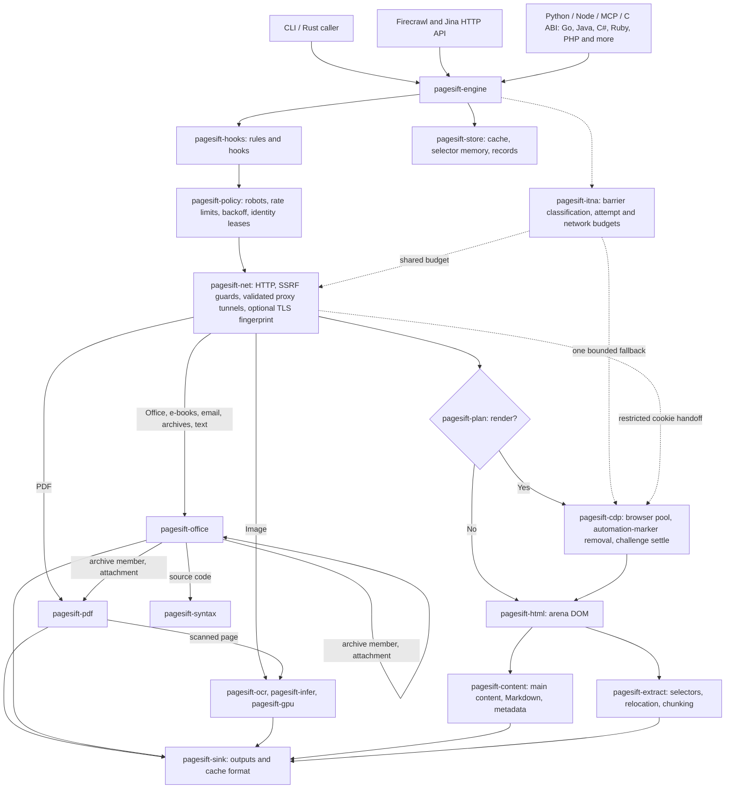
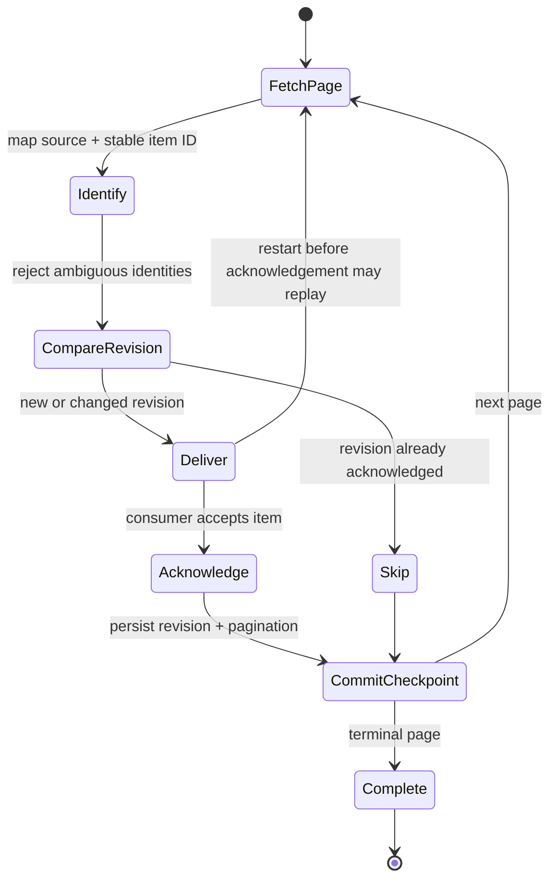
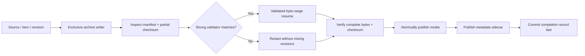

# Architecture

The product is one Rust binary. Python and Node embed the same engine. A browser for JavaScript pages, an NVIDIA GPU
for OCR and a model for `/v2/agent` are optional and found at run time.

## Request pipeline

Access-barrier recovery is opt-in (`[itna] enabled`, off by default). `pagesift-itna` classifies barriers,
allows one bounded browser fallback, and shares one network budget across redirects and browser sub-requests.
Sessions are leased per owner, origin, egress and fingerprint; HTTP cookies reach the browser only through an
exact-origin handoff. Interactive CAPTCHAs are reported as needing a human and are not solved.

The HTTP layer validates options before execution. `"explain": true` (`scrape --explain`) writes every render decision
to `metadata.pagesift.plan.steps`.

## Crates

| Area | Crates |
|---|---|
| Entry points | `pagesift` (CLI and library), `pagesift-api` (HTTP), `pagesift-mcp`, `pagesift-py`, `pagesift-node`, `pagesift-ffi` |
| Engine | `pagesift-engine`, `pagesift-plan`, `pagesift-hooks`, `pagesift-llm`, `pagesift-search` |
| Network and recovery | `pagesift-net`, `pagesift-policy` (rate limits and identity leases), `pagesift-rustls`, `pagesift-cdp`, `pagesift-media`, `pagesift-itna` |
| Content | `pagesift-html`, `pagesift-content`, `pagesift-extract`, `pagesift-diff`, `pagesift-frontier` |
| Documents | `pagesift-pdf`, `pagesift-office`, `pagesift-syntax`, `pagesift-ocr`, `pagesift-infer`, `pagesift-gpu` |
| Runtime | `pagesift-flow` (workers and admission), `pagesift-stat` (online statistics), `pagesift-sys`, `pagesift-store`, `pagesift-sink`, `pagesift-cluster` |

## Execution

CPU work runs on one resident worker per core, grouped by NUMA node, stealing inside the node first. Admission is one
path for CPU, memory and browser tabs, and capacity is sized from the cgroup limit and measured browser memory.

## Measured values

Most limits start from a safe default and move only when the evidence is statistically significant (δ = 0.05). Global
concurrency follows a Universal Scalability Law fit, per-host concurrency a latency gradient, stage timeouts
Kaplan–Meier survival, retries per-class success rates. Whether to render is learned per path family by Thompson
sampling. User settings, safety limits and protocol values stay hard limits.
[Every replaced value](history/0.86_fixed_values.md)

## Several servers

`serve --role gateway`, `worker` and `standby` run from the same binary. Sites are assigned to workers by rendezvous
hashing, the standby takes over through leases with fencing, and jobs and webhooks resume after a restart.
Browser sessions (`/interact`) are not available through the gateway.

## Incremental delivery

Delivery is **at least once**. The caller acknowledges after delivery; a crash before the commit can replay an item. Opt-in deletion sync runs only after a successful terminal traversal. URL cache eviction does not erase business completion records.

## Verified media publication

A retry reconciles partial publication before declaring completion. Filenames are sanitized and collisions rejected. Finite HLS/DASH planning reuses this archive layer for bounded segments; DASH retains timing/addressing in a local MPD. It does not mux tracks, execute FFmpeg or support encrypted/live streams.

See [collection](incremental-collection.md), [archives](media-archive.md) and [bounded core APIs](native-core.md) for exact limits and failure behavior.
