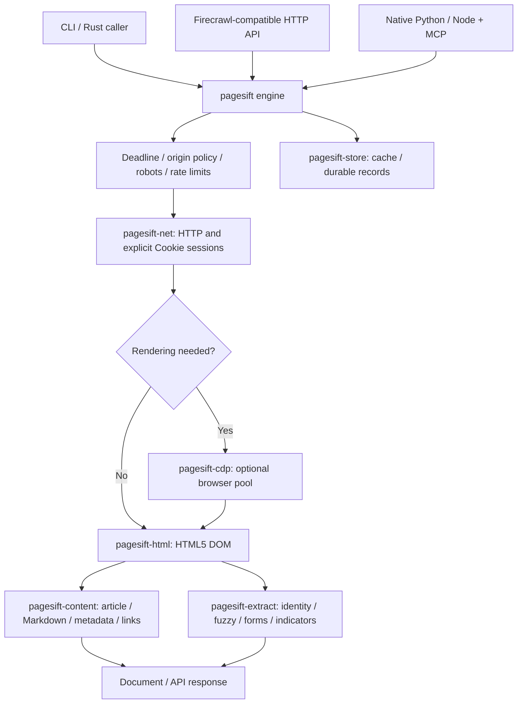
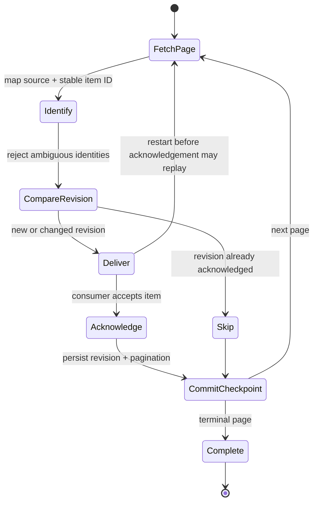
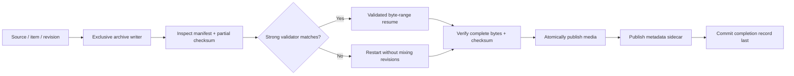

# Architecture

The product core and all new 2.0 modules are Rust. Python and Node embed that engine; benchmark drivers use their existing Python/Node environments. Optional browser rendering is separate from persistent interaction or autonomous Agent workflows.

## Request pipeline

The HTTP layer validates options before execution. Fuzzy similarity is an optional candidate mechanism: it does not override business identity. External module discovery is bounded, same-origin and opt-in, with normal crawl scope and robots checks applied to discovered URLs. New core operations are exposed through the Rust/CLI surfaces described in their own guides; the diagram does not promise every operation in every binding.

## Incremental delivery

Delivery is **at least once**. The caller acknowledges after delivery; a crash before the commit can replay an item. Opt-in deletion sync runs only after a successful terminal traversal. URL cache eviction does not erase business completion records.

## Verified media publication

A retry reconciles partial publication before declaring completion. Filenames are sanitized and collisions rejected. Finite HLS/DASH planning reuses this archive layer for bounded segments; DASH retains timing/addressing in a local MPD. It does not mux tracks, execute FFmpeg or support encrypted/live streams.

See [collection](incremental-collection.md), [archives](media-archive.md) and [bounded core APIs](remaining-core.md) for exact limits and failure behavior.
