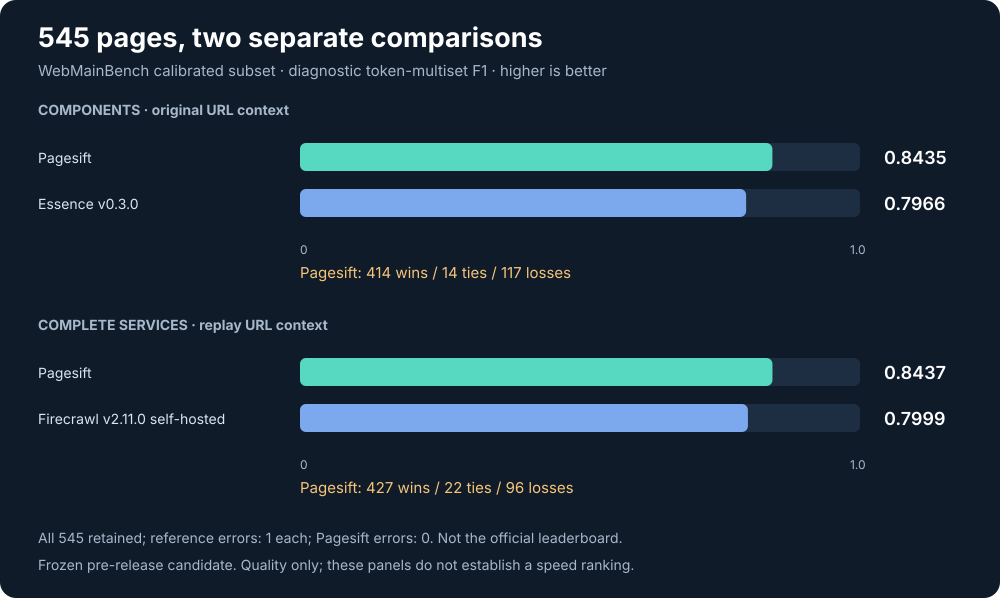
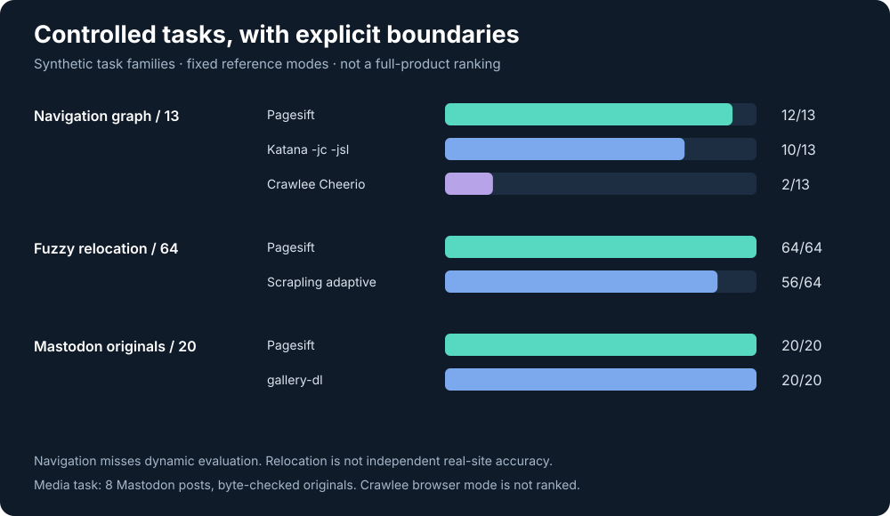
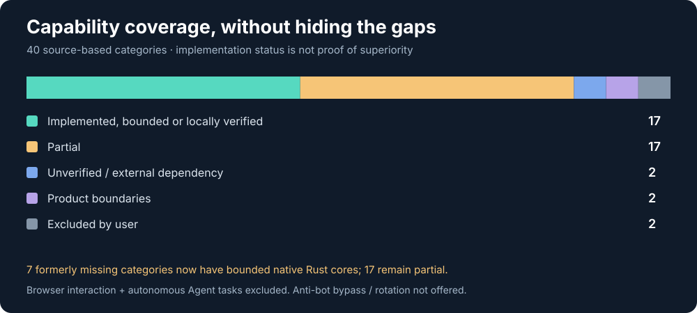

# pagesift 0.20.0

A Rust engine for acquiring pages, extracting usable content, and delivering incremental collections and verified media archives. All workspace crates and native distributions move from 0.12.1 to **0.20.0** together. The network API keeps its `/v2` routes.

## What changes

- **Editorial extraction:** short stories without article declarations, title ownership, quotations, product callouts and video descriptions receive more precise boundaries. Lazy image metadata and Markdown destinations are corrected.
- **Durable collection:** stable business anchors, semantic item discovery, JSON/WordPress pagination, canonical revision checkpoints and acknowledged at-least-once delivery. Deletion synchronization is opt-in.
- **Explicit HTTP sessions:** origin-isolated Cookie state, expiry/use budgets, retirement and private persisted snapshots. Stateless requests remain the default.
- **Verified archives:** streaming writes, strong-validator resume, prefix checksums, single-writer locking, recoverable completion, filename templates and metadata sidecars.
- **Seven bounded Rust cores:** fuzzy candidates with abstention; same-origin external-module discovery; form metadata and GET planning; redacted knowledge indicators; WordPress/Mastodon/Wikimedia/JSON-LD media adapters; finite unencrypted HLS/DASH VOD; named media/metadata publication.
- **Service reliability:** durable completion receipts avoid replaying saved crawl/batch results after a crash. Render-learning decisions are scoped to the origin and first path segment.

The new collection, inspection and archive interfaces are primarily **Rust APIs and CLI commands**. Native Python and Node packages continue to expose their documented scraping interface; installing 0.20.0 does not expose every new CLI command as a binding method.

## Quality evidence and limitations

The measured frozen pre-release candidate scores **0.843529** against the pinned Essence component's **0.796636**, and **0.843676** against complete self-hosted Firecrawl's **0.799858**. Each comparison uses all 545 pages of WebMainBench's calibrated subset; errors remain in the denominator. This is our token-multiset F1 diagnostic, not the official WebMainBench leaderboard. Original-URL components and replay-URL services have separate contexts.

Pagesift still loses on **117 component pages** and **96 service pages**. The fixed self-hosted Firecrawl stack is tested; its managed cloud is not. These results do not establish full-feature leadership or a cross-tool speed ranking. Package/version and release plumbing changes do not constitute a fresh benchmark run.

Controlled navigation, relocation and media tests are bounded synthetic families. Crawlee uses its Cheerio mode, Scrapling uses default adaptive confidence, and the Mastodon comparison covers 8 posts / 20 original attachments. Full browser engines, independent real-world relocation and complete site-extractor ecosystems are not ranked by these tasks.

Seven missing categories gained bounded implementations, while **17 categories remain partial**. Full JavaScript evaluation, broad site/authentication support, live/encrypted streams and A/V mux remain outside these cores. Persistent browser-interaction workflows and autonomous Agent tasks are excluded from 0.20.0's work scope. Automatic rendering, MCP access and existing scrape actions remain available. Anti-bot bypass and automatic proxy rotation remain product boundaries.

See the [public evidence index](../../bench/six/evidence/README.md), [40-category inventory](../../bench/six/CAPABILITIES.md), and [detailed comparison](../../bench/six/REPORT.md). Historical raw runs stay local; the repository includes protocols, per-page scores, source hashes and failure counts without bundling website bodies or build outputs.

## Upgrade from 0.12.1

1. Stop service writes and back up the configured data directory and any explicit session, collection or archive directories. Keep the previous binary/image available for rollback. Do not delete state to upgrade.
2. Pin `0.20.0` across Rust workspace dependencies, native packages and container deployments. Cargo: `cargo install pagesift --version 0.20.0 --locked`; Python: `pip install pagesift==0.20.0`; Node: `npm install pagesift@0.20.0`; container: `ghcr.io/yolow92/pagesift:0.20.0`.
3. Rust callers should rebuild against 0.20.0 and check explicit struct literals and exhaustive error matches. Added options include `ScrapeOptions.discover_scripts` (HTTP JSON `discoverScripts`) and `FetchRequest.same_origin_redirects`; prefer defaults or constructors where available. No ABI compatibility is promised between native versions; do not mix 0.12 native binaries with 0.20.0 loaders.
4. Existing HTTP clients retain `/v2` routes, authentication and response conventions. New discovery is opt-in (`crawl --external-scripts --engine http`). No persistent browser/Agent API is added. Consult [native core boundaries](../native-core.md) before enabling a new workflow.
5. URL cache entries are separate from business completion records. Sessions, collection checkpoints and archive manifests have their own state formats. Earlier collection payload checkpoints migrate to canonical revisions when read; back them up before opening with 0.20.0. There is no blanket destructive state migration. Roll back using a saved state copy if needed.
6. Start a staging instance using an explicit isolated data directory, verify health and representative extraction/collection/download jobs, then resume production writes.

## Release validation

The 0.20.0 workspace passed **613 Rust tests and doctests**, fmt, Clippy with warnings denied, MSRV 1.88, cargo-deny and the article/crawl regression gates. Local work was capped at 8 logical CPUs and 8 GiB with no task swap. The [validation record](0.20.0-validation.json) is separate from the frozen comparison snapshot. The local 0.20.0 native bindings additionally passed **64 Python tests and 38 Node tests**, and the official Firecrawl SDKs passed 17 compatibility checks. Python wheels cover Linux and macOS on x64/arm64. Node packages cover those four targets plus Windows x64 MSVC and Linux x64 musl; musl tests run inside Alpine. Each native release target runs its binding tests before publishing artifacts. Windows supports conversion and HTTP scraping; local browser process management remains unavailable.

## Documentation

Start at the [documentation index](../README.md). The [architecture](../architecture.md) explains request handling, collection acknowledgements and archive commits. The [changelog](../../CHANGELOG.md) lists the full changes.
